# lflustre_iot

**CoStripe: Interference-Aware Storage Allocation for LLM Serving and Adaptation in Hyperconverged IoT Edge Clusters**

(하이퍼컨버지드 IoT 엣지 클러스터에서 LLM 서빙과 적응 학습을 위한 간섭 인지 스토리지 할당 — IFLustre 확장 연구 설계 문서)

> **시스템 이름:** CoStripe. 연산과 그 연산이 쓰는 데이터를 같은 노드에 함께 배치(co-placement)한다는 설계 원칙과 Lustre의 striping(파일 레이아웃) 제어를 결합했다는 뜻이다.
> **상태:** 연구 설계 단계
> **대상 장비:** NVIDIA Jetson Orin Nano 8GB × 5, 1GbE
> **관리:** 설계가 바뀌면 이 문서를 수정하고 커밋한다. "추정"으로 표시한 수치는 5장의 실험으로 확인한 뒤 갱신한다.
> **구성:** 이 문서는 논문의 흐름을 따른다.
> 1장 Introduction → 2장 Background and Related Work → 3장 Motivation(테스트베드 실측) → 4장 Design(문제 정의, 해결 대상, 해결 방법, 통합 구성) → 5장 Experiment Plan

---

## 목차

- [0. 요약](#0-요약)
- [1. Introduction](#1-introduction)
- [2. Background and Related Work](#2-background-and-related-work)
  - [2.1 IoT 데이터 처리와 엣지 컴퓨팅](#21-iot-데이터-처리와-엣지-컴퓨팅)
  - [2.2 엣지 하드웨어: Jetson Orin Nano](#22-엣지-하드웨어-jetson-orin-nano)
  - [2.3 IoT 애플리케이션에서의 LLM 활용](#23-iot-애플리케이션에서의-llm-활용)
  - [2.4 LLM 추론과 학습의 구조, 그리고 저장 I/O](#24-llm-추론과-학습의-구조-그리고-저장-io)
  - [2.5 Content-addressed 저장](#25-content-addressed-저장)
  - [2.6 분산 파일 시스템과 Lustre](#26-분산-파일-시스템과-lustre)
  - [2.7 원 연구: IFLustre](#27-원-연구-iflustre)
  - [2.8 관련 연구](#28-관련-연구)
  - [2.9 종합 비교와 연구 공백](#29-종합-비교와-연구-공백)
- [3. Motivation: 테스트베드 실측](#3-motivation-테스트베드-실측)
  - [3.1 테스트베드와 측정 방법](#31-테스트베드와-측정-방법)
  - [3.2 관찰 M1: 원격 접근은 1GbE가 상한이고, striping은 이득이 없다](#32-관찰-m1-원격-접근은-1gbe가-상한이고-striping은-이득이-없다)
  - [3.3 관찰 M2: 같은 노드 OST 접근은 원격보다 15–22배 빠르지만, CPU의 약 45%를 쓴다](#33-관찰-m2-같은-노드-ost-접근은-원격보다-1522배-빠르지만-cpu의-약-45를-쓴다)
  - [3.4 관찰 M3: 로컬에 저장한 KV는 재계산보다 7–12배 빠르고, 원격 KV는 재계산보다 느릴 수 있다](#34-관찰-m3-로컬에-저장한-kv는-재계산보다-712배-빠르고-원격-kv는-재계산보다-느릴-수-있다)
  - [3.5 관찰 M4: Lustre client 캐시가 8GB 메모리를 잠식하고 GPU 할당을 늦춘다](#35-관찰-m4-lustre-client-캐시가-8gb-메모리를-잠식하고-gpu-할당을-늦춘다)
  - [3.6 관찰 M5: 다른 노드의 I/O가 서버 노드에 주는 부담은 작다](#36-관찰-m5-다른-노드의-io가-서버-노드에-주는-부담은-작다)
  - [3.7 관찰 M6: 엣지 LLM 플래너는 형식은 지키지만 내용 검증이 필요하다](#37-관찰-m6-엣지-llm-플래너는-형식은-지키지만-내용-검증이-필요하다)
  - [3.8 관찰 M7: 여러 흐름이 OSS 하나를 공유하면 총 처리량이 그 OSS의 NIC 하나로 묶인다](#38-관찰-m7-여러-흐름이-oss-하나를-공유하면-총-처리량이-그-oss의-nic-하나로-묶인다)
  - [3.9 관찰 M8: 다른 노드의 읽기를 처리하는 OSS 노드에서 LLM 연산은 거의 느려지지 않는다](#39-관찰-m8-다른-노드의-읽기를-처리하는-oss-노드에서-llm-연산은-거의-느려지지-않는다)
  - [3.10 관찰 M9: stage 노드의 저장 I/O가 stage 사이 activation 전달을 2–4배 늦춘다](#310-관찰-m9-stage-노드의-저장-io가-stage-사이-activation-전달을-24배-늦춘다)
  - [3.11 관찰 M10 (예비): LLM 서버와 같은 노드의 Lustre I/O가 8GB 메모리를 소진해 노드가 멈췄다](#311-관찰-m10-예비-llm-서버와-같은-노드의-lustre-io가-8gb-메모리를-소진해-노드가-멈췄다)
  - [3.12 관찰 M11: 체크포인트 쓰기를 KV 복원과 겹치면 복원이 41% 느려지고, 시점을 미루면 2%로 줄어든다](#312-관찰-m11-체크포인트-쓰기를-kv-복원과-겹치면-복원이-41-느려지고-시점을-미루면-2로-줄어든다)
  - [3.13 관찰 M12: 원격 KV는 첫 사용 후 소비 노드로 옮기면, 이동 비용을 포함해도 세 번째 사용부터 이득이다](#313-관찰-m12-원격-kv는-첫-사용-후-소비-노드로-옮기면-이동-비용을-포함해도-세-번째-사용부터-이득이다)
  - [3.14 관찰 M13: IoT 레코드를 파일 단위로 쓰면 MDS 요청이 병목이고, pack에 붙이면 30배 빠르다](#314-관찰-m13-iot-레코드를-파일-단위로-쓰면-mds-요청이-병목이고-pack에-붙이면-30배-빠르다)
  - [3.15 IFLustre 이점의 계승과 남은 실측](#315-iflustre-이점의-계승과-남은-실측)
  - [3.16 관찰에서 설계로](#316-관찰에서-설계로)
- [4. Design](#4-design)
  - [4.1 대상 환경](#41-대상-환경)
  - [4.2 대상 시나리오와 워크로드](#42-대상-시나리오와-워크로드)
  - [4.3 모델 선정](#43-모델-선정)
  - [4.4 데이터 객체와 I/O 특성](#44-데이터-객체와-io-특성)
  - [4.5 문제 정의](#45-문제-정의)
  - [4.6 문제를 어렵게 만드는 요인](#46-문제를-어렵게-만드는-요인)
  - [4.7 연구 질문](#47-연구-질문)
  - [4.8 해결 대상](#48-해결-대상)
  - [4.9 통합 구성](#49-통합-구성)
  - [4.10 구현](#410-구현)
- [5. Experiment Plan](#5-experiment-plan)
  - [5.1 테스트베드 구성과 사전 점검](#51-테스트베드-구성과-사전-점검)
  - [5.2 워크로드 구성 상세](#52-워크로드-구성-상세)
  - [5.3 측정 도구와 방법](#53-측정-도구와-방법)
  - [5.4 관찰 실험 (논문 Section III, Motivation의 본 측정)](#54-관찰-실험-논문-section-iii-motivation의-본-측정)
  - [5.5 평가 실험 (논문 Section V)](#55-평가-실험-논문-section-v)
  - [5.6 예상 그림과 표](#56-예상-그림과-표)
- [6. 논문 구성 대응](#6-논문-구성-대응)
- [7. 일정](#7-일정)
- [8. 리스크와 예상 반론](#8-리스크와-예상-반론)
- [9. 미결 사항](#9-미결-사항)
- [10. 참고 문헌](#10-참고-문헌)
- [부록 A. 크기와 메모리 계산](#부록-a-크기와-메모리-계산)
- [부록 B. 플래너 입출력 예시](#부록-b-플래너-입출력-예시)
- [부록 C. 주소와 저장 경로 규격](#부록-c-주소와-저장-경로-규격)
- [부록 D. 저장소의 기존 코드](#부록-d-저장소의-기존-코드)
- [변경 이력](#변경-이력)

---

## 0. 요약

### 0.1 국문 요약

**배경.** IoT 애플리케이션은 센서, 음향, 로그 데이터를 해석하기 위해 LLM을 사용하기 시작했다. 지연 시간, 네트워크 대역폭, 데이터 반출 제한 때문에 이 처리는 데이터가 생성되는 엣지 사이트에서 수행하는 것이 바람직하다.

**엣지 장치의 한계.** 대상 장비인 Jetson Orin Nano는 CPU와 GPU가 공유하는 8GB 메모리를 가지며, 4B급 LLM의 FP16 가중치(약 8GB)도 한 대에 올릴 수 없다. 따라서 엣지 사이트는 여러 장치로 소규모 클러스터를 구성하고 모델 layer를 나누어 파이프라인으로 추론한다. 이 구성에서는 공유 분산 파일 시스템(DFS)의 스토리지 서버가 LLM 연산 노드를 겸한다(하이퍼컨버지드 구성).

**두 가지 문제.**
1. **IoT 요청에서는 기존 KV 재사용이 잘 동작하지 않는다.** IoT 요청은 최근 센서·로그 구간을 컨텍스트로 포함한다. 이 구간이 시간에 따라 밀리면(슬라이딩 윈도우) 앞부분 일치(prefix)를 기준으로 하는 KV 재사용이 깨지고, 요청마다 수천 토큰을 다시 계산해야 한다.
2. **저장 I/O가 같은 장치의 LLM 연산을 방해한다.** 8GB 메모리와 1GbE 네트워크에서 저장 I/O는 같은 장치의 LLM 연산과 다음 자원을 놓고 경쟁한다. 파이프라인에서는 한 장치의 지연이 서비스 전체로 전파된다.
   - 메모리 용량(파일 시스템 캐시)
   - CPU
   - 메모리 대역폭
   - 네트워크

**본 연구가 하는 일.**
1. Jetson Orin Nano 5대와 Lustre로 구성한 엣지 클러스터에서 LLM 라이프사이클(수집, 적응, 서빙)의 I/O 특성과 저장-연산 간섭을 분석한다.
2. 스트림 단위로 이어 쓰는 컨텍스트의 KV를 데이터 수집 시점에 미리 계산하고, 내용 주소(content address)로 식별되는 객체로 저장하는 **의미 기반 content-addressed KV 저장소**를 설계한다. 이 저장소는 세 가지를 분리한다.

   | 구분 | 무엇이 결정하는가 |
   |---|---|
   | 객체의 이름 | 내용 (토큰 체인 해시, 모델·어댑터 버전, layer 묶음) |
   | 객체의 위치 | 비용 모델 |
   | 묶음·미리 읽기·압축 정책 | IoT 의미 정보 (스트림, 시간, 이상 여부) |

3. 파이프라인 분할과 데이터 배치를 Layer Group 단위로 함께 결정한다.
4. 적응 학습의 체크포인트·복제·KV 재생성 I/O의 위치·시점·속도를 서빙 SLO에 맞추어 제어한다.
5. 이벤트가 발생하면 LLM 플래너와 비용 모델 검증기로 재계획한다.

본 연구는 MASCOTS 2022에 발표한 IFLustre를 확장한다.

### 0.2 영문 초록 초안

> IoT applications increasingly rely on large language models (LLMs) to interpret sensor streams, acoustic signals, and logs close to where data is generated. Edge devices such as the NVIDIA Jetson Orin Nano offer only 8 GB of memory shared by the CPU and GPU, which cannot hold even a 4B-parameter model in FP16. Edge sites therefore run pipeline-parallel inference on small clusters and exchange model weights, key-value (KV) caches, and adaptation state through a shared distributed file system (DFS), whose storage servers are also the LLM compute nodes. Two problems arise. First, IoT requests carry sliding windows of recent sensor and log records, which defeat prefix-based KV reuse and force repeated long prefills on weak devices. Second, storage I/O competes with LLM computation for memory capacity, CPU cores, memory bandwidth, and a 1 GbE link, and pipeline parallelism amplifies the slowdown of a single device to the entire service. We present CoStripe. CoStripe maintains append-only per-stream contexts, builds their KV caches at ingestion time, and stores them as content-addressed objects whose names are derived from token-chain hashes and model versions, while IoT semantics (data stream, time, anomaly status) drive packing, placement, prefetching, and compaction. CoStripe further co-decides pipeline partitioning and layer-group-aligned file layouts, controls the placement, timing, and rate of checkpoint, replication, and KV-regeneration I/O generated by adaptation, and re-plans upon lifecycle events using an LLM-based planner with a cost-model verifier. On a five-node Jetson Orin Nano cluster running Lustre, CoStripe reduces p99 TTFT by X% and improves SLO attainment by Y% compared to the default Lustre configuration, request-time prefix caching, and our prior work.

### 0.3 설계 변경 요약

| 항목 | 이전 설계 | 현재 설계 | 이유 |
|---|---|---|---|
| 대상 장비 | AGX Orin 64GB 가정 | Orin Nano 8GB × 5, 1GbE | 실제 장비 |
| 서빙 모델 | Qwen3-32B FP16 | Qwen3-4B FP16 (약 8.0GB), 3-stage, LG 12개 | 8GB 노드 1대에 들어가지 않고 3대에 나누면 노드당 2.4–3.2GB |
| KV 재사용 | 요청 시점 prefix 해시 재사용 | 스트림 단위 이어 쓰기 컨텍스트 + 수집 시점 prefill + content-addressed 객체 | 슬라이딩 윈도우에서 prefix 재사용이 깨짐 |
| KV 저장 단위 | (prefix, LG) 파일에 chunk append | (컨텍스트, LG, epoch) 단위 pack 파일 + 내용 주소 검증 | 메타데이터 비용 감소, 위치 독립성 |
| 적응 학습 | 전체 layer LoRA | 상위 LG(기본 LG9–11)에만 LoRA | 하위 LG의 KV가 어댑터 버전과 무관하게 유효 |
| KV 재생성 | 고려 없음 | 상위 LG 입력 activation을 저장해 두고 상위 LG만 다시 계산 | 어댑터 전환 시 재계산 비용 약 75% 감소 |
| 노드 역할 | 5-OST, N0 = 제어 + 플래너 + 전체 가중치 mirror | 비파괴 구성 A': jetson1–3 = OSS + 서빙 stage, jetson(N0) = 제어·수집·대체 stage, jetson0(NM) = MDS + 플래너 | 기존 Lustre를 다시 만들지 않는다. 5-OST 구성은 장치 추가와 MDT 재구축이 필요해 제외 |
| 간섭 분석 | 메모리 대역폭 | 메모리 용량, CPU, 메모리 대역폭, 1GbE | 8GB, 6코어, 1GbE |

---

## 1. Introduction

**IoT 데이터와 엣지 처리.** IoT는 제조, 물류, 에너지, 농업 등에 널리 쓰인다. 산업 현장의 IoT 장치는 진동·온도 같은 시계열 센서 값, 장비 음향, 네트워크 트래픽, 시스템 로그, 영상을 계속 생성한다. 응답 지연 요구, 원격 전송 대역폭 비용, 공정 데이터의 반출 제한 때문에, 이 데이터를 생성된 사이트 안에서 처리하는 엣지 컴퓨팅이 확산되고 있다.

**IoT에서의 LLM과 컨텍스트 구조.** 최근 IoT 데이터 해석에 LLM이 쓰이기 시작했다. LLM은 이상의 원인을 설명하고, 운영자의 자연어 질문에 답하고, 장비 매뉴얼과 로그를 연결해 조치 방법을 제시한다. 이런 요청의 입력에는 공통된 구조가 있다.

```
[시스템 지시문] [라인별 장비 매뉴얼] [해당 스트림의 최근 센서·로그 기록] [질문]
```

앞의 두 부분은 같은 라인의 요청 사이에서 반복된다. 세 번째 부분은 시간이 지나면서 계속 늘어나는 스트림이다.

**IoT 요청에서 KV 재사용이 깨지는 이유.** LLM 서빙 시스템은 같은 prefix의 KV cache를 재사용해 prefill을 줄인다(vLLM, SGLang, LMCache). 그러나 IoT 요청이 최근 N분의 기록만 넣는 슬라이딩 윈도우를 쓰면, 가장 오래된 기록이 앞에서 빠지는 순간 그 뒤 토큰 전체의 prefix가 달라진다. 그래서 재사용되는 부분은 지시문과 매뉴얼뿐이고, 센서·로그 구간(수천 토큰)은 요청마다 다시 계산해야 한다. 연산 성능이 낮은 엣지 장치에서는 이 재계산이 TTFT 수 초에서 수십 초에 해당한다.

**엣지 장치 한 대의 한계.** Jetson Orin Nano는 CPU와 GPU가 공유하는 8GB 메모리, 6코어 CPU, 1GbE 네트워크를 갖는다.
- 4B급 모델(Qwen3-4B)의 FP16 가중치는 약 8GB여서 한 대에 올릴 수 없다.
- 8-bit로 양자화해 올리면 KV cache에 남는 메모리가 1GB 미만이다.

그래서 여러 장치에 모델 layer를 나누는 파이프라인 병렬 추론이 필요하다(EdgeShard, PipeEdge, LOIP, prima.cpp). 또 스트림별 컨텍스트의 KV는 장치 메모리보다 크기 때문에 저장 계층에 두어야 한다. 8개 스트림 컨텍스트가 각각 8k 토큰이면 stage당 약 3GiB로, 노드의 KV 공간(약 0.9–2.0GB)을 넘는다. 이 KV는 여러 운영자의 요청이 함께 쓰고, 분할 변경과 장애 후에도 남아 있어야 한다. 따라서 장치들 사이의 공유 저장 계층, 즉 분산 파일 시스템(DFS)이 필요하다.

**적응 학습과 KV 유효성.** 장비와 공정이 바뀌면 모델도 현장 데이터로 주기적으로 적응해야 한다. 8GB 장치 한 대로는 4B 모델을 학습할 수 없으므로, 서빙 파이프라인이 올린 base 가중치를 공유해 LoRA만 학습한다. 그런데 LoRA 어댑터가 바뀌면 그 어댑터가 적용된 layer와 그 이후 layer의 KV가 모두 달라진다. 따라서 적응 학습은 저장된 KV의 유효성 문제를 만든다.

**하이퍼컨버지드 구성의 간섭.** 엣지 사이트에는 스토리지 전용 서버를 둘 여유가 없으므로 DFS의 스토리지 서버가 LLM 연산 노드를 겸한다. 이때 저장 I/O는 같은 장치의 LLM 연산에 네 가지 경로로 영향을 준다.

| 경로 | 내용 |
|---|---|
| 메모리 용량 | Lustre client 캐시의 기본 상한은 RAM의 1/2이다. 다른 노드의 I/O를 처리하는 서버 측 캐시도 이 노드의 메모리를 쓴다. |
| CPU | OSS 처리, 네트워크 처리, LLM 런타임이 6개 코어를 나눠 쓴다. |
| 메모리 대역폭 | 저장 I/O의 데이터 복사가 decode의 메모리 대역폭을 나눠 쓴다. |
| 네트워크 | activation 전달, 원격 KV 읽기, 복제가 하나의 1GbE를 나눠 쓴다. |

파이프라인에서는 가장 느린 stage가 처리량을 결정하므로, 데이터를 어느 장치에 둘지가 곧 어느 장치의 연산을 늦출지를 정한다.

**기존 연구의 공백.**

| 연구 분야 | 다루지 않는 부분 |
|---|---|
| prefix 기반 KV 재사용 (vLLM, SGLang, LMCache, Mooncake) | 요청 시점에 KV를 만들고 재사용한다. 계속 늘어나는 IoT 스트림이나 슬라이딩 윈도우를 다루지 않는다. |
| 사전 계산 KV (TurboRAG, MemLLM), 모듈 재사용 (Prompt Cache, CacheBlend, EPIC) | 고정된 문서나 프롬프트 모듈을 대상으로 한다. |
| 엣지 KV 오프로딩 (KVSwap, Dual-Blade) | 장치 한 대의 로컬 SSD만 다룬다. |
| 엣지 분산 추론 (EdgeShard, LOIP) | 저장 I/O와 학습 I/O를 고려하지 않는다. |
| DFS 저장 할당 (본 연구진의 IFLustre 포함) | 스토리지 서버 사이의 간섭만 다룬다. |
| content-addressed 저장 (Venti, LBFS, IPFS) | 일반 데이터를 대상으로 하며, LLM 상태의 버전 의존성(어댑터에 따른 KV 변화)을 다루지 않는다. |

**본 연구의 접근 (CoStripe).**
1. **실측 분석.** Jetson Orin Nano 5대와 Lustre로 구성한 클러스터에서 LLM 라이프사이클 I/O와 저장-연산 간섭을 측정한다.
2. **의미 기반 content-addressed KV 저장소.** 스트림 단위로 컨텍스트를 이어 쓰고, 수집 시점에 KV를 미리 계산한다. 이 KV를 내용 주소로 식별되는 객체로 저장한다. 스트림·시간·이상 여부 같은 의미 정보로 객체를 묶고, 배치하고, 미리 읽고, 압축한다.
3. **분할과 배치의 공동 결정.** 가중치, KV, 어댑터가 모두 layer 단위로 나뉜다는 점을 이용해, Layer Group(LG)을 파이프라인 분할과 데이터 배치의 공통 단위로 정하고 하나의 비용 모델로 함께 결정한다.
4. **적응 학습 I/O 제어.** LoRA를 상위 LG에만 적용해 하위 LG의 KV가 어댑터 버전과 무관하게 유효하도록 한다. 상위 LG 입력 activation을 저장해, 어댑터가 바뀌면 상위 LG만 다시 계산한다. 체크포인트·복제·KV 재생성 I/O의 위치·시점·속도는 서빙 SLO에 맞춘다.
5. **이벤트 기반 재계획.** LLM 플래너가 변경안을 만들고, 비용 모델 검증기가 검사한 뒤 적용한다.

CoStripe는 IFLustre의 할당 정책(interference-free, throughput-aware, runtime-aware, read-aware relocation)을 일반화한 것이며, IFLustre는 본 연구의 비용 모델에서 연산 항을 제외한 특수한 경우에 해당한다.

**기여.**
1. 8GB unified memory와 1GbE를 갖는 하이퍼컨버지드 엣지 DFS에서 LLM 라이프사이클 I/O의 특성, 저장-연산 간섭(메모리 용량, CPU, 메모리 대역폭, 네트워크), IoT 요청의 KV 재사용 특성을 실측으로 분석하고, 관찰 결과 7개를 제시한다.
2. 이름(내용), 위치(비용 모델), 정책(IoT 의미)을 분리한 의미 기반 content-addressed KV 저장소를 제안한다. 여기에는 수집 시점 prefill, 의미 기반 묶음과 압축, 어댑터 범위를 반영한 주소, 경계 activation을 이용한 부분 재생성이 포함된다.
3. Layer Group 단위로 파이프라인 분할과 데이터 배치를 함께 결정하는 비용 모델과 배치 기법을 제안한다. 여기에는 장애 대체 분할을 고려한 복제 위치 결정이 포함된다.
4. IFLustre의 할당 정책을 라이프사이클 전체로 확장한 시스템 CoStripe와 이벤트 기반 LLM 플래너·검증기를 구현하고, Jetson Orin Nano 5대에서 평가한다.

---

## 2. Background and Related Work

### 2.1 IoT 데이터 처리와 엣지 컴퓨팅

**IoT 데이터의 형태.** IoT 데이터는 도메인에 따라 형태와 크기가 크게 다르다. 원 IFLustre 연구는 아래 6종의 공개 데이터셋으로 IoT I/O를 모사했다.

| 데이터셋 | 도메인 | 데이터 형태 | 파일 크기 | 원 논문 이름 |
|---|---|---|---|---|
| Bot-IoT | 네트워크 보안 | 네트워크 트래픽(봇넷 공격 포함) | 수백 MB | IoTApp1 |
| Widar3.0 | 행동 인식 | WiFi CSI 기반 제스처 | 약 215KB | IoTApp2 |
| MIMII | 산업 장비 | 정상/고장 장비 음향 | 약 2.5MB | IoTApp3 |
| VisDrone | 영상 | 드론 촬영 이미지 | 수십~수백 KB | IoTApp4 |
| EPIC-Sounds | 음향 | 주방 활동 음향 | 단일 4GB | IoTApp5 |
| LoED | 센서 네트워크 | LoRaWAN 패킷 | 10~30MB | IoTApp6 |

여기에 두 종류를 추가로 고려한다.
- **RIoTBench:** 분산 스트림 처리용 IoT 벤치마크로, 수백 바이트 단위 센서 레코드가 연속으로 들어오는 패턴을 대표한다.
- **Loghub:** 시스템 로그 모음(HDFS, BGL, Thunderbird 등)으로, LLM이 직접 해석하는 텍스트 데이터를 대표한다.

**IoT 데이터의 의미 구조.** IoT 레코드에는 공통된 의미 속성이 있다.

| 속성 | 예시 | 본 연구에서의 용도 |
|---|---|---|
| 출처 | 라인, 스트림, 센서 | 컨텍스트 단위, 묶음 단위, 배치 친화성, 정책 우선순위 |
| 시간 | 타임스탬프, 측정 주기 | 컨텍스트 순서, 보존 기간, 압축 대상 |
| 상태 | 정상, 경고, 이상 | 압축 규칙(이상 기록은 원문 유지) |
| 접근 패턴 | 교대 시각, 점검 일정 | 미리 읽기, 메모리 상주 |

**소파일 IoT 데이터와 striping.** 레코드가 작은 데이터는 파일 단위 striping의 효과가 거의 없다. 원 IFLustre 연구에서도 256KB 파일은 stripe count를 늘려도 처리량이 오르지 않았다. 그래서 본 연구에서 IoT 원본 데이터는 성능 최적화의 주 대상이 아니다. 대신 컨텍스트와 KV를 만드는 입력이자 배경 I/O 부하로 다룬다.

**엣지 컴퓨팅.**

| 항목 | 클라우드 | 엣지 사이트 (본 연구) |
|---|---|---|
| 노드 수 | 수천 이상 | 5 |
| 노드 메모리 | CPU DRAM 수백 GB + GPU HBM 수십 GB | 8GB (CPU와 GPU 공유) |
| 저장 계층 | 전용 스토리지 서버 | 연산 장치에 장착한 NVMe SSD |
| 네트워크 | 25–400Gbps, RDMA | 1GbE |
| 데이터 반출 | 가능 | 제한되는 경우가 많음 |
| 전력 | 노드당 수백 W–kW | 장치당 7–25W |

### 2.2 엣지 하드웨어: Jetson Orin Nano

Jetson Orin은 ARM CPU와 Ampere GPU를 하나의 SoC에 통합한 엣지 AI 모듈이다. CPU와 GPU가 하나의 LPDDR5 메모리를 공유한다(unified memory). 다음이 모두 같은 물리 메모리와 같은 메모리 컨트롤러(EMC)를 사용한다.
- GPU 텐서
- CPU 프로세스 메모리
- 운영체제 page cache
- Lustre 캐시

| 모듈 | CPU | GPU | 메모리 | 메모리 대역폭 | AI 성능 (INT8, sparse) | 전력 | 개발자 키트 NIC |
|---|---|---|---|---|---|---|---|
| **Orin Nano 8GB** | 6-core Cortex-A78AE (1.5GHz, Super 1.7GHz) | 1024-core Ampere, Tensor Core 32개 | 8GB LPDDR5 (128-bit) | 68GB/s (Super 102GB/s) | 40 TOPS (Super 67 TOPS) | 7–15W (Super 최대 25W) | 1GbE |
| Orin NX 16GB | 8-core Cortex-A78AE | 1024-core Ampere, Tensor Core 32개 | 16GB LPDDR5 | 102.4GB/s | 100 TOPS (Super 157) | 10–25W (Super 40W) | 1GbE |
| AGX Orin 64GB | 12-core Cortex-A78AE | 2048-core Ampere, Tensor Core 64개 | 64GB LPDDR5 | 204.8GB/s | 275 TOPS | 15–60W | 최대 10GbE |

수치는 NVIDIA 공개 자료 기준이며, 공식 datasheet와 실측으로 다시 확인한다(9장).

**Orin Nano 개발자 키트 구성**

| 항목 | 내용 | 본 연구에서의 의미 |
|---|---|---|
| 저장 장치 | microSD 슬롯, M.2 Key M 슬롯(NVMe). NVMe는 기본 포함되지 않음 | OST는 NVMe에 둔다. 장착 여부를 확인해야 한다. |
| 네트워크 | 1GbE RJ45 1개 | 원격 접근 상한 약 117MB/s |
| 전력 모드 | 7W, 15W, 최대 25W (`nvpmodel`) | CPU, GPU, EMC 클럭이 함께 바뀐다. |
| 메모리 | 8GB 중 OS에서 사용 가능한 양은 약 7.4GiB | 모든 구성 요소가 이 안에서 나눠 쓴다. |
| 스왑 | JetPack 기본 구성에 zram 스왑이 포함될 수 있음 | 측정 전에 기록하고 고정한다. |

**본 연구에 대한 시사점**
1. **메모리 용량 경쟁이 가장 직접적이다.** 7.4GiB 안에 다음이 모두 들어가야 한다.
   - 운영체제, CUDA/PyTorch 런타임
   - Lustre 서버와 client, 캐시
   - 가중치, KV cache, 학습 상태

   Lustre client 캐시(`llite.*.max_cached_mb`)의 기본 상한은 RAM의 1/2이다.
2. **CPU 여유가 작다.** 6개 코어를 OSS 스레드, LNet/TCP, 체크섬, LLM 런타임이 나눠 쓴다.
3. **메모리 대역폭이 decode의 상한이다.** 68–102GB/s 대역폭을 로컬 NVMe I/O의 DMA와 복사가 일부 사용한다.
4. **원격 접근이 로컬보다 10배 이상 느리다.** 1GbE(약 117MB/s)는 NVMe 순차 읽기(GB/s 단위)보다 훨씬 느리다.
5. **prefill이 느리다.** 연산 성능이 낮아 긴 컨텍스트 prefill이 수 초에서 수십 초 걸린다. 그래서 KV 재사용의 가치가 데이터센터보다 크다.

### 2.3 IoT 애플리케이션에서의 LLM 활용

| 활용 | 입력 | 출력 | 요구 특성 |
|---|---|---|---|
| 이상 원인 설명 | 센서·음향 특징 요약, 이상 탐지 결과, 장비 정보 | 원인 후보와 근거 | 긴 컨텍스트, 도메인 지식 |
| 운영자 질문 응답 | 매뉴얼, 최근 로그·센서 기록, 질문 | 답변, 조치 절차 | 긴 공통 prefix, 계속 늘어나는 기록, 낮은 응답 지연 |
| 로그 분석 | 시스템·장비 로그 | 이상 로그 판정, 요약 | 긴 입력, 로그 형식 적응 |
| 멀티모달 판독 | 이미지, 음향 | 판독 결과 | VLM, 큰 입력 |
| 에이전트 제어 | 상태 요약, 정책 | 제어 명령 | 정확한 출력 형식 |

공통점은 세 가지이다.
- **반복과 누적.** 입력에 반복되는 긴 공통 부분(지시문, 매뉴얼)과, 스트림별로 시간에 따라 누적되는 기록이 함께 들어간다.
- **온라인 적응.** 장비와 공정이 바뀌면 현장 데이터로 주기적으로 적응해야 한다.
- **엣지 실행.** 데이터 반출 제한과 지연 요구 때문에 엣지 실행이 선호된다.

관련 조사 연구로 "When IoT Meet LLMs"(2024), LLM 기반 엣지 인텔리전스 조사(Friha et al., 2024)가 있다. LLM 기반 로그 분석은 Loghub를 기준으로 연구되고 있다.

### 2.4 LLM 추론과 학습의 구조, 그리고 저장 I/O

#### 2.4.1 Transformer 구조와 추론 단계

Decoder-only LLM은 임베딩, L개의 transformer layer, 출력 head로 구성된다. Qwen3-4B는 입력 임베딩과 출력 head가 같은 행렬을 공유한다(tied embedding).

| 단계 | 내용 | 성능 결정 요인 |
|---|---|---|
| Prefill | 입력 전체를 한 번에 처리해 KV cache를 만든다. | 연산량 (약 2 × 파라미터 × 토큰 + attention 항) |
| Decode | 토큰을 하나씩 생성한다. 매 토큰마다 가중치 전체와 누적 KV를 읽는다. | 메모리 대역폭 |

#### 2.4.2 KV cache와 재사용 방식

토큰당 KV 크기는 다음과 같다.

```
KV bytes/token = 2 × L × H_kv × d_head × b
```

**KV 의존성.** layer l의 KV는 두 가지에 의존한다.
1. 그 토큰을 포함한 앞의 모든 토큰 (attention 때문)
2. layer 0부터 l까지의 모든 가중치 (residual stream 때문)

따라서 KV는 다음 조건에서만 그대로 재사용할 수 있다.
- 같은 모델·가중치 버전
- 같은 앞부분 토큰 열

**재사용 방식의 분류**

| 방식 | 대표 연구 | 재사용 조건 | 한계 |
|---|---|---|---|
| prefix 재사용 (GPU 메모리) | vLLM (PagedAttention, block hash), SGLang (RadixAttention) | 앞부분 토큰 열이 같아야 함 | 메모리 용량, 요청 시점에만 생성 |
| prefix 재사용 (계층형 저장) | CachedAttention, Mooncake, LMCache, IMPRESS | 위와 같음 | 요청 시점 생성, 데이터센터 저장 풀 |
| 위치 독립 재사용 | Prompt Cache, CacheBlend, EPIC | 모듈이나 문서 단위로 재사용하고 일부 토큰을 다시 계산 | 근사(품질 영향), 정적 모듈 |
| 사전 계산 KV | TurboRAG, MemLLM | 고정 문서의 KV를 미리 계산 | 고정 문서 대상 |

vLLM의 prefix caching은 블록 해시(`hash(부모 블록 해시, 블록 토큰)`)로 KV 블록을 식별한다. 이는 메모리 안에서 이미 content addressing을 쓰고 있다는 뜻이다. 본 연구는 이 개념을 저장 계층과 스트림으로 확장한다.

**슬라이딩 윈도우 문제.** 요청이 `[지시문][매뉴얼][최근 N분 기록][질문]`이면, 시간이 지나 가장 오래된 기록이 빠질 때 그 뒤 기록 전체의 위치와 앞부분이 바뀐다. prefix 재사용은 매뉴얼까지만 적용되고, 기록 구간은 매번 다시 계산된다.

**후보 모델의 구조와 크기** (계산식은 부록 A)

| 모델 | 파라미터 | Layer | Q head | KV head | hidden | 임베딩 공유 | FP16 | Q8_0 | Q4_K_M | KV/토큰 (FP16) |
|---|---|---|---|---|---|---|---|---|---|---|
| Qwen3-0.6B | 0.6B | 28 | 16 | 8 | 1024 | 예 | 약 1.2GB | 약 0.6GB | 약 0.4GB | 112KiB |
| Qwen3-1.7B | 1.7B | 28 | 16 | 8 | 2048 | 예 | 약 3.4GB | 약 1.8GB | 약 1.1GB | 112KiB |
| **Qwen3-4B** | 4.0B | 36 | 32 | 8 | 2560 | 예 | **약 8.0GB** | 약 4.3GB | 약 2.5GB | **144KiB** |
| Qwen3-8B | 8.2B | 36 | 32 | 8 | 4096 | 아니오 | 약 16.4GB | 약 8.7GB | 약 5.0GB | 144KiB |
| Qwen3-14B | 14.8B | 40 | 40 | 8 | 5120 | 아니오 | 약 29.5GB | 약 15.7GB | 약 9.0GB | 160KiB |

**Orin Nano 1대(가용 약 7.4GiB) 적재 가능성**

| 모델·정밀도 | 1대 적재 | KV 여유 | 판단 |
|---|---|---|---|
| Qwen3-4B FP16 | 불가 | – | 분할 필요 |
| Qwen3-4B Q8_0 | 가능 | 1GB 미만 | 긴 컨텍스트 서빙 불가 |
| Qwen3-4B Q4_K_M | 가능 | 약 2–3GB | 4-bit 품질 저하. 비교 대상(B7)으로 사용 |
| Qwen3-8B 이상 | Q4 외 불가 | – | 분할 필요, PyTorch FP16 분할도 메모리 부족 |

#### 2.4.3 병렬화 방식과 엣지

| 방식 | 분할 방법 | 통신 | 엣지 적합성 |
|---|---|---|---|
| Tensor Parallelism | layer 내부 행렬을 나눔 | layer마다 all-reduce | 1GbE에서 부적합 |
| Pipeline Parallelism | 연속된 layer 구간을 장치에 배정 (stage) | stage 경계에서 activation만 전달 (Qwen3-4B 토큰당 5KiB) | 엣지 분산 추론의 표준 |

- 처리량은 가장 느린 stage가 결정한다.
- 8k 토큰 prefill은 stage 경계마다 약 40MiB(1GbE로 약 0.35초)를 전달하며, 같은 NIC의 원격 저장 I/O와 경쟁한다.
- stage 경계의 activation(hidden state)은 토큰당 5KiB로 KV(144KiB)보다 훨씬 작다. 이를 저장해 두면 경계 이후 layer만 다시 계산할 수 있다(4.8.2절).

#### 2.4.4 적응 학습과 어댑터

**LoRA와 QLoRA.** LoRA는 원래 가중치를 고정하고 일부 projection에 저랭크 행렬을 더해 학습한다. QLoRA는 4-bit base 위에서 LoRA를 학습한다.

**Jetson 제약.** Jetson ARM64에서는 bitsandbytes 4-bit가 불안정하다는 보고가 있다. Orin Nano 8GB에서 안정적으로 보고된 범위는 1B급 FP16 LoRA 정도이다.

**본 연구의 학습 방식: 파이프라인 공동 적응.** 서빙 파이프라인이 올린 FP16 base 가중치를 공유하고, 같은 파이프라인에서 LoRA만 학습한다. 데이터센터에서는 FlexLLM, ConServe, DeltaServe가 같은 GPU에서 추론과 미세조정을 함께 실행한다.

**LoRA 적용 범위와 KV.** LoRA를 layer a 이상에만 적용하면 다음이 성립한다.
- layer a보다 아래의 KV는 어댑터와 무관하다.
- 어댑터가 바뀌어도 하위 layer KV는 그대로 유효하다.
- 하위 layer는 학습 backward가 지나가지 않으므로 학습 비용도 줄어든다.
- 대신 적응 능력이 일부 줄어든다. 이는 5.5절에서 품질로 확인한다.

**어댑터와 체크포인트 크기.** 어댑터는 원래 모델보다 훨씬 작다(Qwen3-4B, rank 16, q/k/v/o, 상위 9 layer 기준 약 6MB). 체크포인트는 어댑터 파라미터와 optimizer 상태로 구성되며, 장애에 대비해 다른 장치에 복제해야 한다.

**다중 어댑터 서빙.** S-LoRA, Punica(데이터센터), EdgeLoRA(엣지)가 있다.

#### 2.4.5 LLM 라이프사이클의 저장 I/O 유형

| I/O 유형 | 발생 시점 | 크기 (Qwen3-4B 기준) | 패턴 | 성능 영향 |
|---|---|---|---|---|
| 가중치 로드 | 시작, 재분할, 장애 복구 | stage당 2.4–3.2GB | 순차 읽기 | 시작·복구 시간 |
| 수집 시점 KV 생성 | 레코드 수집 후 배치 단위 | 256토큰 chunk당 stage별 12MiB | 컨텍스트 KV 읽기 + 새 chunk 쓰기 | 저장 위치 노드의 부하, 데이터 최신성 |
| 요청 시점 KV 로드 | 요청 도착 | 8k 컨텍스트당 stage별 384MiB | 순차 읽기 | TTFT |
| 경계 activation 저장 | 수집 시점 prefill 중 | 토큰당 5KiB | 순차 쓰기 | 작음 |
| 어댑터 전환 후 KV 재생성 | 적응 라운드 종료 후 | 상위 LG(LG9–11) KV, 8k 컨텍스트당 288MiB | 경계 activation 읽기 + KV 쓰기 | 버스트 |
| 체크포인트 | 적응 학습 중 주기적 | 상위 LG stage에서 수십–수백 MB | 버스트 쓰기 + 원격 복제 | 동시 서빙 지연 |
| 컨텍스트 압축 | 컨텍스트 한계 도달 | 컨텍스트 KV 재생성 | 쓰기 버스트 | 연산·I/O 버스트 |
| IoT 수집 | 계속 | 레코드 수백 B–파일 수 GB | 소파일 쓰기 | 배경 부하 |

### 2.5 Content-addressed 저장

Content-addressed 저장(CAS)은 객체의 이름을 저장 위치가 아니라 내용의 해시로 정한다.

| 시스템 | 발표 | 내용 |
|---|---|---|
| LBFS | SOSP 2001 | 파일 chunk의 해시로 중복 전송을 제거하는 네트워크 파일 시스템 |
| Venti | FAST 2002 | 블록 해시를 주소로 쓰는 보관용 저장소. 한 번 쓰면 바뀌지 않음 |
| Data Domain | FAST 2008 | 해시 기반 중복 제거 파일 시스템, 인덱스 병목 해결 |
| Git | – | 객체를 내용 해시로 식별, 여러 객체를 packfile로 묶어 저장 |
| IPFS | arXiv 2014 | 내용 주소 기반 분산 파일 시스템 |

**CAS의 성질과 본 연구에서의 의미**

| 성질 | 의미 |
|---|---|
| 중복 제거 | 같은 내용은 한 번만 저장된다. 예: 같은 라인의 지시문·매뉴얼 KV |
| 쓰기 후 변경 없음 | 한 번 쓴 객체는 바뀌지 않으므로 복제본이 낡지 않고, 일관성 관리가 간단하다. |
| 위치 독립 | 이름이 위치와 무관하므로, 객체를 옮기거나 복제해도 이름이 바뀌지 않는다. 재분할과 장애 대응이 위치 변경만으로 끝난다. |
| 검증 | 읽은 데이터가 기대한 내용인지 해시로 확인할 수 있다. |
| 묶음 저장 | 작은 객체를 큰 파일로 묶고(packfile) 인덱스로 찾는다. 소파일 메타데이터 비용을 줄인다. |

**LLM KV에 CAS를 적용할 때의 차이점**
1. **주소 구성.** KV는 앞부분 전체와 가중치 버전에 의존하므로, 주소는 chunk 내용만이 아니라 앞부분 체인 해시, 모델·어댑터 버전, layer 구간을 포함해야 한다.
2. **버전 의존.** 어댑터 버전이 바뀌면 어떤 layer의 KV가 무효가 되는지 주소 설계에 반영해야 한다.
3. **다른 정책 근거.** 객체의 묶음, 배치, 보존은 해시만으로 정할 수 없다. 그래서 IoT 의미 정보(스트림, 시간, 이상 여부)를 별도 속성으로 둔다.

### 2.6 분산 파일 시스템과 Lustre

#### 2.6.1 DFS 개요

| DFS | 구조 | 특징 |
|---|---|---|
| Lustre | 메타데이터와 데이터 서버 분리 | HPC와 클라우드에서 널리 쓰인다. 파일 단위로 데이터 서버를 지정할 수 있다. |
| Ceph | CRUSH 해시로 객체 위치 결정 | 위치를 사용자가 지정하기 어렵다. |
| BeeGFS | Lustre와 유사 | 설정이 간단하다. |
| HDFS | 대용량 블록, 복제 | POSIX를 완전히 지원하지 않는다. |

본 연구는 Lustre를 사용한다. 파일과 디렉터리 단위로 OST를 지정할 수 있고, 레이아웃·복제·QoS·작업 통계·캐시 제한 기능을 갖추며, IFLustre를 계승하기 때문이다. CoStripe의 KV 저장소는 Lustre 위에 구현한다. 주소에서 경로를 정하고, OST는 레이아웃으로 정한다.

#### 2.6.2 Lustre 구조

| 구성 요소 | 역할 |
|---|---|
| MGS | 파일 시스템 설정 관리 |
| MDS / MDT | 이름 공간, 파일 속성, 레이아웃 관리 |
| OSS / OST | 파일 데이터 저장 |
| Client | POSIX 인터페이스, OST에 직접 I/O |
| LNet | 네트워크 계층 (TCP는 ksocklnd) |
| OSD 백엔드 | ldiskfs 또는 ZFS |

#### 2.6.3 Lustre 레이아웃과 관리 기능

| 기능 | 설명 | 본 연구에서의 용도 |
|---|---|---|
| Striping (`lfs setstripe -c -S -i`) | stripe count, stripe size, 시작 OST 지정 | LG 파일과 KV pack 파일의 OST 지정 |
| 디렉터리 default layout | 새 파일이 상속 | 컨텍스트·LG별 디렉터리 배치 |
| PFL | 파일 구간별 레이아웃 | 단일 가중치 파일의 구간별 OST 지정 (대안) |
| DoM | 작은 파일을 MDT에 저장 | IoT 소파일, 인덱스 파일 (선택) |
| FLR (`lfs mirror create/extend/resync`) | 파일 단위 복제 | 가중치, 공유 prefix KV, 봉인된 pack, 체크포인트의 원격 복제 |
| `lfs migrate` | 경로를 유지한 채 데이터를 새 레이아웃으로 이동 | 재분할·재배치. 경로가 유지되므로 CAS의 위치 독립성과 맞음 |
| NRS TBF | jobid 등 분류별 RPC 속도 제한 | 복제, 재배치, 재생성, 압축 I/O 속도 제한 |
| Job stats | jobid별 I/O 통계 | I/O 클래스별 부하 측정 |
| CPT | 서비스 스레드의 CPU 고정 | OSS 스레드와 LLM 연산의 코어 분리 |
| `llite.*.max_cached_mb` | client 캐시 상한 (현재 매뉴얼 기준 기본값은 RAM의 1/2) | 8GB 노드에서 반드시 상한 설정 |
| `osc.*.checksums` | 전송 체크섬 | CPU 사용량 변수 |

#### 2.6.4 엣지에서 Lustre를 쓸 때의 고려 사항

- **client와 서버의 동시 운용.** Lustre는 같은 노드에서 client와 OSS를 함께 운용하는 구성을 권장하지 않는다(메모리 압박 시 문제 가능성). 8GB 노드에서는 메모리 압박이 일상적이므로 직접 확인해야 한다.
- **원격 I/O가 로컬 메모리를 쓴다.** 다른 노드가 이 노드의 OST를 읽거나 쓰면, 이 노드의 OSS가 메모리와 CPU를 사용한다.
- **같은 노드 OST 접근 경로.** NIC를 거치지 않는 경로가 쓰이는지 확인이 필요하다. 이 경로에서도 RPC 처리 비용은 남는다.
- **OSD 백엔드.** ZFS를 쓰면 ARC 상한을 작게 잡아야 한다.
- **MDS 단일 장애점.** MDS 이중화는 본 연구 범위 밖이다.

### 2.7 원 연구: IFLustre

#### 2.7.1 MASCOTS 2022 버전

IFLustre는 Lustre에서 여러 애플리케이션이 OSS를 공유할 때 생기는 간섭을 줄이는 저장 할당 기법이다.

- **Application Analyzer:** 같은 애플리케이션 이름의 과거 실행 로그로 stripe count와 stripe size를 정하고, 처리량과 실행 시간을 ML로 예측한다.
- **OSS Allocator:** 세 정책을 순서대로 적용한다.
  1. Interference-free allocation
  2. Throughput-aware allocation
  3. Runtime-aware allocation

관찰 결과는 다음과 같다.
- 애플리케이션 성능은 가장 느린 OSS가 결정한다.
- 공유 상황에서도 많은 OSS를 쓰는 것이 유리할 수 있다.
- 총 처리량이 하드웨어 한계에 가까우면 OSS 공유가 성능을 떨어뜨린다.

평가에서 최대 47% 개선했다.

#### 2.7.2 IEEE IoTJ 버전 (Reject & Resubmit)

클라우드 DFS와 IoT 데이터셋 6종으로 확장하고, 파일 크기에 따른 striping 효과 차이와 read-aware relocation을 추가했다. 최대 47.8% 개선을 보고했다.

#### 2.7.3 새 환경에서의 한계

| 항목 | IFLustre의 가정 | Orin Nano 엣지 LLM 환경 |
|---|---|---|
| 노드 역할 | 스토리지와 연산 분리 | 같은 장치가 둘 다 수행 |
| 노드 자원 | 서버급, 10GbE | 8GB 공유 메모리, 6코어, 1GbE |
| 간섭 범위 | OSS 사이 | OSS 사이 + 저장 I/O와 LLM 연산 사이 |
| striping 효과 | stripe count 증가로 대역폭 확대 | 1GbE에서는 원격 stripe가 가장 느린 stripe가 되어 불리 |
| 데이터 | 애플리케이션별 파일 | layer 구조와 버전 의존성을 가진 LLM 상태(가중치, KV, 어댑터, activation) |
| 데이터 식별 | 파일 경로 | 내용 (같은 내용 = 같은 객체) |
| 소비 위치 | 고려하지 않음 | 객체마다 소비 stage가 정해짐 |
| 워크로드 | 독립 애플리케이션 | 데이터를 주고받는 라이프사이클 |
| 결정 근거 | 같은 앱의 과거 로그 | 새 어댑터·컨텍스트는 로그 없음 |
| 결정 시점 | 시작 시 1회 | 이벤트마다 |

### 2.8 관련 연구

#### 2.8.1 저장 I/O 간섭과 QoS

공유 스토리지의 간섭을 다룬 연구는 세 갈래가 있다.
- **스케줄링·조정:** CALCioM, GIFT, LoomIO, Lustre NRS TBF
- **배치·설정:** iez, DCA-IO, A2FL
- **장치 수준:** Radio, Jaliminche et al., CoFS

모두 스토리지와 연산이 분리된 환경을 가정한다.

| 연구 | 발표 | 방법 | 본 연구와의 차이 |
|---|---|---|---|
| CALCioM | IPDPS 2014 | 앱 간 I/O 조정 | 연산 간섭 없음 |
| GIFT | FAST 2020 | 쿠폰 기반 대역폭 관리 | 연산 간섭 없음 |
| iez | IPDPS 2019 | OSS 용량 불균형 완화 | 소비 위치 미고려 |
| LoomIO | TPDS 2021 | 객체 수준 요청 조정 | 연산 간섭 없음 |
| Lustre NRS TBF | SC 2017 | 토큰 버킷 요청 스케줄러 | 본 연구의 실행 수단 |
| DCA-IO | CCGrid 2019 | 로그 기반 설정 조정 | 로그 필요 |
| A2FL | IPDPS 2024 | 실시간 패턴 기반 레이아웃 | 연산 간섭 없음 |
| Radio / Jaliminche et al. / CoFS | CLOUD 2022 / SoCC 2023 / TCAD 2024 | 장치 수준 간섭 | 장치 수준 |
| IFLustre | MASCOTS 2022 | 예측 기반 OSS 할당 | 본 연구의 기반 |

#### 2.8.2 자원 공존과 간섭 격리

Heracles(ISCA 2015), PARTIES(ASPLOS 2019), Caladan(OSDI 2020)은 한 서버의 자원을 나누어 지연 민감 서비스의 SLO를 지킨다. MemGuard(RTAS 2013)는 코어별 메모리 대역폭을 예약한다. 본 연구와의 차이는 세 가지이다.
- 간섭원이 DFS 서버 측 I/O라서 데이터 배치로 간섭 위치를 바꿀 수 있다.
- 피해자가 파이프라인 stage라서 한 노드의 지연이 전체로 전파된다.
- 8GB 장치에서는 메모리 용량이 먼저 한계에 도달한다.

#### 2.8.3 LLM 모델 로딩과 오프로딩

ServerlessLLM(OSDI 2024), LLM in a flash(ACL 2024), PowerInfer(SOSP 2024), PowerInfer-2(arXiv 2024), FlexGen(ICML 2023), prima.cpp(arXiv 2025), NVMe 오프로딩 I/O 특성 분석(ACM 2025)은 로딩 시간과 메모리 부족을 다룬다. 모두 장치·서버 한 대의 로컬 저장 계층을 대상으로 한다.

#### 2.8.4 KV cache 저장과 재사용 (데이터센터)

| 연구 | 발표 | 방법 | 본 연구와의 차이 |
|---|---|---|---|
| vLLM | SOSP 2023 | PagedAttention, 블록 해시 prefix 재사용 | GPU 메모리 안, 요청 시점 생성 |
| SGLang | NeurIPS 2024 | radix tree prefix 재사용 | 동일 |
| CachedAttention | USENIX ATC 2024 | 멀티턴 KV를 메모리·디스크에 저장 | 서버 내부, 요청 시점 생성 |
| Mooncake | FAST 2025 | KV 중심 분리형 서빙, 블록 해시 기반 KV 풀 | 분리형 풀, RDMA |
| LMCache | arXiv 2025 | 엔진 독립 KV 계층, chunk 해시(256토큰) | 요청 시점 생성, 연산 간섭 미고려 |
| CacheGen | SIGCOMM 2024 | KV 압축·스트리밍 | 전송 중심 |
| IMPRESS | FAST 2025 | 중요도 기반 다계층 prefix KV | 단일 서버 |

이 연구들은 블록·chunk 해시로 KV를 식별한다는 점에서 이미 content addressing을 사용한다. 그러나 KV를 요청 시점에 만들고, 분리된 저장 풀을 가정한다.

#### 2.8.5 KV 사전 계산과 위치 독립 재사용

| 연구 | 발표 | 방법 | 본 연구와의 차이 |
|---|---|---|---|
| Prompt Cache | MLSys 2024 | 스키마로 정의한 프롬프트 모듈 단위 KV 재사용 | 정적 모듈, 스트림 아님 |
| CacheBlend | EuroSys 2025 | 여러 문서 KV를 결합하고 일부 토큰을 다시 계산 | 근사 재사용, RAG 대상 |
| EPIC | arXiv 2024 (ICML 2025) | 위치 독립 컨텍스트 캐싱 | 근사 재사용 |
| TurboRAG | arXiv 2024 | RAG 문서 chunk KV를 미리 계산 | 고정 문서 |
| MemLLM | arXiv 2026 | 장치 내 RAG용 사전 계산 KV를 플래시에 저장 | 고정 문서, 단일 장치 |

본 연구와의 차이는 네 가지이다.
1. **스트림 대상.** 계속 늘어나는 IoT 스트림의 KV를 수집 시점에 만든다.
2. **근사 없음.** 스트림 단위 이어 쓰기 컨텍스트로 근사 없이 재사용한다.
3. **압축과 버전.** 컨텍스트 한계에서 의미 기반 압축을 하고, 어댑터 버전 변화에 따른 부분 재생성을 다룬다.
4. **엣지 DFS.** 하이퍼컨버지드 엣지 DFS에서 배치와 간섭을 함께 다룬다.

#### 2.8.6 엣지 KV cache 오프로딩

| 연구 | 발표 | 환경 | 방법 | 본 연구와의 차이 |
|---|---|---|---|---|
| KVSwap | arXiv 2025 | Jetson AGX Orin, NVMe 약 1.8GB/s | 디스크 인지 KV 교체 | 단일 장치 |
| Dual-Blade | arXiv 2026 | 엣지, NVMe | page cache 경로와 NVMe 직접 경로 병행 (page cache thrashing 지적) | 단일 장치 |
| MTDS | Complex & Intelligent Systems 2025 | 자원 제약 엣지 | DRAM-SSD 다계층 KV | 단일 장치 |

#### 2.8.7 엣지 분산 LLM 추론

| 연구 | 발표 | 환경 | 분할 기준 | 본 연구와의 차이 |
|---|---|---|---|---|
| PipeEdge | DSD 2022 | 이기종 엣지 | 연산, 메모리, 네트워크 | 저장 I/O 미고려 |
| EdgeShard | IEEE IoTJ 2025 | Jetson Orin + 클라우드 | 장치 선택 + 분할 (동적 계획법) | 저장 I/O, KV, 학습 미고려 |
| Galaxy | INFOCOM 2024 | 엣지 협력 | 연산, 통신 | 동일 |
| LOIP | arXiv 2025 | Jetson AGX Orin, Xavier NX | 파이프라인 + 로컬 layer 오프로딩 | 공유 DFS 없음 |
| prima.cpp | arXiv 2025 | 가정용 장치 | 장치 성능, 디스크 속도 | 로컬 디스크 |

#### 2.8.8 엣지 학습, 추론·학습 공동 실행, 어댑터 서빙

| 연구 | 발표 | 내용 | 본 연구와의 차이 |
|---|---|---|---|
| LoRA / QLoRA | ICLR 2022 / NeurIPS 2023 | 저랭크 적응 | 상위 LG 한정 LoRA로 사용 |
| PockEngine | MICRO 2023 | Jetson Orin 희소 역전파 미세조정 | 학습 단독 |
| MobiZO | EMNLP 2025 | 엣지 zeroth-order 미세조정 | 학습 단독 |
| FlexLLM | arXiv 2024 | 추론과 PEFT의 토큰 단위 공동 실행 | 데이터센터, 저장 I/O·KV 유효성 미고려 |
| ConServe / DeltaServe | arXiv 2024 / 2026 | 온라인·오프라인 공동 실행 | 데이터센터 |
| S-LoRA / Punica / EdgeLoRA | MLSys 2024 / MLSys 2024 / arXiv 2025 | 다중 LoRA 서빙 | 어댑터 변경에 따른 저장 KV 무효화 미고려 |

#### 2.8.9 학습 체크포인트

CheckFreq(FAST 2021), Check-N-Run(NSDI 2022), Gemini(SOSP 2023), DataStates-LLM(HPDC 2024), ByteCheckpoint(NSDI 2025)는 학습 처리량과 복구 시간을 목표로 한다. 같은 저장 계층·NIC를 쓰는 서빙 지연에 주는 영향은 다루지 않는다.

#### 2.8.10 Content-addressed 저장과 중복 제거

LBFS(SOSP 2001), Venti(FAST 2002), Data Domain(FAST 2008), Git, IPFS(2014)는 내용 해시로 데이터를 식별한다. 이 연구들은 일반 데이터를 대상으로 하므로 다음을 다루지 않는다.
- LLM 상태의 의존성: 앞부분 토큰과 가중치 버전
- 의미 정보에 따른 정책
- 연산 노드와 저장 노드가 같을 때의 배치

#### 2.8.11 LLM 기반 시스템·스토리지 튜닝

ION(HotStorage 2024)과 STELLAR(SC 2025)는 LLM으로 HPC I/O를 진단하거나 병렬 파일 시스템 설정을 튜닝한다. DB-BERT(SIGMOD 2022), GPTuner(VLDB 2024), λ-Tune(SIGMOD 2025)은 데이터베이스 설정을 튜닝한다. 모두 단일 대상의 오프라인 튜닝이다. 본 연구의 플래너는 서비스 중 이벤트마다 온라인으로 재계획하고, 검증기로 실행 전 결과를 확인하며, 8GB 장치에서 실행된다.

### 2.9 종합 비교와 연구 공백

| 분류 | 대표 연구 | 엣지 | 저장-연산 공존 | 분산 추론 | KV 저장 | 스트림 KV 사전 생성 | 버전 인지 KV | 학습 I/O | 공유 DFS | 온라인 재계획 |
|---|---|---|---|---|---|---|---|---|---|---|
| 저장 간섭/QoS | GIFT, LoomIO, IFLustre | ✗ | ✗ | ✗ | ✗ | ✗ | ✗ | ✗ | ✓ | △ |
| 자원 공존 격리 | Heracles, Caladan | ✗ | △ | ✗ | ✗ | ✗ | ✗ | ✗ | ✗ | ✓ |
| prefix KV 재사용 | vLLM, Mooncake, LMCache | ✗ | ✗ | ✗ | ✓ | ✗ | ✗ | ✗ | △ | ✗ |
| 사전 계산·위치 독립 KV | Prompt Cache, CacheBlend, TurboRAG | ✗ | ✗ | ✗ | ✓ | △ (고정 문서) | ✗ | ✗ | ✗ | ✗ |
| 엣지 KV 오프로딩 | KVSwap, Dual-Blade | ✓ | △ | ✗ | ✓ | ✗ | ✗ | ✗ | ✗ | ✗ |
| 엣지 분산 추론 | EdgeShard, LOIP | ✓ | ✗ | ✓ | ✗ | ✗ | ✗ | ✗ | ✗ | △ |
| 추론·학습 공동 실행 | FlexLLM, ConServe | ✗ | △ | ✗ | ✗ | ✗ | ✗ | ✓ | ✗ | △ |
| 체크포인트 | CheckFreq, Gemini | ✗ | ✗ | ✗ | ✗ | ✗ | ✗ | ✓ | △ | ✗ |
| CAS | Venti, LBFS, IPFS | ✗ | ✗ | ✗ | ✗ | ✗ | ✗ | ✗ | ✓ | ✗ |
| LLM 기반 튜닝 | ION, STELLAR | ✗ | ✗ | ✗ | ✗ | ✗ | ✗ | ✗ | ✓ | ✗ |
| **CoStripe** | | ✓ | ✓ | ✓ | ✓ | ✓ | ✓ | ✓ | ✓ | ✓ |

(✓: 주요 대상, △: 일부, ✗: 다루지 않음. 투고 전 원문으로 재확인한다.)

**연구 공백**

| ID | 공백 |
|---|---|
| G1 | 저장 서버와 LLM 연산 노드가 같은 소형 엣지 클러스터에서 저장 I/O가 LLM 연산에 주는 간섭(메모리 용량, CPU, 메모리 대역폭, 네트워크)이 측정·모델링되지 않았다. |
| G2 | 엣지 분산 추론의 분할은 저장 위치를 고려하지 않고, DFS 배치 연구는 연산 분할을 고려하지 않는다. |
| G3 | 계속 늘어나는 IoT 스트림을 컨텍스트로 쓰는 요청에서 KV를 수집 시점에 만들어 근사 없이 재사용하는 저장 구조가 없다. 어댑터 버전 변화에 따른 저장 KV의 유효성 관리도 다뤄지지 않았다. |
| G4 | 수집, 적응, 서빙의 I/O가 한 클러스터에서 공존할 때 체크포인트·복제·재생성 I/O의 위치·시점·속도 제어가 다뤄지지 않았다. |
| G5 | 엣지 현장의 잦은 이벤트와 자연어 운영 정책 아래에서의 온라인 재계획이 다뤄지지 않았다. |

---

## 3. Motivation: 테스트베드 실측

이 장은 P0 점검(2026-10-22)에서 실제 클러스터로 측정한 결과이다. 4장 설계의 근거이며, 5.4절 관찰 실험(O1–O7)의 예비 결과이다.

- 장비·구성 상세: `docs/testbed.md`
- 결과 요약: `results/p0/summary.md`
- 그림 생성: `experiments/p0_env/plot_motivation.py` (결과 파일에서 직접 읽어 그린다)

### 3.1 테스트베드와 측정 방법

| 호스트 | Lustre 역할 | NVMe | 비고 |
|---|---|---|---|
| jetson0 | MGS + MDT | Samsung 970 EVO Plus 500GB (MGT·MDT가 전부 사용) | – |
| jetson1 / jetson2 / jetson3 | OSS, OST0000 / 0001 / 0002 | Samsung 980 500GB (장치 전체가 OST) | 측정 ①②③에서 jetson1에 client를 임시 마운트 |
| jetson | client | 없음 | 측정 C2, C5, C8 |

| 항목 | 내용 |
|---|---|
| 공통 | Orin Nano 8GB Super(25W), L4T R36.4.4, Lustre 2.17.0(ldiskfs), 유선 1GbE, OS는 microSD, GUI 켜짐 |
| 저장 측정 | fio, 2GiB 파일, 4MiB I/O, libaio iodepth 16, direct I/O(별도 표기 시 buffered), 측정 전 캐시 비움, 3회 평균 |
| KV 측정 | llama.cpp(commit e3797b1, CUDA sm_87), Qwen3-4B Q4_K_M, KV FP16, slot save/restore, 2회 평균 |
| 그림 색 | 로컬 = 파랑, 원격 = 주황, 재계산 = 청록 (모든 그림에서 같은 대상은 같은 색) |

### 3.2 관찰 M1: 원격 접근은 1GbE가 상한이고, striping은 이득이 없다

<picture>
  <source media="(prefers-color-scheme: dark)" srcset="docs/figures/m1a-network-dark.svg">
  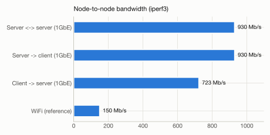
</picture>

<picture>
  <source media="(prefers-color-scheme: dark)" srcset="docs/figures/m1b-striping-dark.svg">
  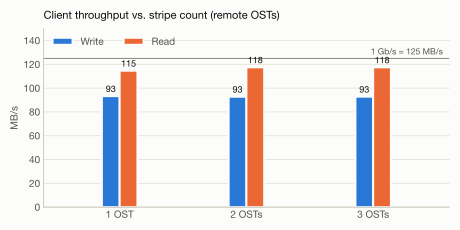
</picture>

| 측정 | 결과 |
|---|---|
| 노드 간 유선 대역폭 | 약 930Mb/s (client 송신만 약 723Mb/s, 케이블·포트 문제로 추정) |
| client → OST, stripe count 1 / 2 / 3 (재측정, 3회 평균) | 쓰기 93.3 / 92.8 / 92.8MB/s, 읽기 114.6 / 117.5 / 117.5MB/s |
| buffered 쓰기 / 읽기 | 65MB/s / 113.5MB/s |

- stripe count 측정은 다시 했다. P0 C2에서는 fio가 크기가 모자란 파일을 지우고 다시 만들면서 `lfs setstripe` 설정이 사라졌을 수 있었다. 재측정에서는 파일을 dd로 미리 채우고, OSS별 송수신량으로 실제 분산(stripe 2는 OSS 2대에 각 1.08GiB, stripe 3은 3대에 각 0.72GiB)을 확인했다(`experiments/motivation/m1b_striping.sh`).

**시사점:** 원격 경로의 대역폭은 client NIC가 정한다. stripe count를 늘려 대역폭을 넓히는 기존 방법(원 IFLustre의 수단)이 엣지에서는 통하지 않는다. 그래서 성능을 바꾸는 수단은 데이터를 어느 노드에 두느냐뿐이다.

### 3.3 관찰 M2: 같은 노드 OST 접근은 원격보다 15–22배 빠르지만, CPU의 약 45%를 쓴다

<picture>
  <source media="(prefers-color-scheme: dark)" srcset="docs/figures/m2a-local-remote-dark.svg">
  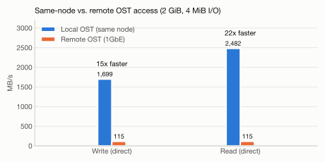
</picture>

<picture>
  <source media="(prefers-color-scheme: dark)" srcset="docs/figures/m2b-io-cpu-dark.svg">
  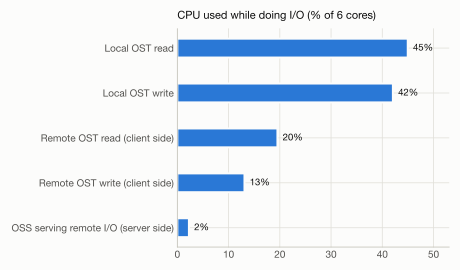
</picture>

| 경로 (jetson1) | 쓰기 | 읽기 | NIC 사용 | CPU (6코어 전체 대비) |
|---|---|---|---|---|
| 같은 노드 OST | 1,699MB/s | 2,482MB/s | 0 | 42–45% |
| 원격 OST | 114.6MB/s | 114.8MB/s | 회선 최대 | 13–20% (client 측) |
| 원격 I/O를 처리하는 서버 | – | – | – | 약 2% |

**시사점:**
- 데이터 위치에 따라 접근 속도가 15–22배 달라진다. KV와 가중치를 소비 노드의 OST에 두는 배치가 핵심이다.
- 같은 노드 접근은 NIC를 거치지 않는 대신 CPU를 6코어의 약 45% 쓴다. 저장 I/O와 LLM 연산의 간섭은 "자기 노드의 로컬 I/O"에서 크게 나타난다.

### 3.4 관찰 M3: 로컬에 저장한 KV는 재계산보다 7–12배 빠르고, 원격 KV는 재계산보다 느릴 수 있다

<picture>
  <source media="(prefers-color-scheme: dark)" srcset="docs/figures/m3-prefill-vs-kv-dark.svg">
  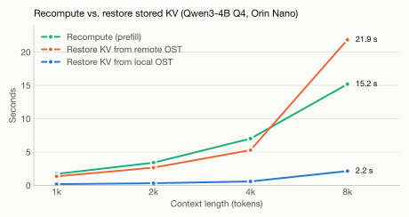
</picture>

| 토큰 | 재계산 (prefill) | KV 파일 | 로컬 OST 복원 | 원격 OST 복원 | 복원 후 첫 토큰 |
|---|---|---|---|---|---|
| 1k | 1.73초 | 144MiB | 0.20초 | 1.37초 | 0.11초 |
| 2k | 3.42초 | 288MiB | 0.34초 | 2.68초 | 0.12초 |
| 4k | 7.03초 | 576MiB | 0.61초 | 5.30초 | 0.12초 |
| 8k | 15.2초 | 1,152MiB | 2.16초 | 21.9초 | 0.14초 |

**시사점:**
- 로컬에 저장한 KV를 복원하면 재계산보다 7–12배 빠르다. 복원 후 첫 토큰까지는 0.1초대이다. 데이터가 들어올 때 KV를 미리 만들어 두는 설계(4.8.2절)의 이득이 크다.
- 원격 KV 복원은 재계산과 비슷하고, 8k에서는 오히려 느리다(약 53MB/s). 원격 KV는 재계산과 비교해 선택해야 한다.
- 8k에서는 로컬 복원도 4k 대비 3.5배 느려졌다(크기는 2배). llama-server 실행 중 남은 메모리가 약 1.8GB여서 1.15GB 파일을 page cache로 읽으며 메모리 회수가 일어난 것으로 추정한다. KV 읽기는 page cache를 거치지 않게 해야 한다(direct I/O 또는 캐시 해제).
- KV 파일 크기(토큰당 144KiB)는 부록 A의 계산과 일치한다.

### 3.5 관찰 M4: Lustre client 캐시가 8GB 메모리를 잠식하고 GPU 할당을 늦춘다

<picture>
  <source media="(prefers-color-scheme: dark)" srcset="docs/figures/m4a-cache-memfree-dark.svg">
  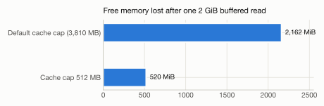
</picture>

<picture>
  <source media="(prefers-color-scheme: dark)" srcset="docs/figures/m4b-cache-gpu-dark.svg">
  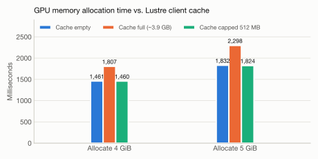
</picture>

| 측정 | 결과 |
|---|---|
| client 캐시 기본 상한 | 3,810MB (RAM의 1/2) |
| 2GiB buffered 읽기 1회 후 | MemFree −2,162MiB (상한 512MB이면 −520MiB). `MemAvailable`은 −105MiB만 보임 |
| GPU 4GiB / 5GiB 할당 (캐시 가득) | 할당 시간 +24% / +25%, 가장 느린 256MiB 할당 지연 2배. 실패는 없음 |
| 캐시 상한 512MB | 할당 시간이 캐시가 빈 상태와 같음 |

**시사점:**
- 8GB unified memory에서는 파일 시스템 캐시가 GPU가 쓸 메모리를 직접 줄인다. 캐시 상한은 선택이 아니라 필수이다.
- 메모리 압박은 `MemAvailable`로는 보이지 않으므로 MemFree와 PSI로 측정해야 한다.

### 3.6 관찰 M5: 다른 노드의 I/O가 서버 노드에 주는 부담은 작다

| 측정 | 결과 |
|---|---|
| OSS가 회선 최대 속도로 원격 I/O를 처리할 때 CPU | 약 2% (jetson1, jetson3) |
| 같은 상황의 OSS 메모리 | 변화 없음 (서버 측 read/writethrough cache가 꺼져 있음) |
| 예외 | jetson2에서 13–19%가 측정되었다. 측정 중 SSH 조회가 polkitd·dbus CPU를 올린 영향으로 보이며, 노드 내부 샘플러로 다시 측정한다. |

**시사점:**
- 1GbE가 원격 부하 자체를 제한하므로, 다른 노드의 I/O가 이 노드의 연산을 방해하는 효과는 작다.
- 그래서 간섭에 대한 주장은 자기 노드의 로컬 I/O(M2)와 메모리(M4)를 중심으로 한다. 서버 측 캐시를 켜는 경우는 5.4절 O2에서 따로 확인한다.

### 3.7 관찰 M6: 엣지 LLM 플래너는 형식은 지키지만 내용 검증이 필요하다

| 측정 (jetson, llama.cpp, Qwen3-4B Q4_K_M, ctx 4096) | 결과 |
|---|---|
| 입력 1,653토큰 prefill | 2.84초 (583 tok/s) |
| 생성 속도 | 약 15.4 tok/s |
| 결정 1회 총시간 | 16–21초 (같은 입력 재사용 시 16–17초) |
| JSON 스키마 준수 | 3/3 |
| 메모리 | 약 4.1GB |
| 내용 | 조치 유형을 잘못 사용함 (예: `repartition` 대상에 컨텍스트 ID 지정) |

**시사점:** 결정 지연은 이벤트 단위 재계획에 쓸 수 있는 수준이다. 하지만 검증기와 조치별 입력 형식 제한이 필수이고, 플래너 모델 크기와 배치 노드를 다시 정해야 한다(메모리 4.1GB).

### 3.8 관찰 M7: 여러 흐름이 OSS 하나를 공유하면 총 처리량이 그 OSS의 NIC 하나로 묶인다

client 3개(jetson, jetson1, jetson3)가 동시에 30초 동안 2GiB 파일을 direct I/O(4MiB, iodepth 16)로 읽거나 쓴다. 2회 반복(`experiments/motivation/m7_oss_share.sh`).

<picture>
  <source media="(prefers-color-scheme: dark)" srcset="docs/figures/m7-oss-sharing-dark.svg">
  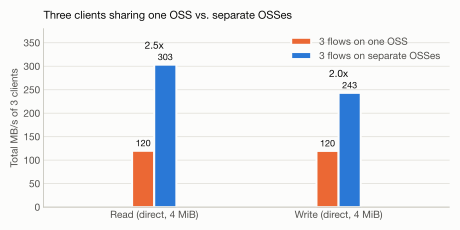
</picture>

| 조건 | 읽기: jetson / jetson1 / jetson3 (합계) | 쓰기: jetson / jetson1 / jetson3 (합계) |
|---|---|---|
| 세 흐름이 OST0001(jetson2) 하나를 공유 | 76–92 / 14–21 / 17–21MB/s (120) | 40 / 40 / 40MB/s (120) |
| 서로 다른 OSS (OST0001 / OST0002 / OST0000) | 115 / 94 / 94MB/s (303, 2.5배) | 93 / 75 / 75MB/s (243, 2.0배) |
| jetson의 3-stripe 파일, 혼자 | 117.6MB/s | 93.0MB/s |
| jetson의 3-stripe 파일 + OST0001에 다른 흐름 2개 | 110.8MB/s (−6%) | 69.5MB/s (−25%) |

**시사점:**
- 원 IFLustre의 interference-free allocation이 전제로 삼은 OSS 공유 간섭이 엣지에서도 그대로 나타난다. OSS마다 1GbE NIC가 상한이므로, 흐름을 서로 다른 OSS로 나누면 총 처리량이 2–2.5배가 된다.
- 공유할 때 몫이 고르지 않다. 읽기에서 한 흐름은 14MB/s까지 떨어졌다. 지연에 민감한 흐름이 붐비는 OSS에 놓이면 크게 느려진다.
- 원 IFLustre의 "가장 느린 OSS가 성능을 정한다"는 관찰도 나타난다. 쓰기에서는 붐비는 OST 하나가 3-stripe 파일 전체를 25% 늦춘다. 읽기에서 영향이 6%로 작은 것은, 이 파일이 OST마다 필요로 하는 속도(약 39MB/s)가 공유 상태에서 받는 몫과 비슷하기 때문이다.
- OSS를 가진 노드(jetson1, jetson3)가 client로 원격 OST를 읽으면 94MB/s로, client 전용 노드(115MB/s)보다 낮다. 원인은 확인하지 않았다.

### 3.9 관찰 M8: 다른 노드의 읽기를 처리하는 OSS 노드에서 LLM 연산은 거의 느려지지 않는다

jetson1에서 llama-server(Qwen3-4B Q4_K_M, 모델은 로컬 디스크)를 실행하고, 요청마다 2,048토큰 prefill과 128토큰 decode를 측정했다. 그동안 jetson(client)이 jetson1의 OST0000을 읽거나 쓴다. 조건마다 요청 5개를 보냈다(`experiments/motivation/m8_oss_llm.sh`).

| 조건 (jetson1) | prefill | decode | 토큰 간격 p99 | 저장 I/O 처리량 (LLM 없을 때) |
|---|---|---|---|---|
| 저장 I/O 없음 | 608 tok/s | 16.08 tok/s | 67ms | – |
| jetson이 OST0000을 읽음 (1GbE 최대) | 600 tok/s (−1.3%) | 15.98 tok/s (−0.6%) | 70ms | 117MB/s (115) |
| jetson이 OST0000에 씀 | 측정 못 함 (노드 멈춤) | – | – | 93MB/s (94) |

**시사점:**
- OSS가 원격 읽기를 회선 최대 속도로 처리해도 같은 노드의 prefill·decode는 1% 안팎만 느려진다. M5(서버 CPU 약 2%)와 일치한다. 원격 I/O는 연산이 아니라 NIC를 통해 LLM에 영향을 준다(M9).
- 원격 쓰기 조건에서 jetson1이 응답을 멈추고 재부팅되었다(17:46경). 첫 재부팅 직후 NVIDIA 디스플레이 드라이버(`nv_pmops_runtime_suspend`)의 NULL 참조로 커널 panic이 한 번 더 발생했고, 두 번째 부팅에서 OST0000이 자동으로 다시 마운트되어 client가 복구되었다. 첫 멈춤의 원인 기록은 남지 않았다(ramoops에는 두 번째 panic만 남음). 두 번째 멈춤(M10 측정 중)은 감시 기록으로 메모리 소진이 원인임을 확인했다(3.11절, `docs/testbed.md` F7).
- 같은 노드의 로컬 I/O와 LLM의 간섭(M8 로컬 조건)은 stage 노드에 client를 마운트한 뒤 측정한다.

### 3.10 관찰 M9: stage 노드의 저장 I/O가 stage 사이 activation 전달을 2–4배 늦춘다

jetson1(stage 1)에서 jetson2(stage 2)로 activation을 TCP로 보내고, 그동안 jetson(client)이 fio로 저장 I/O를 낸다. activation 크기는 Qwen3-4B hidden 2560, FP16 기준 토큰당 5,120B이다(`experiments/motivation/act_probe.py`). 각 조건 2회, 노드 내부 샘플러로 NIC 사용량을 확인했다.

<picture>
  <source media="(prefers-color-scheme: dark)" srcset="docs/figures/m9a-activation-handoff-dark.svg">
  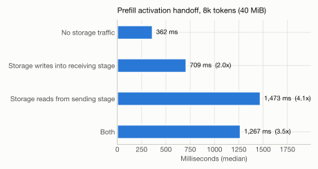
</picture>

<picture>
  <source media="(prefers-color-scheme: dark)" srcset="docs/figures/m9b-decode-hop-dark.svg">
  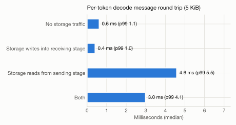
</picture>

| 조건 | 2k prefill activation (10MiB) | 8k prefill activation (40MiB) | decode 메시지 왕복 (p99) | 저장 I/O 처리량 (단독) |
|---|---|---|---|---|
| 저장 I/O 없음 | 91ms | 362ms | 0.6ms (1.1) | – |
| 받는 stage의 OST(OST0001)에 쓰기 → 수신 링크 공유 | 178ms (2.0배) | 709ms (2.0배) | 0.4ms (1.0) | 90MB/s (94) |
| 보내는 stage의 OST(OST0000)에서 읽기 → 송신 링크 공유 | 388ms (4.3배) | 1,473ms (4.1배) | 4.6ms (5.5) | 111MB/s (115) |
| 둘 다 | 372ms (4.1배) | 1,267ms (3.5배) | 3.0ms (4.1) | 86 / 108MB/s |

**시사점:**
- stage 노드의 OSS가 다른 노드의 I/O를 처리하면, 같은 NIC를 쓰는 pipeline activation이 느려진다. 저장 I/O 처리량은 거의 줄지 않고 손해는 activation 쪽에 생긴다. LNet이 4MiB RPC 여러 개를 동시에 보내 송신 큐를 차지하기 때문으로 추정한다.
- 송신 링크를 공유할 때(4.1배)가 수신 링크를 공유할 때(2.0배)보다 크다. 원격 읽기를 받는 OST가 어느 stage 노드에 있느냐가, 그 stage가 다음 stage로 보내는 시간을 정한다.
- decode 메시지도 송신 링크를 공유하면 왕복이 0.6ms에서 4.6ms로 늘어난다. 영향을 받는 hop마다 토큰당 약 4ms가 더해진다.
- M5·M8에서 원격 I/O가 서버의 CPU와 연산에 주는 영향은 작았다. 그러나 NIC 공유를 통해 LLM pipeline에는 큰 영향을 준다. 원 IFLustre가 다룬 OSS 사이의 간섭이, 하이퍼컨버지드 구성에서는 OSS와 pipeline 사이의 간섭으로 넓어진다.

### 3.11 관찰 M10 (예비): LLM 서버와 같은 노드의 Lustre I/O가 8GB 메모리를 소진해 노드가 멈췄다

M10(메모리 압박 시 LLM 성능)을 측정하던 중 jetson1이 멈췄다. 같은 노드는 M8 원격 쓰기 조건에서도 한 번 멈췄다(`docs/testbed.md` F7). 두 번째에는 노드 내부 감시 샘플러(1초 간격, 매 줄 fsync)가 직전 상태를 남겼다.

<picture>
  <source media="(prefers-color-scheme: dark)" srcset="docs/figures/m10-jetson1-hang-dark.svg">
  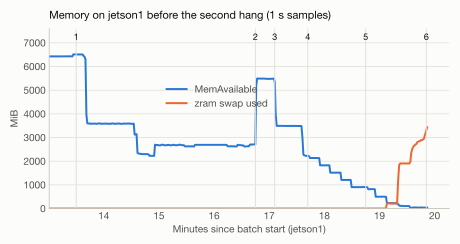
</picture>

| 그림 번호 | 내용 | MemAvailable |
|---|---|---|
| 1 | M12: llama-server 시작 (Qwen3-4B Q4_K_M, 모델을 Lustre에서 mmap, ctx 4608) | 6,550 → 약 2,700MB |
| 2 | M12 서버 종료 | 5,491MB (시작 전보다 약 1GB 적음) |
| 3 | M10: llama-server 시작 (모델은 로컬 디스크, ctx 8192) | 5,479 → 2,216MB |
| 4 | LLM 요청 5개 (2k prefill + 128 decode). 요청마다 KV 페이지가 약 300MB씩 확보됨 | 2,216 → 906MB |
| 5 | 같은 노드에서 Lustre direct 읽기 시작 (자기 client → 자기 OSS) | 906 → 41MB, zram 스왑 0 → 3.4GB |
| 6 | 응답 없음, 약 3분 뒤 재부팅. client 마운트가 사라지고 OST0000은 자동으로 다시 마운트됨 | – |

**시사점:**
- 8GB 노드에서 Q4 모델 서버 하나(ctx 8192)가 KV를 채우면 약 4.6GB를 쓴다. 남은 메모리를 같은 노드의 저장 계층이 쓰면 노드 전체가 멈춘다. client 캐시 상한(512MB)이 걸려 있었는데도 일어났다. 이 상한은 client page cache만 제한하며, OSS 쪽 처리, RPC 버퍼, Lustre에서 mmap한 파일의 페이지는 제한하지 않는다.
- jetson2에서 따로 확인한 결과, Lustre에서 모델을 mmap한 서버가 끝난 뒤 약 1.3GB가 MemAvailable에서 빠졌고 `drop_caches` 후에야 돌아왔다. 로컬 디스크 모델에서는 생기지 않았다.
- M4에서는 캐시가 GPU 할당을 늦추는 정도였지만, LLM이 상주한 상태에서는 노드 가용성 문제가 된다. 메모리 제약(4.9.3절)과 상주 집합 관리(4.8.2절)가 성능 최적화가 아니라 필수 조건인 근거이다.
- 다음 측정은 메모리 보호(MemAvailable 700MB 미만이면 실험 프로세스 종료)를 켜고 진행한다. 서버 ctx와 저장 I/O 종류별로 남는 메모리와 LLM 성능을 잰다.

### 3.12 관찰 M11: 체크포인트 쓰기를 KV 복원과 겹치면 복원이 41% 느려지고, 시점을 미루면 2%로 줄어든다

jetson3에서 4k 토큰 KV(576MiB)를 3초 간격으로 10번 복원한다(매번 캐시 비움). 같은 로컬 OST에 체크포인트 파일(1GiB)을 쓴다(`experiments/motivation/kv_restore_bench.py`).

<picture>
  <source media="(prefers-color-scheme: dark)" srcset="docs/figures/m11-runtime-aware-dark.svg">
  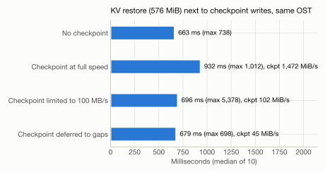
</picture>

| 조건 | KV 복원 중앙값 (최대) | 체크포인트 쓰기 속도 |
|---|---|---|
| 체크포인트 없음 | 663ms (738) | – |
| 동시에 최대 속도로 쓰기 | 932ms (1,012), +41% | 1,472MiB/s |
| 100MB/s로 제한 | 696ms (5,378), +5% | 102MiB/s |
| 복원 사이로 미루기 (복원이 끝나면 256MiB씩) | 679ms (698), +2% | 45MiB/s |

**시사점:**
- 원 IFLustre의 runtime-aware allocation(기다릴지, 공유할지)이 엣지에서도 의미가 있다. 같은 OST에서 체크포인트를 최대 속도로 함께 쓰면 복원이 41% 느려지고, 시점을 미루면 2%로 줄어든다.
- 대신 체크포인트 속도가 1,472 → 102 → 45MiB/s로 줄어든다. 어느 쪽을 택할지는 체크포인트 크기와 마감 시간으로 정해야 한다. 비용 모델의 시점 결정이 필요한 이유이다.
- 속도 제한 조건에서도 한 번 5.4초가 걸렸다. 속도 제한만으로는 꼬리 지연을 막지 못할 수 있다.

### 3.13 관찰 M12: 원격 KV는 첫 사용 후 소비 노드로 옮기면, 이동 비용을 포함해도 세 번째 사용부터 이득이다

jetson1이 원격 OST0001에 있는 4k 토큰 KV(576MiB)를 5번 쓴다. 세 방식을 비교한다(`experiments/motivation/kv_restore_bench.py`).

<picture>
  <source media="(prefers-color-scheme: dark)" srcset="docs/figures/m12-relocation-dark.svg">
  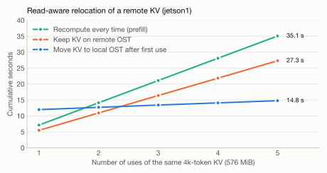
</picture>

| 방식 | 1회째 | 2회째부터 (회당) | 5회 누적 |
|---|---|---|---|
| 매번 재계산 (prefill) | 7.15초 | 약 6.98초 | 35.1초 |
| 원격 OST에서 복원 | 5.49초 | 약 5.46초 | 27.3초 |
| 첫 사용 후 `lfs migrate`로 로컬 OST로 이동 | 5.49초 + 이동 6.50초 | 약 0.70초 | 14.8초 |

**시사점:**
- IoTJ 버전의 read-aware relocation이 KV에서도 성립한다. 이동 비용을 요청 경로에 포함해도 세 번째 사용부터 원격 유지보다 빠르고, 재계산보다는 두 번째 사용부터 빠르다. 이동을 백그라운드에서 하면 두 번째 사용부터 이득이다.
- 어떤 KV를 옮길지는 재사용 횟수 예측이 정한다. 같은 데이터 스트림에 대한 반복 요청 같은 의미 정보가 그 예측의 근거가 된다(4.8.2절).

### 3.14 관찰 M13: IoT 레코드를 파일 단위로 쓰면 MDS 요청이 병목이고, pack에 붙이면 30배 빠르다

jetson(client)에서 512B IoT 레코드 3,000개를 세 방식으로 쓴다. 레코드당 파일과 256KiB 창 파일은 fsync하지 않고, pack은 32개마다 fsync한다(pack에 불리한 비교). 2회 반복(`experiments/motivation/m13_smallfile.py`).

<picture>
  <source media="(prefers-color-scheme: dark)" srcset="docs/figures/m13-ingest-pack-dark.svg">
  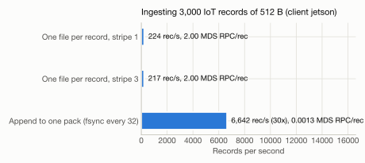
</picture>

| 방식 | stripe count 1 | stripe count 3 | 레코드(파일)당 MDS 요청 |
|---|---|---|---|
| 레코드당 파일 (512B) | 224 rec/s | 217 rec/s | 2.0 |
| 256KiB 창 파일 (원 IFLustre IoTJ의 소파일 크기) | 180 파일/s, 47MB/s | 177 파일/s, 46MB/s | 2.0 |
| pack append (32개마다 fsync) | 6,642 rec/s | – | 0.0013 |

**시사점:**
- 작은 IoT 레코드를 파일로 쓰면 파일마다 MDS 요청 2개가 필요하고, 처리량은 MDS 왕복이 정한다. stripe count는 효과가 없다. 원 IFLustre IoTJ의 소파일 관찰이 엣지에서도 그대로 나타난다.
- 256KiB 파일도 47MB/s로 큰 파일 쓰기(93MB/s)의 절반이다.
- 같은 레코드를 pack에 붙이면 30배 빠르고 MDS 요청은 약 1/1,500이다. KV chunk를 pack 단위로 저장하는 설계(4.8.2절)의 근거이다.

### 3.15 IFLustre 이점의 계승과 남은 실측

CoStripe가 IFLustre의 확장이 되려면, 원 IFLustre의 전제가 엣지에서도 성립해야 한다. 아래 표는 IFLustre의 정책·관찰별로 엣지에서의 확인 결과와 남은 실측을 정리한 것이다. 상세 계획은 `docs/motivation_plan.md`에 있다.

| 원 IFLustre 정책·관찰 | 엣지(A')에서의 형태 | 실측 | 상태 |
|---|---|---|---|
| 소파일은 striping 효과가 없음 (IoTJ) | 레코드당 파일은 MDS 요청이 병목, stripe 무관 | M13 | 확인 (pack 30배) |
| Throughput-aware allocation (많은 OSS 사용) | 단일 client는 자기 NIC가 상한 | M1 | 확인 (stripe 1–3 차이 2% 이내) |
| Interference-free allocation (OSS 공유 회피) | OSS마다 1GbE가 상한. 흐름이 한 OSS를 공유하면 각자 줄어든다 | M7 | 확인 (공유 시 합계 120MB/s, 분산 시 2–2.5배) |
| 가장 느린 OSS가 성능을 결정 | 여러 OST에 걸친 파일은 붐비는 stage 노드 OST가 속도를 정한다 | M7 | 확인 (쓰기 −25%, 읽기 −6%) |
| Runtime-aware allocation (대기 대 공유) | 체크포인트·복제 쓰기가 KV 복원과 겹치지 않게 시점을 미룬다 | M11 | 확인 (동시 +41%, 지연 +2%) |
| Read-aware relocation (IoTJ) | 반복 읽히는 원격 KV를 소비 노드 OST로 옮긴다 | M12 | 확인 (5회 사용 시 27.3초 → 14.8초) |
| (확장) 간섭 범위: NIC | 저장 I/O가 activation 전달을 늦춘다 | M9 | 확인 (2–4배) |
| (확장) 간섭 범위: 같은 노드 연산 | 원격 읽기는 영향 작음. 로컬 I/O는 측정 필요 | M8 | 원격 확인, 로컬 예정 |
| (확장) 간섭 범위: 메모리 | 캐시가 메모리를 잠식하고 GPU 할당을 늦춘다. LLM이 상주하면 노드가 멈출 수 있다 | M4, M10 | M4 확인, M10 노드 정지 2회 (메모리 보호를 켜고 재측정 예정) |
| (종합) 배치 정책별 TTFT | Lustre 기본 할당 / OSS 부하 기반 분산 / 소비 노드 배치 | M14 | 예정 (프로토타입 `kv_router.py` 작성 완료) |

남은 항목(M8 로컬 조건, M10 재측정, M14)은 메모리 보호를 켜고 측정한다.

### 3.16 관찰에서 설계로

| 관찰 | 시사점 | 설계 반영 |
|---|---|---|
| M1 원격은 1GbE가 상한, striping 이득 없음 | 성능을 바꾸는 수단은 위치뿐 | stripe count 1 + 소비 노드 배치 (4.8.1, 4.9.4절) |
| M2 로컬 15–22배, 로컬 I/O가 CPU 45% 사용 | 소비 노드 배치, 로컬 I/O 간섭을 비용 모델에 반영 | 4.8.1, 4.8.4, 4.9.3절 |
| M3 로컬 KV 복원이 재계산보다 7–12배 빠름, 원격은 재계산 이하 | KV pack 로컬 배치, 재계산 대 읽기 판단, page cache 우회 | 4.8.2절 |
| M4 캐시가 메모리를 잠식하고 GPU 할당을 늦춤 | 캐시 상한 필수, 메모리 항을 비용 모델에 | 4.1.4, 4.8.4절 |
| M5 원격 I/O의 서버 측 부담은 작음 | 간섭 주장은 로컬 I/O와 메모리 중심 | 8.3절 |
| M6 플래너는 형식만 신뢰 가능, 메모리 4.1GB | 검증기 필수, 모델 크기 재결정 | 4.8.5절 |
| M8 원격 읽기를 처리하는 OSS 노드의 LLM 감속은 1% 안팎 | 연산 간섭(β)은 로컬 I/O 중심으로 모델링 | 4.8.4, 4.9.3절 |
| M9 저장 I/O가 같은 NIC의 activation 전달을 2–4배 늦춤 | OST 선택 시 그 노드의 NIC 송신 부하와 pipeline 위치를 함께 본다 | 4.9.3절 (A_k, U_k), 4.9.7절 |
| M7 OSS 공유 시 합계가 NIC 하나로 묶임, 분산하면 2–2.5배 | 동시 흐름을 서로 다른 OSS로 분산 (interference-free 계승) | 4.9.7절 |
| M10 LLM 상주 노드에서 저장 계층 메모리가 노드를 멈추게 함 | 메모리 제약은 필수 조건, 캐시 상한 외 저장 계층 메모리도 예산에 포함 | 4.1.4, 4.9.3절 |
| M11 체크포인트와 KV 복원이 겹치면 +41%, 미루면 +2% | 백그라운드 쓰기의 시점 지연 (runtime-aware 계승) | 4.8.3, 4.9.7절 |
| M12 원격 KV는 이동 후 세 번째 사용부터 이득 | 재사용 예측 기반 migrate (read-aware relocation 계승) | 4.8.2, 4.9.7절 |
| M13 레코드당 파일은 MDS가 병목, pack은 30배 | KV chunk와 수집 레코드를 pack 단위로 저장 | 4.8.2절 |

---

## 4. Design

### 4.1 대상 환경

#### 4.1.1 하드웨어와 역할 (설계 기준: 비파괴 구성 A')

기존 Lustre(MGS/MDT 1개, OST 3개)를 다시 만들지 않는다. OST를 가진 세 노드에 client 마운트만 더해, 스토리지 서버가 곧 LLM 연산 노드인 구성을 만든다.

| 노드 | 호스트 | Lustre 역할 | 연산 역할 |
|---|---|---|---|
| NM | jetson0 | MGS, MDS(MDT0000) | LLM 플래너(llama.cpp, Qwen3-4B Q4_K_M) |
| N1 | jetson1 | OSS(OST0000), client | W3 stage 1 (LG0–3 + 임베딩), 수집 시점 prefill, 재생성 |
| N2 | jetson2 | OSS(OST0001), client | W3 stage 2 (LG4–7), 수집 시점 prefill, 재생성 |
| N3 | jetson3 | OSS(OST0002), client | W3 stage 3 (LG8–11 + head), W2 적응 학습(LG9–11 LoRA), 재생성 |
| N0 | jetson | client (NVMe 없음, OST 없음) | 제어 모듈(telemetry 수집, 비용 모델, 검증기, 실행기), W1 수집, Context Builder, Prefill Scheduler, 압축기. 장애 시 대체 stage |

- **네트워크:** 5대를 같은 1GbE 스위치에 연결한다. 데이터 경로는 유선이다.
- **연산 부하가 없는 OST는 없다.** OST를 가진 N1–N3는 모두 서빙 stage이다. 그래서 복제본(mirror)도 다른 stage 노드에 둔다(4.8.1절).
- **NM(jetson0)이 플래너를 맡는 이유:**
  1. MDS의 메모리 사용량이 작다(P0 실측 약 120MiB). 플래너(실측 약 4.1GB)를 올려도 여유가 남는다.
  2. 플래너는 이벤트가 있을 때만 실행된다. MDS 처리와 겹치는 시간이 짧다.
  3. N0의 메모리를 제어, 수집, 대체 stage에 남긴다. N0가 대체 stage를 맡아도 플래너를 내리지 않는다.
  - 이 배치는 기본값이다. 플래너 실행 중 MDS 메타데이터 지연을 O4에서 측정해 확정한다.
- **N0(jetson)를 서빙 stage에서 제외하는 이유:**
  1. NVMe가 없어 OST를 둘 수 없다. N0가 stage를 맡으면 가중치와 KV를 모두 원격으로 읽어야 한다.
  2. 수집, 컨텍스트 구성, 제어 모듈을 서빙 연산과 분리한다.
  3. 장애 시 대체 stage가 된다.
- **학습이 N3에서만 일어나는 이유:** LoRA를 상위 LG(LG9–11)에만 적용하기 때문이다(4.8.3절). 그 LG를 맡은 N3에서만 backward와 학습 상태가 생긴다. LG9 입력 경계 activation도 N3 안에서 만들어지고 쓰인다.

#### 4.1.2 현재 실제 구성과의 차이 (2026-10-22 P0 실측, 상세는 `docs/testbed.md`)

| 호스트 | 설계 노드 | 현재 Lustre 역할 | NVMe 사용 | client 마운트 | 설계와의 차이 |
|---|---|---|---|---|---|
| jetson0 | NM | MGS + MDT0000 | Samsung 970 EVO Plus 500GB: MGT 8GB + MDT 457.8GB | 없음 | 없음 (플래너는 실험 시 실행) |
| jetson1 | N1 | OSS, OST0000 | Samsung 980 500GB 전체 | 없음 | client 마운트 추가 필요 |
| jetson2 | N2 | OSS, OST0001 | Samsung 980 500GB 전체 | 없음 | client 마운트 추가 필요 |
| jetson3 | N3 | OSS, OST0002 | Samsung 980 500GB 전체 | 없음 | client 마운트 추가 필요 |
| jetson | N0 | Client | 없음 | `/mnt/lustrefs` | 없음 |

- 5대 모두 Orin Nano Super(25W), L4T R36.4.4, Lustre 2.17.0(ldiskfs), OS는 microSD, GUI 켜짐, zram 3.8GB이다.
- 데이터 경로는 유선 1Gb/s이다. jetson 송신만 약 725Mb/s이다.
- **A' 적용 방법:** jetson1–3에 client를 비영구로 마운트하고 캐시 상한(512MB)을 설정한다. 되돌릴 때는 `umount`만 하면 된다. 포맷, 재구축, 장치 추가는 없다(`docs/hyperconverged_plan.md`).
- **MGS 주소:** 서버의 MGS 연결이 무선 IP로 설정되어 끊겨 있다(`docs/testbed.md` F1). client 마운트와 실험 조작에는 영향이 없으므로 당장 고치지 않는다. 서버 재부팅, OST 추가, 영구 설정(`set_param -P`)이 필요할 때 정정한다.
- **5-OST 구성(방안 B)은 제외했다.** jetson에 NVMe가 없고 jetson0 NVMe는 MGT·MDT가 전부 쓰므로, 장치 추가와 MDT 재구축이 필요하다.
- 현재 분리형 구성(jetson만 client)은 관찰 실험의 비교 기준으로도 쓴다.

#### 4.1.3 소프트웨어

| 구성 | 내용 |
|---|---|
| OS | JetPack 6.x (L4T, Ubuntu 22.04), headless |
| Lustre | 버전, OSD 백엔드 기록. PFL, FLR, NRS TBF, jobstats, CPT 지원 확인 |
| 서빙·학습 런타임 | PyTorch + HF transformers + PEFT 기반 자체 파이프라인 런타임 (4.10절) |
| KV 저장소 | CoStripe KV Store (Python, Lustre 위 pack 파일 + 인덱스) |
| 플래너·비교 대상 | llama.cpp (CUDA), JSON schema 제약 디코딩 |
| 측정 | tegrastats/jtop, `lctl get_param`, `/proc`, PSI, fio, iperf3 |

#### 4.1.4 노드별 메모리 예산 (추정, O4에서 측정)

가용 메모리 약 7.4GiB 기준이다.

| 항목 | N1 (stage 1) | N2 (stage 2) | N3 (stage 3) | NM | N0 |
|---|---|---|---|---|---|
| OS (headless) + 서비스 | 0.6GB | 0.6GB | 0.6GB | 0.6GB | 0.6GB |
| CUDA + PyTorch 런타임 | 1.2GB | 1.2GB | 1.2GB | – | – |
| Lustre 서버 + client (캐시 제외) | 0.3GB | 0.3GB | 0.3GB | 0.5GB (MGS/MDS) | 0.3GB (client) |
| Lustre 캐시 상한 (설정값) | 0.5GB | 0.5GB | 0.5GB | – | 0.5GB |
| 모델 가중치 (FP16) | 3.2GB (LG 4개 + 임베딩) | 2.4GB (LG 4개) | 3.2GB (LG 4개 + head) | – | – |
| 적응 학습 (LoRA 상태 + 활성화) | – | – | 0.3GB | – | – |
| 플래너 (Qwen3-4B Q4_K_M, ctx 4096, P0 실측) | – | – | – | 4.1GB | – |
| 수집, Context Builder, Prefill Scheduler, 압축기, 제어 모듈 | – | – | – | – | 0.8GB |
| 안전 마진 | 0.4GB | 0.4GB | 0.4GB | 0.6GB | 0.6GB |
| **KV 상주 가용 / 남는 메모리** | **KV 약 1.2GB** | **KV 약 2.0GB** | **KV 약 0.9GB** | 약 1.6GB | 약 4.6GB |

- **상주 가능한 컨텍스트 수:** 3-stage에서 8k 컨텍스트 하나는 stage당 384MiB(12 layer)이다. 따라서 N1 약 3개, N2 약 5개, N3 약 2개를 메모리에 둘 수 있다. 8개 컨텍스트 중 대부분은 저장 계층에 있다.
- **stage별 상주 차이:** stage마다 상주 가능한 수가 다르므로, 어떤 요청은 일부 stage에서만 메모리 적중이 일어난다. 이 경우 TTFT는 저장 계층에서 읽어야 하는 stage가 결정한다(4.8.2절 2f).
- **캐시 상한:** Lustre client 캐시를 기본값(약 3.7GB)으로 두면 KV 상주 공간이 없어진다. 따라서 상한 설정은 필수 조건이다.
- **N0의 대체 stage 여유:** 남는 4.6GB로 대체 stage(런타임 1.2GB + 가중치 최대 3.2GB)를 올릴 수 있다. KV 상주 공간은 거의 남지 않으므로, 대체 중에는 KV를 원격에서 읽거나 재계산한다. jetson의 실험과 무관한 프로세스(F4)를 정리한다는 전제이다.

**P0 실측 (2026-10-22, jetson·서버 노드)**

| 항목 | 실측 | 위 추정과 비교 |
|---|---|---|
| OS + GUI + 서비스 (서버 노드 유휴) | 약 0.8GB 사용, MemAvailable 약 6.5–6.6GB | GUI가 켜진 상태. headless로 전환하면 줄어듦 |
| 실험과 무관한 프로세스 (jetson) | 약 1.8GB (`node` 4개, `codex`, GNOME, docker) | 실험 전 정리 필요 |
| CUDA 컨텍스트 (PyTorch 제외) | 약 74MiB | PyTorch 오버헤드는 미측정 (미설치) |
| Lustre 서버 memused | 약 120MiB | 추정(0.3GB) 이내 |
| client 캐시 상한 기본값 | 3,810MB (RAM의 1/2) | 가정과 일치. 2GiB buffered 읽기에서 MemFree가 2.16GB 감소 |
| client 캐시 상한 512MB 적용 시 | 캐시 증가가 약 0.38–0.49GB에서 멈춤 | 상한 설정이 실제로 작동함 |
| 플래너 (llama.cpp, Qwen3-4B Q4_K_M, ctx 4096) | 약 4.1GB | 추정 3.0GB보다 큼. 그래서 플래너를 NM(jetson0)에 둔다 |
| Lustre 캐시 3.9GB가 찬 상태의 GPU 할당 | 실패 없음, 할당 시간 +25%, 최악 지연 2배 | 캐시 상한으로 해소 |

### 4.2 대상 시나리오와 워크로드

#### 4.2.1 시나리오

공장 엣지 사이트에서 장비 이상 분석 LLM 서비스를 운영한다.
- **데이터 스트림과 컨텍스트:** 4개 생산 라인에서 라인마다 데이터 스트림이 2개씩 들어와, 총 8개의 스트림 컨텍스트가 있다. 스트림 하나는 한 장비 그룹의 센서·음향·로그 데이터이며 계속 수집된다.
- **요청:** 운영자는 특정 장비 그룹의 상태와 이상 원인을 자연어로 묻는다.
- **적응:** 장비와 공정이 바뀌므로 요청이 적은 시간대에 모델을 적응시킨다.
- **데이터 반출:** 데이터는 사이트 밖으로 반출하지 않는다.

#### 4.2.2 워크로드 정의

| ID | 이름 | 내용 | 실행 위치 |
|---|---|---|---|
| W1 | Ingest | IoT 데이터를 Lustre에 저장하고, 스트림별 레코드(간결한 텍스트 형식)로 변환해 스트림 컨텍스트에 이어 붙인다. 일정량이 쌓이면 수집 시점 prefill 작업을 파이프라인에 넣는다. | 수집·변환: N0 / prefill: N1–N3 |
| W2 | Adapt | N0가 학습 샘플을 만들고, 파이프라인이 상위 LG의 LoRA를 학습한다(forward는 전체, backward는 상위 LG만). 라운드가 끝나면 새 어댑터로 전환하고, 영향받는 상위 LG의 KV를 다시 만든다. | 샘플: N0 / 학습: N1–N3 (backward는 N3) |
| W3 | Serve | 운영자 요청을 처리한다. 스트림 컨텍스트의 KV를 주소로 찾아 읽고, 아직 prefill되지 않은 꼬리 부분과 질문만 계산한다. | N1–N3 |

**데이터 흐름:** IoT 원본 → 스트림 레코드 → 스트림 컨텍스트 → 수집 시점 KV(content-addressed 객체) → 요청 시 재사용 → 요청·응답 로그는 세션 객체와 W1 데이터로

#### 4.2.3 스트림 컨텍스트와 요청 구성

```
스트림 컨텍스트 (epoch e):
[시스템 지시문 ~300] [라인 매뉴얼 2k–4k] [스트림 헤더 ~50] [압축 요약 (e>0)] [레코드 r1 r2 r3 ...]

요청:
[스트림 컨텍스트 (현재까지)] [세션 이전 턴 (있으면)] [질문 30–100]  →  출력 128–256
```

| 항목 | 값 |
|---|---|
| 레코드 형식 | 간결한 한 줄 텍스트. 예: `10:01:20 P2 vib=3.2 T=61 a=0.12` (약 20토큰) |
| 레코드 주기 | 스트림당 10초에 1개 (민감도 변수) → 스트림당 시간당 약 7.2k 토큰 |
| 컨텍스트 한계 | 기본 8k 토큰, 민감도 16k |
| 압축 | 한계에 도달하면 실행 (4.8.2절 2g) |
| 세션 | 1–5턴, 턴 간격 30초–10분. 세션 턴은 스트림 컨텍스트에서 갈라지는 별도 체인 |

같은 라인의 두 스트림 컨텍스트는 `[지시문][매뉴얼]` 부분이 같으므로, 그 KV 객체를 공유한다(content addressing에 의한 중복 제거).

### 4.3 모델 선정

#### 4.3.1 선정 기준

1. 목표 정밀도에서 노드 1대에 가중치와 KV가 함께 들어가지 않아야 한다.
2. 3대로 나눴을 때 노드당 메모리가 7.4GiB 안에 들어가야 한다.
3. base 가중치를 공유한 LoRA 학습의 추가 메모리가 수백 MB 이내여야 한다.
4. GQA 구조여야 한다.
5. HF transformers와 llama.cpp에서 모두 실행할 수 있어야 한다.
6. 가중치가 공개되어 있어야 한다.

#### 4.3.2 기본 구성

| 역할 | 모델 | 정밀도 | 크기 | 실행 노드 |
|---|---|---|---|---|
| 서빙 (W3), 수집 시점 prefill (W1) | Qwen3-4B | FP16 | 약 8.0GB | N1–N3 (stage당 LG 4개) |
| 적응 학습 (W2) | Qwen3-4B + LoRA (LG9–11) | FP16 base 공유, LoRA FP32 | N3 추가 약 0.3GB | N1–N3 (backward는 N3) |
| 플래너 (⑦) | Qwen3-4B | Q4_K_M (GGUF) | 파일 약 2.5GB, 실행 시 약 4.1GB | NM (llama.cpp) |
| 플래너 비교 | Qwen3-1.7B / Qwen3-0.6B | Q8_0 | 약 1.8GB / 0.6GB | NM |
| 비교 대상 B7 | Qwen3-4B | Q4_K_M | 약 2.5GB | N1–N3 각각 (복제 서빙) |
| 서빙 규모 민감도 (선택) | Qwen3-8B | Q8_0 (llama.cpp RPC) | 약 8.7GB | N1–N3 (O1–O3만) |
| 작은 모델 민감도 | Qwen3-1.7B | FP16 | 약 3.4GB | 2-stage 또는 1대 |

**서빙 모델 분할**
- 36 layer를 g=3으로 묶어 LG 12개(LG0–LG11, LG당 약 0.6GB)를 만든다.
- 임베딩(약 0.78GB)은 입력과 출력 head가 공유한다. stage 1과 stage 3이 모두 필요하므로 FLR mirror로 두 노드에 둔다.
- 초기 분할: `{N1: LG0–3 + 임베딩, N2: LG4–7, N3: LG8–11 + head}`
- LoRA를 적용하는 LG9–11은 모두 N3에 있다.

**적응 학습 설정**

| 항목 | 값 |
|---|---|
| LoRA 적용 범위 | LG9–11 (layer 27–35). 비교: 전체 LG |
| LoRA rank / alpha / dropout | 16 / 32 / 0.05 |
| 대상 projection | q, k, v, o |
| 시퀀스 길이 | 512–1024 |
| micro-batch / gradient accumulation | 1 / 8 |
| 라운드당 step | 50–100 (측정 후 조정) |
| 체크포인트 간격 | 25 step |
| 대용량 체크포인트 민감도 | rank 64, 전체 linear (N3에서 약 0.4GB) |

#### 4.3.3 선택하지 않은 대안과 이유

| 대안 | 이유 |
|---|---|
| Qwen3-4B Q8_0을 노드 1대에 | KV 여유가 1GB 미만이다. |
| Qwen3-4B Q4_K_M 노드별 복제 | 품질 저하, KV 공유 없음, 학습 불가. 비교 대상(B7)으로만 사용 |
| Qwen3-8B FP16 분할 | 3-stage에서 stage당 가중치가 약 4.6–5.9GB로 메모리 초과 |
| 노드 1대 단독 QLoRA | Jetson ARM64 bitsandbytes 불안정, 메모리 부족 |
| 전체 layer LoRA | 어댑터가 바뀔 때마다 모든 LG의 KV가 무효가 된다. 비교 구성으로만 사용 |
| 위치 독립 근사 재사용 (CacheBlend 방식) | 품질 영향이 있다. 이어 쓰기 컨텍스트로 근사 없이 재사용할 수 있으므로 채택하지 않는다. 선택 비교 대상으로만 둔다. |

### 4.4 데이터 객체와 I/O 특성

기본 구성(Qwen3-4B FP16, g=3, chunk 256토큰, 컨텍스트 한계 8k) 기준이다. 계산식은 부록 A, 경로 규격은 부록 C에 있다.

| 객체 | 식별 | 단위 크기 | 생성 | 소비 | 접근 패턴 |
|---|---|---|---|---|---|
| 가중치 | 모델 버전 + LG | LG당 약 0.6GB | 사전 배치 | 해당 LG stage | 시작·재분할·복구 시 읽기 |
| 임베딩 | 모델 버전 | 약 0.78GB | 사전 배치 | stage 1, 3 | 로드 시 읽기 |
| KV chunk (공유 prefix) | 내용 주소 | LG당 3MiB/chunk | 첫 컨텍스트의 수집 시점 prefill | 같은 라인의 모든 컨텍스트 | 요청·prefill 시 읽기 |
| KV chunk (스트림 로그) | 내용 주소 | LG당 3MiB/chunk | 수집 시점 prefill | 해당 스트림 요청 | append 후 봉인, 읽기 |
| KV pack | (컨텍스트, LG, epoch, 순번) | 32 chunk, LG당 96MiB | KV Store | – | 봉인 후 수정 없음, 복제 |
| 경계 activation | 내용 주소 (LG9 입력) | chunk당 1.25MiB | N3 (LG8 출력) | N3 (재생성 시) | 로컬 쓰기 후 재생성 시 로컬 읽기 |
| 세션 KV | 내용 주소 (컨텍스트 체인에서 분기) | 턴당 수 MiB | stage | 같은 세션 | 단기 보존 |
| 체크포인트 | (라운드, step, LG) | LG당 약 12MB (rank 16) | N3 | N3, 장애 시 대체 노드(N0) | 로컬 버스트 쓰기 + 다른 stage 노드로 지연 복제 |
| 어댑터 | (버전, LG) | LG당 약 2MB | N3 | N3 | 라운드 종료 시 확정, 세 stage OST에 복제 |
| IoT 원본, 레코드 로그 | 경로 | 수백 B–4GB | N0 (stage 노드 OST에 저장) | N0 | 연속 쓰기 |

**규모 (8개 스트림 컨텍스트, 8k 한계)**
- 컨텍스트 KV: 컨텍스트당 1.125GiB, stage당 384MiB
- 8개 합계: stage당 약 3GiB, 클러스터 전체 약 9GiB
- 16k 한계에서는 두 배
- 경계 activation: 컨텍스트당 40MiB

### 4.5 문제 정의

#### 4.5.1 문제 서술

하이퍼컨버지드 엣지 DFS에서 W1–W3가 동시에 실행될 때 다음을 결정하는 문제이다.

| 기호 | 결정 대상 |
|---|---|
| P | LG를 서빙 노드에 배정하는 파이프라인 분할 (장애 시 대체 분할 포함) |
| M | 각 객체(가중치, KV pack, 경계 activation, 체크포인트, 어댑터)의 OST, stripe, mirror 위치 |
| R | stage별 메모리 상주 컨텍스트 집합 |
| S | 백그라운드 작업의 시점과 속도: 수집 시점 prefill 배치 간격, 압축 시점, KV 재생성 일정, 체크포인트 복제, 재배치, 적응 시간대와 연산 비율 |

**목표**
- 서빙 SLO(TTFT p99, TPOT p99)를 만족한다.
- 서빙 처리량을 최대화한다.
- 데이터 최신성(요청 시점에 아직 prefill되지 않은 레코드 양), 적응 라운드 완료 시간, 장애 복구 시간을 정책 상한 안에 둔다.

#### 4.5.2 정식화

```
maximize    Throughput(P, M, R, S) = 1 / max_k T_k

subject to  TTFT_p99            <= SLO_TTFT
            TPOT_p99            <= SLO_TPOT
            mem_k(P, R, S)      <= MemCap_k − margin        for all k
            used_j(M)           <= OstCap_j                 for all OSTs j
            freshness_lag(S)    <= LagMax                   (미처리 레코드 시간)
            ckpt_interval(S)    <= CkptMax
            round_time(S)       <= RoundMax                 (선택)
            recover_time(P', M) <= RecoverMax               for all single-node failures
            P는 연속 분할
```

T_k와 mem_k의 정의는 4.9.3절에 있다.

#### 4.5.3 문제가 성립하는 이유

다음 네 조건이 동시에 성립하기 때문에 문제가 생긴다.
1. 모델이 노드 1대에 들어가지 않는다 → 분할이 필요하다.
2. 스트림 컨텍스트의 KV가 메모리보다 크고, 여러 요청이 공유하며, 분할 변경·장애 후에도 유지되어야 한다 → 공유 저장이 필요하다.
3. 엣지에는 별도 스토리지 계층이 없다 → 저장 서버와 연산 노드가 같다.
4. 적응 학습이 모델 버전을 바꾼다 → 저장된 KV의 유효성 관리가 필요하다.

Orin Nano 8GB에서는 두 조건이 문제를 키운다.
- 메모리가 작아서 캐시가 연산 메모리를 직접 줄인다.
- 1GbE라서 위치에 따른 접근 시간 차이가 10배 이상이다.

### 4.6 문제를 어렵게 만드는 요인

| ID | 요인 | 설명 |
|---|---|---|
| D1 | 저장-연산 결합 | OST가 연산 노드에 있어서, I/O를 어디로 보내는지가 곧 노드별 연산 부하를 정한다. |
| D2 | 메모리 용량 경쟁 | 가중치, 상주 KV, 런타임, 캐시, 학습 상태가 7.4GiB 안에서 경쟁한다. 캐시가 늘면 상주 KV가 줄고 저장 계층 I/O가 늘어난다. |
| D3 | 파이프라인 병목 | 가장 느린 stage가 처리량과 TTFT를 결정한다. |
| D4 | 1GbE 네트워크 | 원격 접근이 10배 이상 느리고, activation·원격 KV·복제가 같은 NIC를 쓴다. |
| D5 | P, M, R의 상호 의존 | P가 바뀌면 객체의 소비 노드가 바뀌고, M과 R의 최적값도 바뀐다. |
| D6 | I/O 클래스 간 충돌 | 요청 시점 KV 읽기(지연 민감)와 수집 시점 prefill, 체크포인트 복제, 재생성, 압축(버스트)이 같은 OST·NIC·메모리를 쓴다. |
| D7 | 스트림 KV의 증가와 수명 | 스트림 로그 KV는 계속 늘어나고, 압축으로 epoch가 바뀌며, 어댑터 버전으로 상위 LG KV가 무효가 된다. |
| D8 | 수집 시점 prefill의 읽기 증폭 | 새 chunk를 계산하려면 그 컨텍스트의 이전 KV 전체가 메모리에 있어야 한다. 상주하지 않은 컨텍스트를 prefill하려면 매번 컨텍스트 KV를 읽어야 한다. |
| D9 | 시간에 따른 변화 | 적응 라운드, 장애, 부하 변화, 정책 변경이 일어나며, 새 객체에는 이력이 없다. |

### 4.7 연구 질문

| ID | 질문 | 관련 공백 | 실험 |
|---|---|---|---|
| RQ1 | 8GB unified memory와 1GbE를 갖는 하이퍼컨버지드 엣지 노드에서 저장 I/O는 같은 노드의 LLM 연산을 얼마나, 어떤 경로로 지연시키는가? | G1 | O1, O2, O3, O4 |
| RQ2 | 파이프라인 분할(P)과 데이터 배치(M, R)를 함께 결정하면 각각 결정할 때보다 서빙 성능과 복구 시간이 얼마나 개선되는가? | G2 | O4, O6, S2, S5 |
| RQ3 | 스트림 단위 이어 쓰기 컨텍스트와 수집 시점 prefill, content-addressed KV 저장은 요청 시점 prefix 재사용 대비 TTFT를 얼마나 줄이며, 그 대가(저장 용량, 수집 시점 I/O, 압축·재생성 비용)는 얼마인가? | G3 | O7, S2, S7 |
| RQ4 | 적응 학습과 KV 재생성의 I/O를 어떻게 제어해야 서빙 SLO를 유지하면서 라운드를 제시간에 끝낼 수 있는가? | G4 | O5, S3, S4, S7 |
| RQ5 | 이벤트 발생 시 LLM 플래너와 검증기로 재계획하면 규칙·탐색 기반 대비 결과 품질, 정책 준수, 결정 비용이 어떻게 다른가? | G5 | S1, S6 |

### 4.8 해결 대상

해결 대상은 다섯 가지이며, 번호는 기존 논의의 번호(②③⑤⑦⑧)를 유지한다. 서술은 의존 관계 순서(⑧ → ② → ⑤ → ③ → ⑦)를 따른다.

| 번호 | 해결 대상 | 대응 요인 | 대응 RQ |
|---|---|---|---|
| ⑧ | 분산 추론의 분할과 가중치 배치 | D1, D3, D4, D5 | RQ2 |
| ② | 의미 기반 content-addressed KV 저장소 | D2, D4, D6, D7, D8 | RQ2, RQ3 |
| ⑤ | 적응 학습과 KV 유효성 | D6, D7, D9 | RQ4 |
| ③ | 저장-연산 간섭 측정과 완화 | D1, D2, D3, D4 | RQ1 |
| ⑦ | 이벤트 기반 재계획 (LLM 플래너) | D5, D9 | RQ5 |

#### 4.8.1 ⑧ 분산 추론의 분할과 가중치 배치

**정의**

LG 12개를 N1–N3에 연속 구간으로 배정해 파이프라인 추론을 수행한다. 각 stage는 자기 LG 가중치를 Lustre에서 읽는다. 장애에 대비해 대체 분할과 복제 위치를 미리 정한다.

**해결해야 하는 이유**
1. **모델이 노드 1대에 들어가지 않는다.** FP16 약 8.0GB는 가용 7.4GiB보다 크다.
2. **로드 시간이 곧 서비스 중단 시간이다.** stage 가중치(2.4–3.2GB)를 로컬 NVMe에서 읽으면 수 초 이내이지만, 1GbE 원격으로 읽으면 약 21–28초이다.
3. **기본 레이아웃은 모든 노드에 부하를 준다.** LG 파일이 OST 전체에 흩어져 대부분 원격 읽기가 되고, 다른 stage 노드의 OSS에도 부하가 생긴다.
4. **striping이 이득이 되지 않는다.** 1GbE에서는 원격 stripe가 가장 느린 stripe가 되어 파일 읽기 전체를 늦춘다.
5. **장애 시 데이터도 함께 사라진다.** 노드 장애가 나면 연산과 OST가 함께 사라진다. 연산이 없는 OST가 없으므로 복제본도 다른 stage 노드에 두어야 한다.
6. **임베딩은 소비 노드가 둘이다(stage 1, 3).**
7. **분할과 배치는 따로 정할 수 없다(D5).**

**세부 문제**

| ID | 세부 문제 |
|---|---|
| 8a | 분할 P 선택: LG별 연산 시간, 출력 head 연산, 학습(N3), 노드별 I/O 부하, 메모리를 함께 고려 |
| 8b | 가중치 배치: LG 파일과 임베딩의 OST, stripe count |
| 8c | 장애 대비: 대체 분할과 mirror 위치 |
| 8d | 재분할: 이동량과 서빙 영향 최소화 |

**해결 방법**
1. **LG 단위 파일.** `weights/<model>/lg{i}.safetensors`(약 0.6GB)로 저장한다. 재분할할 때 파일 단위로 이동한다.
2. **기본 배치.** LG 파일은 소비 노드 OST에 둔다(`lfs setstripe -c 1 -i <OST>`). 임베딩은 stage 1 OST에 두고 stage 3 OST에 mirror를 둔다.
3. **stripe count는 1로 고정한다.** O1의 striping 측정 결과를 근거로 쓴다.
4. **이웃 stage mirror.** stage k의 LG 가중치는 다음 stage 노드 OST에 FLR mirror를 둔다(N1 → N2 → N3 → N1). 임베딩은 두 소비 노드(N1, N3)에 이미 한 벌씩 있다. 노드당 추가 저장량은 약 2.4GB이고, 읽기 전용이므로 동기화 비용이 없다. 이웃 노드도 서빙 노드이므로, mirror 생성 I/O는 비용 모델이 고른 저부하 시점에 TBF로 속도를 제한해 수행한다.
5. **대체 분할 두 가지.**

   | 대체 분할 | 내용 | 장점 | 단점 |
   |---|---|---|---|
   | P'_k (N0 대체) | N0가 N_k의 LG 구간을 넘겨받고, 이웃 stage mirror에서 원격으로 읽는다(2.4–3.2GB, 약 21–28초). | 남은 stage와 플래너(NM)를 그대로 유지 | N0에 OST가 없어 KV pack도 원격 읽기 |
   | P''_k (2-stage 재분할) | 남은 2개 노드에 LG를 다시 나눈다. | 추가 노드 불필요 | FP16에서는 노드당 가중치가 약 4.4GB(LG 6개 + 임베딩)로 KV 공간이 남지 않는다. INT8 weight-only로 바꿀 때만 가능 |

   기본값은 P'_k이다.
6. **분할 선택.** C(11,2)=55개 후보를 비용 모델로 전수 평가한다. 규모가 커지면 동적 계획법을 쓴다.
7. **재분할.** 바뀐 LG 파일만 이동한다. 새 담당 노드는 먼저 mirror에서 읽어 서비스를 재개하고, 이후 저부하 구간에 자기 OST로 `lfs migrate`한다. 이동 I/O는 TBF로 속도를 제한한다. N0는 OST가 없으므로 원격 읽기를 유지하고, 장애 노드가 복귀하면 stage를 반납한다.

**검증 방법**
- 초기 로드 시간과 로드 중 다른 stage 처리량
- stripe count 1/2/3 비교
- 재분할 시 이동 바이트와 시간
- 장애 복구 시간 (mirror 없음 / 이웃 stage mirror + P'_k / P''_k(INT8))

**관련 연구와의 차이**

EdgeShard, PipeEdge, LOIP는 연산·메모리·네트워크로 분할한다. 본 기법은 분할에 저장 I/O 부하를 포함하고, 분할 결과로 배치를 함께 정하고, 장애 대체 분할을 기준으로 복제 위치를 정한다.

**원 IFLustre와의 관계**

시작 OST 지정을 그대로 쓰고, 할당 기준을 소비 노드와 연산 부하로 확장한다. 1GbE에서 stripe count 증가가 불리한 현상은 원 관찰("성능은 가장 느린 OSS가 결정")의 연장으로 설명한다.

#### 4.8.2 ② 의미 기반 content-addressed KV 저장소

**정의**

스트림 단위로 뒤에만 이어 쓰는 컨텍스트를 유지하고, 그 KV를 데이터 수집 시점에 미리 계산한다. 계산한 KV는 내용 주소로 식별되는 객체로 DFS에 저장한다. 요청은 컨텍스트의 KV를 주소로 찾아 읽고, 아직 계산되지 않은 꼬리 부분과 질문만 prefill한다.

**설계 원칙: 이름, 위치, 정책의 분리**

| 구분 | 결정 근거 | 예 |
|---|---|---|
| 이름 (식별) | 내용 | 토큰 체인 해시, 모델 버전, 해당 LG에 영향을 주는 어댑터 버전, LG 번호 |
| 위치 (배치) | 비용 모델 (4.9.3절) | 어느 OST, mirror 여부, 메모리 상주 여부 |
| 정책 | IoT 의미 정보 | 스트림·라인(묶음 단위, 우선순위), 시간(보존, 압축 대상), 이상 여부(압축 시 원문 유지), 접근 패턴(미리 읽기) |

이름이 위치와 독립이므로, 객체를 옮기거나 복제해도 이름과 유효성이 바뀌지 않는다. 의미 정보는 이름에 들어가지 않으므로, 정책을 바꿔도 객체를 다시 만들 필요가 없다.

**해결해야 하는 이유**
1. **슬라이딩 윈도우에서 prefix 재사용이 깨진다.** 기존 요청 시점 prefix 재사용(vLLM, LMCache)에서는 기록 구간이 매번 다시 계산된다(2.4.2절).
2. **Orin Nano에서 prefill은 비용이 크다.** Qwen3-4B 8k 토큰 prefill은 약 8.6e13 FLOP으로, 3-stage에서 수 초에서 10초 이상 걸린다(추정, O4). 반면 로컬 NVMe에서 stage당 KV 384MiB를 읽는 데는 약 0.15–0.3초가 걸린다.
3. **스트림 컨텍스트 KV는 메모리보다 크다.** 8개 컨텍스트 × 8k이면 stage당 약 3GiB로, 상주 가용량(0.9–2.0GB)을 넘는다. 16k 한계에서는 두 배가 된다. 저장 계층이 필수이다.
4. **여러 요청이 같은 내용을 공유한다.** 같은 라인의 컨텍스트는 지시문·매뉴얼 KV를 공유한다. 같은 스트림을 묻는 여러 운영자는 같은 스트림 로그 KV를 공유한다. 내용 주소로 중복 없이 한 번만 저장하고 계산한다.
5. **분할 변경, 장애, 복제를 단순하게 만든다.** 봉인된 객체는 바뀌지 않으므로 복제본이 낡지 않고, 이름이 위치와 무관하므로 재배치가 위치 변경만으로 끝난다.
6. **어댑터 버전이 KV 유효성을 바꾼다.** 버전 의존성을 이름에 넣어야 잘못된 KV를 재사용하지 않는다.
7. **KV I/O는 간섭의 원인이자 피해자이다.** 수집 시점 prefill의 KV 쓰기와 컨텍스트 읽기, 요청 시점 KV 읽기가 모두 저장 위치 노드의 메모리·CPU·NIC를 쓴다.

**세부 문제**

| ID | 세부 문제 |
|---|---|
| 2a | 주소 설계: 무엇을 이름에 넣는가 |
| 2b | 컨텍스트 구성: 토큰 단위 결정성, chunk 경계 |
| 2c | 수집 시점 prefill: 배치 간격, 읽기 증폭(D8), 데이터 최신성 |
| 2d | 묶음(pack)과 인덱스: 메타데이터 비용, 조회 비용 |
| 2e | 배치와 복제: LG pack의 OST, 공유 prefix와 봉인된 pack의 mirror |
| 2f | 메모리 상주와 미리 읽기: stage별 상주 집합, stage 간 조정 |
| 2g | 압축: 시점, 결정적 규칙, 이상 기록 보존 |
| 2h | 어댑터 버전과 유효성: 범위 반영 주소, 부분 재생성 |
| 2i | 수거(GC)와 용량 |
| 2j | 읽기 경로: 재계산 vs 읽기 선택, 캐시 이중 점유 |

**해결 방법**

1. **주소 (2a)**

   ```
   chain_0  = H(model_id ‖ tokenizer_id)
   chain_n  = H(chain_{n-1} ‖ tokens(chunk_n))                  # chunk 단위 체인 해시
   key(i,n) = H(model_id ‖ adapter_scope_version(i) ‖ LG_i ‖ chain_n)
   adapter_scope_version(i) = LG_i 이하 layer에 적용된 어댑터 버전 (없으면 "none")
   ```

   - LoRA를 LG9–11에만 적용하면 LG0–8의 주소에는 어댑터 버전이 들어가지 않는다. 따라서 적응 라운드가 지나도 그대로 유효하다.
   - 체인 해시 덕분에 같은 앞부분을 가진 컨텍스트끼리 chunk를 공유한다. 그래서 같은 라인의 지시문·매뉴얼은 한 번만 저장된다.
   - 세션 턴은 스트림 컨텍스트의 체인에서 갈라지는 별도 체인이 된다.

2. **컨텍스트 구성 (2b)**
   - 레코드를 하나씩 따로 토큰화하고 토큰 ID를 이어 붙인다. 텍스트를 합친 뒤 토큰화하면 경계에서 토큰이 합쳐질 수 있어 결정성이 깨지기 때문이다.
   - 컨텍스트 시작부터 256토큰마다 chunk 경계를 고정한다. 가득 찬 chunk만 객체가 되고(봉인), 덜 찬 꼬리는 요청 시 prefill한다.
3. **수집 시점 prefill (2c)**
   - N0의 Prefill Scheduler가 스트림별로 봉인 가능한 chunk를 모아, 배치 간격(기본 5분, 변수 1–15분)마다 파이프라인에 낮은 우선순위 작업으로 넣는다. 서빙 요청이 우선이다.
   - 작업을 실행하려면 그 컨텍스트의 이전 KV가 각 stage 메모리에 있어야 한다. 상주하지 않은 컨텍스트는 저장소에서 읽어야 한다(읽기 증폭).
   - 배치 간격은 다음 셋의 균형으로 정한다.
     - 길수록 읽기 증폭과 연산 횟수가 줄어든다.
     - 길수록 요청 시점 꼬리 prefill(데이터 최신성)이 늘어난다.
     - 연산 여유와 SLO에 맞아야 한다.
   - 비용 모델과 플래너가 스트림별로 조정한다.
   - 연산 비용 추정: 8개 스트림, 스트림당 시간당 7.2k 토큰이면 시간당 약 5.8만 토큰이다. 이는 시간당 수십 초에서 수 분의 파이프라인 연산으로, 유휴 시간의 일부를 쓴다(O7에서 측정).
4. **묶음과 인덱스 (2d)**
   - 같은 (컨텍스트, LG, epoch)의 chunk를 순서대로 pack 파일에 이어 쓴다(32 chunk, LG당 96MiB).
   - 가득 차면 pack을 봉인하고, 이후에는 수정하지 않는다.
   - 스트림 로그 chunk의 위치는 (컨텍스트, epoch, chunk 순번)으로 경로와 오프셋을 계산한다. pack 헤더에 기록된 주소로 내용을 검증한다.
   - 공유 prefix chunk는 라인별 공유 pack에 두고, 작은 전역 인덱스(주소 → 경로·오프셋)로 찾는다.
   - chunk마다 파일을 만드는 방식(세션당 수백 개 파일)보다 MDS 메타데이터 연산이 크게 줄어든다. 원 IFLustre의 소파일 관찰을 반영한 설계이다.
5. **배치와 복제 (2e)**
   - LG i의 pack은 LG i 소비 노드 OST에 둔다(로컬 쓰기·읽기).
   - 비용 모델이 소비 노드를 병목으로 판단하면, 새 pack의 위치를 다른 노드로 바꾼다(디렉터리 default layout).
   - 공유 prefix pack은 이웃 stage 노드 OST에 FLR mirror를 둔다. 봉인된 스트림 pack의 복제 여부는 의미 정보(라인 우선순위, 이상 구간 포함 여부)로 정한다.
   - 이웃 노드도 서빙 노드이므로, 복제는 비용 모델이 고른 저부하 시점에 TBF로 속도를 제한해 실행한다. 봉인된 pack은 바뀌지 않으므로 mirror가 낡지 않는다.
6. **메모리 상주와 미리 읽기 (2f)**
   - 각 stage는 상주 집합 R_k를 가진다.
   - 요청 TTFT는 상주하지 않은 stage들의 KV 읽기 시간 중 최댓값이 결정한다. 그래서 상주 집합을 stage마다 독립적으로 정하지 않고 같은 컨텍스트를 함께 상주시키도록 조정한다. 상주 공간이 가장 작은 stage(N3)가 기준이 된다.
   - 운영 정책의 시간대 정보(교대 시각, 라인 우선순위)로 요청이 몰릴 스트림 컨텍스트를 미리 읽는다.
7. **압축 (2g)**
   - 컨텍스트가 한계에 도달하면 결정적 규칙으로 압축한다.
     - 일정 시간보다 오래된 정상 레코드는 구간별 통계 한 줄로 요약한다.
     - 경고·이상 레코드는 원문 그대로 유지한다.
   - 새 epoch 컨텍스트는 `[지시문][매뉴얼][헤더][요약][최근 레코드]`이다.
   - 공유 prefix KV는 그대로 재사용하고, 요약 이후 부분만 다시 계산한다.
   - 이전 epoch 객체는 참조하는 세션이 끝나면 수거 대상이 된다.
   - 규칙 기반이므로 결과가 재현 가능하고 주소 체계와 맞는다. LLM 요약은 선택 비교 항목으로 둔다.
8. **어댑터 버전과 부분 재생성 (2h)**
   - LG9 입력 activation(hidden state, 토큰당 5KiB)을 수집 시점 prefill 중에 함께 저장한다(경계 activation 객체).
   - 새 어댑터 버전으로 전환할 때, LG0–8의 KV는 그대로 쓰고 LG9–11의 KV만 경계 activation에서 다시 계산한다.
   - 비용 비교:
     - 처음부터 다시 계산하는 것보다 연산이 약 75% 줄어든다.
     - 경계 activation 저장 비용은 KV의 약 3.5%이다.
   - 재생성은 컨텍스트별로 진행한다. 재생성이 끝난 컨텍스트부터 새 버전으로 서빙하고, 나머지는 이전 버전 어댑터(LG당 약 2MB)를 함께 유지해 서빙한다.
9. **수거와 용량 (2i)**
   - 다음 기준 중 하나라도 해당하는 객체는 유지하고, 나머지는 유예 시간 뒤 삭제한다.
     - 현재 epoch에서 쓰는 객체
     - 사용 중인 어댑터 버전의 객체
     - 열린 세션이 참조하는 객체
   - OST 사용률이 임계값을 넘으면 오래된 epoch와 세션 객체부터 지운다.
10. **읽기 경로 (2j)**
    - chunk별로 예상 읽기 시간(경로, NIC·OST 부하)과 재계산 시간을 비교해 작은 쪽을 고른다.
    - 읽은 데이터는 GPU 버퍼로 옮긴 뒤 page cache에서 해제한다(`posix_fadvise(DONTNEED)`, direct I/O와 비교).

**검증 방법**

| 항목 | 비교 |
|---|---|
| 슬라이딩 윈도우 요청의 prefix 재사용률과 TTFT | 요청 시점 prefix 재사용 vs 이어 쓰기 컨텍스트 + 수집 시점 prefill |
| 수집 시점 prefill 비용 | 배치 간격별 연산 시간, 읽기 증폭량, 데이터 최신성 |
| 메타데이터 연산 수 | chunk별 파일 vs pack |
| 중복 제거 효과 | 공유 prefix 저장량 |
| 어댑터 전환 비용 | 전체 LoRA(전체 재계산) vs 상위 LG LoRA(경계 activation 재생성) |
| 압축 비용과 품질 | 규칙 압축 vs LLM 요약 vs 압축 없음(한계 도달 시 재계산) |
| stage 간 상주 조정 | 독립 상주 vs 조정 상주의 TTFT |

**관련 연구와의 차이**

| 연구 | 차이 |
|---|---|
| vLLM, SGLang, LMCache, Mooncake | 블록·chunk 해시로 KV를 식별하지만 요청 시점에 만들고, 스트림·버전 범위·의미 정책을 다루지 않는다. |
| Prompt Cache, CacheBlend, EPIC | 정적 모듈을 근사적으로 재사용한다. |
| TurboRAG, MemLLM | 고정 문서의 KV를 미리 계산한다. |
| Venti, LBFS, IPFS | 일반 데이터의 CAS이다. |
| CoStripe | IoT 스트림의 KV를 수집 시점에 만들어 근사 없이 재사용한다. 주소에 어댑터 범위를 반영하고, 의미 정보로 묶음·배치·압축하며, 하이퍼컨버지드 엣지 DFS에서 간섭을 고려해 배치한다. |

**원 IFLustre와의 관계**

소파일 메타데이터 관찰을 pack 설계로, read-aware relocation을 의미 기반 배치와 미리 읽기로 확장한다.

#### 4.8.3 ⑤ 적응 학습과 KV 유효성

**정의**

N0가 학습 샘플을 만들고, 서빙 파이프라인이 FP16 base 가중치를 공유하며 상위 LG(LG9–11)의 LoRA를 학습한다. forward는 전체 stage를 지나고, backward와 학습 상태는 LG9–11을 맡은 N3에만 생긴다. 라운드가 끝나면 새 어댑터로 전환하고, 영향받는 LG9–11의 KV를 다시 만든다.

**해결해야 하는 이유**
1. **모델이 현장 변화를 따라가야 한다.** IoT 데이터 분포는 장비 노후, 라인 변경, 계절로 바뀐다.
2. **적응은 엣지 안에서 해야 한다.** 데이터 반출이 제한된다.
3. **8GB 노드 1대로는 학습할 수 없다.** 서빙 base를 공유하는 공동 학습이 현실적인 유일한 방법이다.
4. **어댑터 변경은 저장 KV를 무효로 만든다.** 전체 layer에 LoRA를 적용하면 매 라운드 모든 컨텍스트의 모든 KV를 다시 만들어야 한다(8개 컨텍스트 × 8k 토큰 전체 prefill). 범위를 제한하고 경계 activation을 쓰면 이 비용이 크게 줄어든다.
5. **체크포인트는 생성 노드에만 두면 장애에 취약하다.** N3가 고장 나면 N3의 OST도 함께 사라진다. 다른 stage 노드로 복제해야 하고, 이 복제는 1GbE와 받는 노드의 서빙과 경쟁한다.
6. **학습 연산과 메모리가 N3에 몰린다.** N3는 출력 head도 계산하므로, 학습까지 더해지면 병목이 될 수 있다. 분할(⑧)이 이를 반영해야 한다.
7. **새 버전은 이벤트를 만든다.** 새 어댑터 버전에는 이력이 없으므로 재계획(⑦)이 필요하다.

**세부 문제**

| ID | 세부 문제 |
|---|---|
| 5a | LoRA 적용 범위: 적응 품질 vs KV 재생성 비용 vs 학습 비용 |
| 5b | 체크포인트 저장·복제 위치·시점·속도 |
| 5c | 적응 시간대와 연산 비율 |
| 5d | 버전 전환: 컨텍스트별 전환, 이전 버전 유지, 실패 시 롤백 |
| 5e | KV 재생성 일정 (경계 activation 기반) |

**해결 방법**
1. **LoRA 범위 (5a)**
   - 기본은 LG9–11이고, 비교 구성으로 LG6–11과 전체를 둔다.
   - 품질은 라벨이 있는 IoT 판정 과제로 확인한다(5.2.2절).
2. **3단계 체크포인트 (5b)**
   1. 메모리 스냅샷 (N3, rank 16 기준 약 35MB)
   2. 로컬 OST 쓰기
   3. `lfs mirror extend`로 N1 또는 N2 OST에 지연 복제 (비용 모델이 부하가 낮은 노드를 고른다)
   - 복제는 jobid로 태깅하고 TBF로 속도를 제한하며, 저부하 구간에 실행한다.
   - 복제되지 않은 체크포인트가 간격 상한(CkptMax)을 넘으면 속도 제한 범위 안에서 즉시 복제한다.
3. **적응 시간대 (5c)**
   - 플래너가 요청률 예측과 정책으로 시간대와 학습 비율을 정한다.
   - 서빙 요청을 우선 처리하고, 남는 연산에 학습 micro-batch를 넣는다.
   - 선택 최적화: 스트림 컨텍스트에서 만든 학습 샘플은 저장된 경계 activation을 입력으로 쓸 수 있다. 이 경우 N1, N2와 N3의 LG8 forward를 생략할 수 있다.
4. **버전 전환 (5d)**
   - 라운드가 끝나면 어댑터를 확정하고(`adapters/v{n}/lg{i}`) 세 stage OST 모두에 mirror한다(LG당 약 2MB).
   - 재생성이 끝난 컨텍스트부터 새 버전으로 서빙하고, 나머지는 이전 버전으로 서빙한다. 한 요청 안에서는 LG9–11 전체가 같은 버전을 쓴다.
   - 확정에 실패하면 이전 버전을 유지한다.
5. **KV 재생성 (5e)**
   - 비용(경계 activation 읽기, LG9–11 연산, KV 쓰기)을 비용 모델로 계산해 저부하 구간에 컨텍스트별로 실행한다.
   - 요청이 많은 스트림부터 처리하며, 우선순위는 정책과 접근 빈도로 정한다.

**검증 방법**
- 체크포인트·복제 중 TTFT p99
- 학습 처리량과 라운드 완료 시간
- 재생성 소요 시간과 재생성 중 TTFT
- LoRA 범위별 적응 품질
- 장애 시 학습 재개 손실
- 버전 불일치 발생 여부

**관련 연구와의 차이**

FlexLLM 등 공동 실행 연구는 연산 자원 공유를, CheckFreq 등은 학습 처리량을 다룬다. 본 기법은 어댑터 변경이 저장된 KV에 주는 영향을 LoRA 범위와 경계 activation으로 제한하고, 그 재생성·복제 I/O를 서빙 SLO 기준으로 스케줄한다.

**원 IFLustre와의 관계**

runtime-aware allocation을 복제·재생성 I/O의 시점 제어와 속도 제한으로 확장한다.

#### 4.8.4 ③ 저장-연산 간섭 측정과 완화

**정의**

한 노드의 OSS와 client가 처리하는 I/O가 같은 노드의 LLM 연산(서빙, 수집 시점 prefill, 학습, 재생성)을 지연시키는 현상이다. 경로는 네 가지로 나눈다.

| 경로 | 내용 |
|---|---|
| 메모리 용량 | 캐시·버퍼가 상주 KV와 런타임 메모리를 줄이고, 메모리 회수 지연·스왑·OOM을 일으킨다. |
| CPU | OSS 스레드, LNet/TCP, softirq, 체크섬이 LLM 런타임과 경쟁한다. |
| 메모리 대역폭 | 데이터 복사와 DMA가 decode 대역폭을 나눠 쓴다. |
| 네트워크 | 원격 I/O가 activation 전달과 같은 NIC를 쓴다. |

**해결해야 하는 이유**
1. **스토리지 전용 노드가 없다.** 모든 OST가 서빙 stage 노드(N1–N3)에 있고, MDS 노드(NM)도 플래너를 실행한다.
2. **메모리 용량이 가장 먼저 한계에 도달한다.**
   - client 캐시 기본 상한은 RAM의 1/2이다.
   - 다른 노드의 KV 읽기를 처리하는 서버 측 캐시도 이 노드의 상주 KV 공간을 줄인다.
   - Dual-Blade는 파일 기반 KV 오프로딩에서 page cache thrashing을 보고했다.
3. **CPU와 메모리 대역폭이 작다.** 6코어, 68–102GB/s이다.
4. **KV 저장소가 저장 I/O를 늘린다.** 수집 시점 prefill, 재생성, 압축, 복제가 추가 I/O를 만든다. 이 I/O가 어느 노드에서 처리되는지가 서빙에 영향을 준다.
5. **파이프라인이 영향을 키운다(D3).**
6. **다른 요소들의 공통 입력이다.** 모든 배치 결정의 기준(감속 β, 캐시 점유 cache)이 된다.
7. **안정성을 확인해야 한다.** client와 OSS의 동시 운용은 8GB 노드에서 반드시 확인해야 한다.

**세부 문제**

| ID | 세부 문제 |
|---|---|
| 3a | 크기: I/O 유형(읽기/쓰기, 크기, 서버/client 측, 로컬/원격)별, LLM 작업(prefill, decode, 학습)별 감속 |
| 3b | 경로: 네 경로 중 주 원인 |
| 3c | 완화: 노드 내 격리 수단 |
| 3d | 안정성: 메모리 압박 시 동작 |

**해결 방법**
1. **측정 (3a, 3b).** 서버 측(원격 → 이 노드 OST, 1GbE 상한), 로컬 client, 원격 client 부하를 건 상태에서 stage 연산을 측정한다(5.4절 O2).
2. **경로 분리 (3b).**

   | 경로 | 분리 방법 |
   |---|---|
   | 메모리 용량 | 캐시 상한별 상주 KV, PSI memory, 회수 지연 |
   | CPU | CPU 분리 전후, 체크섬 on/off |
   | 메모리 대역폭 | EMC 사용률 상관 |
   | 네트워크 | 원격 부하 중 activation 전달 시간 |

3. **모델링 (3a).** 감속 함수 β_k와 캐시 점유 함수 cache_k를 회귀로 구한다. 원 IFLustre의 예측 모델을 재사용한다.
4. **노드 내 격리 수단 (3c).**

   | 수단 | 방법 |
   |---|---|
   | 캐시 상한 | client `max_cached_mb`, OSS read/writethrough cache, ZFS ARC 상한 |
   | 캐시 해제 | `posix_fadvise(DONTNEED)`, direct I/O 비교 |
   | CPU 분리 | CPT로 OSS 스레드 고정, LLM은 cgroup cpuset |
   | 체크섬 | on/off 측정 |
   | 속도 제한 | NRS TBF |
   | 스왑 | zram 설정 고정 |
   | 전력 모드 | 모드별 β 측정 |

5. **안정성 (3d).** KV 상주가 가득 찬 상태에서 학습과 원격 I/O를 함께 실행해 장시간 확인한다.

**검증 방법**
- 감속 곡선
- 캐시 상한별 상주 KV와 PSI
- 격리 수단별 효과
- 비용 모델 예측 오차 (목표 평균 15% 이내)

**관련 연구와의 차이**

Heracles 등은 노드 내 자원 분할을 다룬다. 본 기법은 데이터 배치로 간섭 위치를 정하고, 8GB 장치의 메모리 용량 경로를 명시적으로 다룬다.

**원 IFLustre와의 관계**

"성능은 가장 느린 OSS가 결정한다"를 "파이프라인 처리량은 가장 느린 stage가 결정하고, stage 속도와 상주 KV는 같은 노드의 저장 I/O에 영향을 받는다"로 확장한다.

#### 4.8.5 ⑦ 이벤트 기반 재계획 (LLM 플래너)

**정의**

이벤트가 발생하면 현재 상태와 운영 정책을 입력받아 (P, M, R, S) 변경안을 만드는 제어 모듈이다. NM(jetson0)에서 llama.cpp로 Qwen3-4B Q4_K_M을 실행한다. 변경안은 비용 모델 기반 검증기가 검사한 뒤 적용한다.

**해결해야 하는 이유**
1. **결정을 반복해야 한다.** 다음 이벤트마다 다시 정해야 한다.
   - 적응 라운드
   - 장애
   - 부하 변화
   - 정책 변경
   - 컨텍스트 압축
2. **이력이 없다.** 원 IFLustre의 로그 기반 결정은 새 어댑터·epoch에 쓸 수 없다.
3. **운영 정책이 자연어이고 IoT 의미와 직결된다.** 예를 들면 다음과 같은 정책이다.
   - "라인 3 우선"
   - "교대 시작 10분 전 해당 라인 미리 준비"
   - "점검 중인 장비의 스트림은 수집 시점 prefill 중단"

   이 정책들은 스트림·시간 의미 정보와 바로 연결되어 상주 집합, 미리 읽기, prefill 배치 간격, 재생성 순서로 바뀌어야 한다.
4. **변경 범위를 골라야 한다.** 1GbE에서 LG 하나를 원격으로 옮기는 데 약 5초가 걸린다.
5. **탐색 공간 밖의 조치가 있다.** 시간대 기반 미리 읽기, 적응 시간대 조정, 정비 일정에 맞춘 사전 재분할이 그 예이다.

**범위 한정**
- 분할 후보는 55개라서 탐색으로 풀 수 있다. 플래너는 수치 최적화를 대체하지 않는다.
- 플래너의 역할은 세 가지이다.
  1. 정책을 목적·제약으로 변환
  2. 이벤트별 변경 범위 결정
  3. 탐색 공간 밖의 조치 제안
- 수치 타당성은 검증기가 보장한다.
- 장애는 미리 계산한 대체 분할을 규칙으로 즉시 적용한다.
- 평가에서 Search-only, 규칙 기반, LLM-only와 직접 비교한다(S6).

**세부 문제**

| ID | 세부 문제 |
|---|---|
| 7a | 상태 표현 |
| 7b | 출력 형식 |
| 7c | 정확성 |
| 7d | 비용 (NM 메모리 약 4.1GB, P0 실측) |
| 7e | 가용성과 MDS 영향 (플래너와 MDS가 같은 노드) |

**해결 방법**
1. **입력 (7a)**
   - JSON 상태 요약(1–2k 토큰)
   - 운영 정책 텍스트
   - 스트림 목록과 의미 속성(라인, 우선순위, 교대 일정)
   - 모델 config 요약
   - 관찰 규칙 요약
   - 정적 부분은 llama.cpp prompt cache로 재사용한다.
2. **출력 (7b).** JSON 스키마로 제한한 조치 목록이다.

   | 조치 | 내용 |
   |---|---|
   | `repartition` | 새 분할 |
   | `set_layout` | 레이아웃 |
   | `migrate` | 파일 이동 |
   | `mirror` | 복제 |
   | `set_tbf` | TBF 규칙 |
   | `set_cache_limit` | 캐시 상한 |
   | `set_residency` | stage별 상주 컨텍스트 |
   | `prefetch_context` | 컨텍스트 미리 읽기 |
   | `set_ingest_batch` | 스트림별 수집 시점 prefill 배치 간격 |
   | `pause_ingest_prefill` | 수집 시점 prefill 중단 |
   | `schedule_compaction` | 압축 시점 |
   | `schedule_regeneration` | 재생성 순서·시점 |
   | `schedule_replication` | 복제 시점·속도 |
   | `set_adapt_window` | 적응 시간대·비율 |
   | `pause_adapt` | 학습 정지 |
   | `set_objective` | 목적 가중치 |

3. **propose-verify 루프 (7c)**
   1. 플래너가 후보 1–3개를 만든다.
   2. 검증기가 제약을 검사하고, 비용 모델로 TTFT, 처리량, 최신성, 이동 바이트를 계산한다.
   3. 통과한 최선 후보를 적용한다.
   4. 모두 실패하면 사유를 넣어 재요청한다(최대 2회).
   5. 그래도 실패하면 규칙 기반 정책을 적용한다.
4. **호출 (7d)**
   - 이벤트 시에만 호출하며, 10초 안의 이벤트는 모아서 한 번 호출한다.
   - 요청 단위 결정은 계획 테이블을 조회한다.
   - 결정 지연은 10–20초로 추정한다.
5. **가용성과 MDS 영향 (7e)**
   - 플래너는 NM에서 실행하므로, stage 장애로 N0가 대체 stage를 맡아도 계속 동작한다.
   - 플래너 실행 중 MDS 메타데이터 처리 지연을 O4에서 측정한다. 영향이 크면 플래너 모델을 Qwen3-1.7B로 줄이거나 실행 시점을 제한한다.

**검증 방법**
- 비교 대상: Search-only, 규칙, LLM-only, LLM + 검증기
- 지표: SLO 달성률, 최신성, 이동 바이트, 결정 지연, 정책 준수율, 유효하지 않은 계획 비율
- 처음 보는 시나리오에서의 결과
- 플래너 모델 크기(0.6B/1.7B/4B) 비교

**관련 연구와의 차이**

ION, STELLAR 등은 오프라인 단일 대상 튜닝이다. 본 플래너는 온라인, 검증기 결합, 8GB 장치 실행이며, IoT 의미 정책을 저장 결정으로 바꾼다.

**원 IFLustre와의 관계**

Application Analyzer를 비용 모델(수치 예측)과 플래너·검증기(결정)로 나눈다.

### 4.9 통합 구성

#### 4.9.1 다섯 요소가 하나의 시스템이어야 하는 이유

1. **같은 라이프사이클.**
   - W1 데이터가 스트림 컨텍스트와 KV가 된다(②).
   - 그 KV로 서빙한다(⑧).
   - 학습(⑤)은 어댑터를 바꾸고 KV 재생성을 요구한다(②).
   - 서빙 로그는 다시 W1 데이터가 된다.
2. **같은 메모리.** 가중치(⑧), 상주 KV(②), 학습 상태(⑤), 캐시(③)가 한 노드의 7.4GiB에서 경쟁한다.
3. **같은 자원.** 가중치 I/O, 요청·수집 시점 KV I/O, 체크포인트·재생성·압축 I/O가 모두 같은 노드의 CPU, 메모리 대역폭, 1GbE를 쓴다(③).
4. **같은 단위.** 가중치, KV, 경계 activation, 어댑터, 체크포인트가 모두 LG 단위이다. 분할 P 하나가 모든 객체의 소비 노드를 정한다.
5. **같은 이름 체계.** 모든 KV·activation 객체가 내용 주소로 식별된다. 재분할(⑧), 복제(⑤), 장애 대응이 이름 변경 없이 위치 변경으로만 처리된다.
6. **같은 비용 모델.** 모든 결정이 하나의 식(4.9.3절)의 서로 다른 항을 바꾸고, ⑦이 이벤트마다 결정을 갱신한다.

#### 4.9.2 의존 관계

```
                          ③ 저장-연산 간섭 측정
                                  │ β (감속), cache (메모리 점유)
                                  ▼
 ┌───────────────────────── 비용 모델 T_k, mem_k ──────────────────────────┐
 │                                                                          │
 │  ⑧ 분할 P ──▶ 모든 LG 객체의 소비 노드·대체 노드                           │
 │      │                 │                            │                   │
 │      ▼                 ▼                            ▼                   │
 │  가중치 배치      ② content-addressed KV 저장소    ⑤ 적응 학습             │
 │  이웃 stage mirror 이름=내용, 위치=비용 모델,         LoRA 범위 → KV 유효성    │
 │                   정책=IoT 의미                     체크포인트·재생성 I/O    │
 │                   (수집 시점 prefill, 상주, 압축)                          │
 └──────────────────────────────────┬───────────────────────────────────────┘
                                    │ L_k, U_k, 이벤트
                                    ▼
                    ⑦ 이벤트 발생 시 (P, M, R, S) 재결정
```

| 요소 | 다른 요소에 제공 | 다른 요소에서 받음 |
|---|---|---|
| ③ | β, cache 함수 | 측정 대상 I/O 패턴 |
| ⑧ | P, 대체 분할, 가중치 로드 부하 | β, 재분할 지시 |
| ② | 수집 시점·요청 시점 KV I/O, 상주 메모리, TTFT, 최신성 | P, β·cache, 어댑터 범위(⑤), 상주·배치 간격·압축 지시(⑦) |
| ⑤ | 학습 연산·메모리(N3), 체크포인트·재생성 I/O, 새 어댑터 이벤트 | P, β, 시점·속도 지시 |
| ⑦ | (P, M, R, S) 갱신 | 전 요소의 상태, 운영 정책, 스트림 의미 정보 |

#### 4.9.3 비용 모델

```
T_k   = C_k(P, S) · (1 + β_k(L_k)) + A_k(P, U_k) + F_k(M, R, U_k)

Throughput  = 1 / max_k T_k
TTFT(e)     = max_k load_k(e) + tail_prefill(e) + 전달 지연
              load_k(e)   : stage k에서 컨텍스트 e가 상주하지 않으면 KV 읽기 시간, 상주하면 0
              tail_prefill: 아직 수집 시점 prefill되지 않은 레코드 + 질문의 prefill 시간
mem_k = W_k(P) + KV_k(R) + R_k + cache_k(L_k, limit_k) + Train_k(S)  ≤  MemCap_k − margin
U_k   = (activation + 원격 KV + 원격 가중치 + 복제 + 재배치) 전송량 / NIC 대역폭
L_k   = 서빙 KV 읽기 + 수집 시점 prefill의 컨텍스트 읽기·KV 쓰기 + 재생성 + 압축 + 체크포인트 + 수집 + 재배치
C_k   = 서빙 연산 + 수집 시점 prefill 연산 + 재생성 연산 + 학습 연산 (S가 시점과 비율을 정함)
```

| 기호 | 의미 | 측정·계산 |
|---|---|---|
| C_k | stage k 연산 시간 | LG별 연산 프로파일(prefill, decode, 학습) 합산, 마지막 stage는 head 추가 |
| β_k | 저장 I/O에 따른 감속 | O2 회귀 |
| A_k | activation 전달 시간 | 전달량 / 유효 NIC 대역폭 |
| F_k | 연산과 겹치지 않는 KV 읽기 대기 | 경로, OST 부하, NIC 점유 (O1) |
| cache_k | 캐시 점유 | O2, O4 회귀 |
| KV_k(R) | 상주 KV 메모리 | 상주 집합 × 컨텍스트 크기 |

- 원 IFLustre는 C=0, β=0, A=0, 메모리 제약 없음, R·S 중 runtime 대기만 있는 특수한 경우이다.
- β가 작게 측정되면 메모리(cache → R → TTFT)와 네트워크 항이 주로 작동한다.

#### 4.9.4 로컬 배치와 원격 배치의 선택

| 배치 | 접근 시간 (stage KV 384MiB) | 네트워크 | 부하 증가 노드 |
|---|---|---|---|
| 소비 노드 OST | 약 0.15–0.3초 | 사용 안 함 | 소비 노드 (β, cache) |
| 다른 stage 노드 OST | 약 3.5초 이상 | 양쪽 NIC | 다른 stage 노드 (NIC 속도로 상한) |
| 이웃 stage 노드 OST (mirror) | 쓰기는 백그라운드, 장애 시 읽기 약 3.5초 이상 | 양쪽 NIC | 이웃 stage 노드 (쓰기 시점을 비용 모델이 고름) |

- **지연 민감 객체(KV pack):** 대부분 로컬이 유리하다.
- **내구성 객체(mirror, 체크포인트 복제본, 어댑터):** 연산 부하가 없는 OST가 없으므로 이웃 stage 노드 OST에 둔다. 쓰기 시점은 비용 모델이 받는 노드의 부하가 낮은 구간으로 고르고, TBF로 속도를 제한한다.
- **병목 stage 노드의 새 pack:** 비용 모델 비교로 원격이 선택될 수 있다.

#### 4.9.5 시스템 아키텍처

```
N0 (jetson): 제어·수집 ──────────────────────────────────────────────────────
  Telemetry Aggregator ─▶ Cost Model ─▶ Verifier ─▶ Executor
  Ingest Writer (W1)   Context Builder   Prefill Scheduler   Compactor   Sample Builder
  Lustre client        (장애 시) 대체 Stage Runtime
      │ 상태 요약 ▲ 변경안                       │ 계획 테이블, lfs/lctl, prefill·재생성 작업
      ▼          │                               ▼
NM (jetson0) ────────────────     N1–N3 (jetson1–3): Data plane ─────────────────────
  LLM Planner (llama.cpp)         Stage Runtime (서빙, 수집 시점 prefill, 재생성, N3: LoRA 학습)
  운영 정책·스트림 의미 정보 해석    KV Store (주소 계산, pack 쓰기·봉인, 조회·검증, 상주 관리, 캐시 해제)
  Lustre MGS/MDS                  Activation Store (N3)   Weight Loader   Adapter Manager
                                  Checkpoint Manager (N3)   Telemetry Agent   place()
                                  Lustre client   OSS/OST0000–0002 (이웃 stage mirror 포함)
```

| 모듈 | 위치 | 역할 |
|---|---|---|
| Context Builder | N0 | 레코드 토큰화, 컨텍스트 체인 유지, chunk 봉인 판정 |
| Prefill Scheduler | N0 | 스트림별 배치 간격에 따라 수집 시점 prefill 작업 생성 (낮은 우선순위) |
| Compactor | N0 | 한계 도달 시 규칙 기반 압축, 새 epoch 생성 |
| KV Store | N1–N3 | 주소 계산(chain, key), pack append·봉인, 조회(경로 계산 + 헤더 검증, 공유 prefix는 전역 인덱스), 상주 집합 관리, page cache 해제 |
| Activation Store | N3 (로컬 쓰기·읽기) | 경계 activation 객체. LG8 출력을 쓰고, 재생성 시 LG9 입력으로 읽는다 |
| Planner | NM | 이벤트 시 변경안 생성 (4.8.5절) |
| Telemetry Aggregator, Cost Model, Verifier, Executor | N0 | 상태 수집, 비용 계산, 변경안 검증, lfs/lctl 실행 |
| Weight Loader, Adapter Manager, Checkpoint Manager, place() | N1–N3 (Checkpoint Manager는 N3) | 가중치·어댑터 로드, 체크포인트, 배치 결정 |

**처리 경로**

| 경로 | 용도 | 지연 |
|---|---|---|
| Slow path | 이벤트 시 재계획 (Planner, Verifier, Executor) | 10–20초 (추정) |
| Rule path | 장애 등 즉시 대응 (미리 계산한 대체 분할) | 수 초 |
| Background path | 수집 시점 prefill, 재생성, 압축, 복제 (스케줄러, TBF) | 분 단위 |
| Fast path | 요청·chunk 단위 배치와 조회 (place(), KV Store) | 마이크로초–밀리초 |

#### 4.9.6 이벤트별 동작

| ID | 이벤트 | 경로 | 수행 내용 |
|---|---|---|---|
| E0 | 시작 | Slow | 초기 P, LG 배치, 이웃 stage mirror, 대체 분할, 캐시 상한, 공유 prefix KV 생성 |
| E1 | 요청 도착 | Fast | 체인 해시 계산 → stage별 상주 확인 → 미상주 pack 읽기 → 꼬리 + 질문 prefill → 세션 체인 생성 |
| E2 | 레코드 도착 | Background | 컨텍스트에 이어 붙임 → 봉인 가능 chunk가 생기면 대기열에 등록 |
| E3 | prefill 배치 시점 | Background | 컨텍스트 KV 로드(미상주 시) → 새 chunk 계산 → stage별 pack append, 경계 activation 저장 |
| E4 | 컨텍스트 한계 | Background | 규칙 압축 → 새 epoch 컨텍스트 → 공유 prefix 재사용, 나머지 KV 생성 → 이전 epoch 수거 예약 |
| E5 | 적응 시간대 시작 | Slow | 학습 비율, 복제 위치·속도 결정 |
| E6 | 체크포인트 | Background | 스냅샷 → 로컬 쓰기 → 지연 복제 |
| E7 | 라운드 종료 | Slow (경량) | 어댑터 확정·mirror → 컨텍스트별 LG9–11 KV 재생성 일정 → 재생성 완료 컨텍스트부터 새 버전 서빙 |
| E8 | 노드 장애 | Rule → Slow | P'_k 적용(N0가 대체, 이웃 stage mirror에서 원격 로드), 장애 노드 LG의 미복제 pack은 재계산. 플래너(NM)는 계속 동작 |
| E9 | 부하 변화·SLO 위반 | Slow | 상주 집합·배치 간격·캐시 상한·TBF 조정, 필요 시 부분 재분할 |
| E10 | 정책 변경 | Slow | 목적·제약 갱신 후 재계획 |
| E11 | 노드 복귀 | Slow | N0 stage 반납, 복귀 노드 OST의 `mirror resync` |

#### 4.9.7 원 IFLustre 정책과의 대응

| 원 IFLustre | CoStripe |
|---|---|
| Application Analyzer | Cost Model + LLM Planner + Verifier |
| Interference-free allocation | 동시에 실행되는 I/O 흐름을 서로 다른 OSS에 나눈다. 각 OSS는 자기 1GbE NIC로 상한이 정해지므로, OSS 공유를 피한다는 원 IFLustre의 전제가 엣지에서 더 강하게 성립한다. 지연에 민감한 단계(서빙 KV 읽기, prefill)에 있는 노드의 OST는 피하고, 내구성 객체는 저부하 시점에 이웃 stage 노드에 쓴다. |
| Throughput-aware allocation | max_k T_k 증가와 메모리 감소가 최소인 OST 선택 |
| Runtime-aware allocation | 수집 시점 prefill·재생성·압축·복제 I/O의 시점 지연과 TBF 속도 제한 |
| Read-aware relocation | 의미 기반 상주·미리 읽기, LG 단위 migrate/mirror |
| 소파일 관찰 | KV pack 설계 |
| stripe count 결정 | 1GbE에서는 stripe count 1 + 소비 노드 배치 |
| 파일 경로 기반 식별 | 내용 주소 기반 식별, 의미 정보 기반 정책 |
| 간섭: OSS 사이 | OSS 사이 + 저장 I/O와 LLM 연산 사이 |

#### 4.9.8 실행 예시

```
t0      E0   P = {N1: LG0–3+embed, N2: LG4–7, N3: LG8–11+head}
             가중치 mirror: N1 → N2, N2 → N3, N3 → N1 (저부하 시점, TBF)
             라인 1–4의 [지시문][매뉴얼] KV 생성 → 공유 pack (이웃 stage mirror)
t0~     E2   데이터 스트림 8개의 레코드가 10초마다 컨텍스트에 이어 붙음 (N0)
        E3   5분마다 스트림별 새 chunk를 수집 시점 prefill → stage별 로컬 pack append, N3에 경계 activation 저장
        E1   요청: 상주 stage는 메모리, 미상주 stage는 로컬 pack 읽기 → 꼬리 + 질문만 prefill
t1      E9   교대 시작 10분 전: 정책에 따라 라인 2 컨텍스트를 전 stage에 함께 상주시키도록 조정
t2      E4   스트림 L1-A 컨텍스트 8k 도달 → 규칙 압축 → epoch 1 생성 (공유 prefix 재사용)
t3      E5–E6  야간 적응 시간대: N3에서 LG9–11 LoRA 학습, 25 step마다 체크포인트 → N1 또는 N2로 지연 복제
t4      E7   어댑터 v8 확정 → 세 stage OST에 mirror → 스트림별 LG9–11 KV를 N3의 경계 activation에서 재생성
             (요청이 많은 스트림부터) → 재생성이 끝난 스트림부터 v8로 서빙, 나머지는 v7
t5      E8   N3 장애 (N3의 OST0002도 사용 불가) → N0가 LG8–11 담당
             N1의 mirror에서 LG8–11 가중치, N1의 임베딩으로 head 로드, mirror된 봉인 pack 사용
             → 미복제 pack의 chunk는 재계산, 학습은 마지막으로 복제된 체크포인트에서 재개 대기
             플래너(NM)는 계속 동작
t6      E11  N3 복귀 → OST0002 mirror resync → 저부하 구간에 N0가 LG8–11 반납
```

#### 4.9.9 요소를 제거했을 때의 결과

| 제거 요소 | 결과 |
|---|---|
| ⑧ | FP16 모델을 올릴 수 없다. 소비 노드 기준 배치가 성립하지 않는다. |
| ② | 요청마다 기록 구간 수천 토큰을 다시 계산한다. 스트림 KV를 공유·보존할 수 없다. 공유 저장의 필요성이 약해진다. |
| ⑤ | 온라인 적응이 없다. KV 유효성 문제, 재생성 I/O, 복제 I/O가 사라진다. |
| ③ | 배치·상주·캐시 상한의 기준이 없다. 캐시가 상주 KV를 차지한다. |
| ⑦ | 이벤트마다 수동 재설정이 필요하다. 스트림 의미 정책을 저장 결정으로 바꿀 수 없다. |

### 4.10 구현

#### 4.10.1 소프트웨어 구성

| 구성 | 선택 | 이유 |
|---|---|---|
| 서빙·학습 런타임 | PyTorch + HF transformers + PEFT 자체 파이프라인 | LG 단위 로드, KV 직렬화, 경계 activation 추출, 부분 재생성, 상위 LG LoRA 학습 제어 |
| stage 간 통신 | TCP (ZeroMQ 또는 gRPC) | activation 토큰당 5KiB |
| KV Store | Python 라이브러리 (각 stage 프로세스에 포함) | pack append·봉인, 주소 계산(BLAKE3 또는 SHA-256), 헤더 검증, 상주 관리 |
| 전역 인덱스 | 공유 prefix용 작은 KV DB (SQLite 또는 LMDB) 파일, 한 stage OST + 다른 두 stage에 mirror | 조회 빈도 낮음, 파일이 작음 |
| 체크포인트 | 스냅샷 → 로컬 쓰기 → `lfs mirror extend` | 3단계 분리 |
| 플래너 | llama.cpp server (Qwen3-4B Q4_K_M) + JSON schema + prompt cache, NM에서 실행 | NM 메모리 예산 (실측 약 4.1GB) |
| 비교 대상 B7 | llama.cpp server 노드별 복제 | 단일 노드 양자화 |
| 비용 모델·검증기·Executor | Python, N0에서 실행 | 분할 전수 탐색(55개) |
| Telemetry | tegrastats, `lctl get_param`, `/proc`, PSI | 1초 주기 |

#### 4.10.2 디렉터리 구조 (예정)

```
lflustre_iot/
├── README.md
├── legacy/                # 기존 IFLustre IoT 스크립트 (정리 시 이동)
├── harness/
│   ├── place.py           # 배치 인터페이스
│   ├── ingest/            # W1 수집, 레코드 변환
│   ├── context/           # Context Builder, Prefill Scheduler, Compactor
│   ├── kvstore/           # 주소, pack, 인덱스, 상주, 수거
│   ├── runtime/           # stage runtime, weight/adapter loader, activation store, checkpoint manager
│   ├── samples/           # W2 학습 샘플
│   ├── workload/          # 요청 생성기, 트레이스 재생
│   └── telemetry/
├── control/               # cost model, planner client, verifier, executor
├── tools/                 # LG 분할 변환기, 크기·메모리 계산기
├── baselines/             # B7, B8 등
├── experiments/
│   ├── p0_env/
│   ├── o1_path/ ... o7_kvreuse/
│   └── eval/
└── docs/
```

#### 4.10.3 주요 인터페이스

```python
def place(obj: str, lg: int | None, producer: str, consumer: list[str],
          size: int, attrs: dict) -> Layout:
    """obj: 'weight'|'embed'|'kvpack'|'act'|'session'|'ckpt'|'adapter'|'iot'
       attrs: 의미 속성 (line, stream, epoch, anomaly, priority 등)
       반환: 기본 OST, stripe, mirror OST 목록, 복제 정책"""

class KVStore:
    def key(self, lg: int, chain: bytes) -> bytes: ...                 # 내용 주소
    def append(self, ctx: str, lg: int, chunk_kv, chain: bytes): ...   # 열린 pack에 append
    def seal(self, ctx: str, lg: int): ...                             # pack 봉인 → 복제 대기열
    def get(self, ctx: str, lg: int, chain_upto: bytes) -> KVView: ...  # 경로 계산 + 검증 + 읽기
    def resident(self, ctx: str) -> bool: ...
    def gc(self, live_epochs, live_versions, live_sessions): ...
```

비교 대상(baseline)은 `place()`, KV Store의 정책 부분, 스케줄러 구현만 다르고 나머지 코드는 같다.

---

## 5. Experiment Plan

### 5.1 테스트베드 구성과 사전 점검

#### 5.1.1 기록할 장비 정보

| 항목 | 기록 내용 |
|---|---|
| 모듈 | Orin Nano 모듈 버전, Super 여부, JetPack, 전력 모드 |
| 메모리 | `free -m`, zram |
| 저장 장치 | NVMe 장착·모델·용량·raw 대역폭, OS 위치 |
| 네트워크 | 유선·무선 인터페이스, 경로, LNet NID, iperf3 |
| Lustre | 버전, 백엔드, MGS/MDS 위치, OST ↔ 호스트, 노드별 client 마운트, `max_cached_mb` 기본값 |

P0 기록 결과는 `docs/testbed.md`에 있다(2026-10-22).

#### 5.1.2 사전 점검 항목

| ID | 점검 | 통과 기준 |
|---|---|---|
| C1 | Lustre 기능 (PFL, FLR, migrate, TBF, jobstats, CPT) | 정상 동작 |
| C2 | 같은 노드 OST 경로, 원격 경로 대역폭 | 결과 기록 |
| C3 | client + OSS 동시 운용 안정성 (사용자 승인 후) | hang, OOM 없음 |
| C4 | 캐시 설정 기록 | 기록 |
| C5 | 메모리 예산 실측 | 4.1.4절 표 갱신 |
| C6 | Qwen3-4B 3-stage 출력 일치 | 토큰 일치 |
| C7 | 상위 LG LoRA 공동 학습 10 step | OOM 없음 |
| C8 | 플래너 JSON 출력, 결정 지연 | 스키마 준수 |
| C9 | 시간 동기화 | 1ms 이내 |
| C10 | KV 직렬화·복원 정확성: 저장 후 다시 읽은 KV로 생성한 토큰이 전체 prefill 결과와 일치 | 토큰 일치 |
| C11 | 경계 activation 기반 LG9–11 재생성 KV가 전체 재계산 KV와 일치 (FP16 허용 오차) | 오차 기준 이내 |

### 5.2 워크로드 구성 상세

#### 5.2.1 W1 Ingest

| 항목 | 값 |
|---|---|
| 원본 데이터 | 원 논문 6종, Loghub(HDFS, BGL), RIoTBench 레코드 |
| 스트림 컨텍스트 | 4개 라인 × 2개 스트림 = 8개 |
| 레코드 변환 | MIMII 음향 → 특징·이상 점수 레코드, Bot-IoT → flow 요약 레코드, Loghub → 로그 줄(정규화), RIoTBench → 센서 값 레코드 |
| 레코드 주기 | 스트림당 10초 (변수: 2/10/30초) |
| 시간 가속 | 실험 시 기록 시간을 2–10배 가속 재생 |
| 원본 저장 | N0가 쓰고, 위치는 비용 모델이 정한다(기본: 부하가 가장 낮은 stage 노드 OST). 기본 수집률 10MB/s (변수 0–60MB/s) |
| 수집 시점 prefill 배치 간격 | 기본 5분 (변수 1/5/15분, 비활성) |
| 컨텍스트 한계 | 기본 8k, 민감도 16k |

#### 5.2.2 W2 Adapt

| 항목 | 값 |
|---|---|
| 학습 샘플 | 스트림 컨텍스트 구간 + 라벨(MIMII 정상/고장, Bot-IoT 공격 여부, Loghub 이상 여부) → 판정·근거 응답 |
| 라운드당 샘플 | 400–1,000 |
| LoRA 범위 | LG9–11 (비교: LG6–11, 전체) |
| 적응 시간대 | 실험용 30–60분 |
| 체크포인트 | 25 step, N3 약 35MB (민감도 0.4GB) |
| 품질 확인 | 라운드별 검증 세트에서 판정 정확도. LoRA 범위별, 압축 방식별로 비교한다. 주 평가가 아닌 확인용이다. |

#### 5.2.3 W3 Serve

| 항목 | 값 |
|---|---|
| 요청 구성 | 4.2.3절 |
| 요청 대상 분포 | 라인·스트림별 Zipf 분포 + 교대 시각 집중 |
| 도착 과정 | ① Poisson (최대 처리량의 30/60/90%), ② BurstGPT/Azure 시간 패턴 축소 재생, ③ 교대 시각 집중 |
| 세션 | 1–5턴, 턴 간격 30초–10분 |
| SLO | TTFT p99 = 상주 적중 시 TTFT의 3배 (O7 후 확정), TPOT p99 = 무부하의 1.5배 |
| 동시 micro-batch | 4 |

#### 5.2.4 배경 간섭 부하

| 부하 | 용도 |
|---|---|
| fio (로컬·원격, 읽기/쓰기, 속도 단계) | O2, O3의 통제된 간섭원 |
| W1 수집 | IoT 배경 부하 |
| W2 체크포인트·복제, KV 재생성, 압축 | 버스트 부하 |

### 5.3 측정 도구와 방법

| 측정 대상 | 도구 | 주기 |
|---|---|---|
| GPU, EMC, CPU, 전력 | tegrastats / jtop | 100ms–1s |
| 메모리, zram | `/proc/meminfo`, `/sys/block/zram*` | 1s |
| 압박 | PSI (`/proc/pressure/*`) | 1s |
| 메모리 회수 | `/proc/vmstat` | 1s |
| softirq | `/proc/softirqs`, `pidstat` | 1s |
| NIC | `/proc/net/dev` | 1s |
| Lustre OST (jobid별) | `obdfilter.*.job_stats`, `brw_stats` | 1s |
| Lustre client | `osc.*.rpc_stats`, `llite.*` | 1s |
| MDS 메타데이터 연산 | `mdt.*.md_stats` | 1s |
| 블록 장치 | `iostat -x` | 1s |
| KV Store | 조회 적중(상주/로컬/원격/재계산), pack 수, 저장량, 중복 제거량, 최신성 지연 | 이벤트 단위 |
| LLM | TTFT, 토큰별 시간, stage별 시간, 학습 step, 재생성 시간 | 이벤트 단위 |

**실험 규칙**

| 항목 | 규칙 |
|---|---|
| 반복 | 단기 실험 5회, 장시간 실험 3회. 평균과 95% 신뢰구간 |
| 백분위 | p99는 구성당 300 요청 이상, p95 함께 보고 |
| 캐시 초기화 | 측정 전 drop_caches, Lustre lock 정리 |
| 예열 | 2분 |
| 전력 모드 | 최대 모드 고정 (민감도 제외), 발열 기록 |
| 스왑 | zram 설정 고정 |
| 시간 동기화 | 전 노드 동기화 후 이벤트 결합 |

### 5.4 관찰 실험 (논문 Section III, Motivation의 본 측정)

#### O1. 엣지 저장 경로 특성

| 항목 | 내용 |
|---|---|
| 목적 | 로컬·원격·striping 경로의 대역폭과 CPU·NIC·캐시 비용 |
| 구성 | 같은 노드 OST, 원격 OST, stripe count 2/3, 기본 레이아웃 |
| 변수 | 읽기/쓰기, bs 1M/4M, 파일 0.6GiB/2GiB/8GiB, direct 0/1, 동시 client 1/2/4 |
| 추가 측정 | 원격 읽기 중 activation(40MiB) 전달 시간 |
| 가설 | 원격 약 117MB/s 제한. striping은 원격 stripe가 가장 느린 stripe가 되어 불리. 원격 읽기가 activation 전달을 늦춤 |
| 반영 | 기본 배치 규칙, stripe count 1, F_k·A_k |

#### O2. 저장-연산 간섭

| 항목 | 내용 |
|---|---|
| 목적 | β, cache 함수 측정 |
| 구성 | 단일 stage에서 decode, prefill, 학습 step을 실행하면서 서버 측·로컬 client·원격 client 부하 |
| 변수 | 부하 속도, 읽기/쓰기, bs, 캐시 상한(기본값/1GB/512MB/256MB), 격리 수단, 전력 모드 |
| 지표 | tokens/s, 토큰 지연, step 시간, GPU·EMC·CPU, Cached, PSI, pgmajfault, OOM |
| 가설 | 기본 캐시 상한에서 상주 KV 공간이 크게 줄고 PSI가 오른다. 로컬 고속 I/O가 decode를 늦춘다. 서버 측 원격 부하는 감속은 작지만 캐시를 늘린다. |
| 반영 | β_k, cache_k, 캐시 상한·격리 기본값 |

#### O3. 파이프라인 증폭

| 항목 | 내용 |
|---|---|
| 목적 | 한 stage 간섭의 전체 영향 |
| 구성 | 같은 총 부하를 ① 병목 stage에 집중, ② 균등 분산, ③ 병목이 아닌 stage에 집중 |
| 가설 | ① 최악, ③ 최선 |
| 반영 | 목적 함수, 배치 규칙 |

#### O4. 메모리 구성과 prefill 대 KV 로드

| 항목 | 내용 |
|---|---|
| 목적 | 메모리 구성, prefill vs KV 로드, 단일 노드 대안의 한계 |
| 구성 | ① 노드별 메모리 분해, ② 컨텍스트 1k–16k에서 prefill 시간 vs KV 로드 시간(경로별), ③ 상주 가능 컨텍스트 수, ④ 캐시 해제·direct I/O, ⑤ 단일 노드 Q8_0/Q4_K_M 최대 컨텍스트, ⑥ NM에서 플래너 실행 중 MDS 메타데이터 지연 |
| 가설 | 로컬 KV 로드가 prefill보다 10배 이상 빠르고, 원격 로드는 재계산과 비슷하다. |
| 반영 | ②의 필요성, 재계산 vs 읽기 기준, SLO, 플래너 배치(NM) 확정 |

#### O5. 라이프사이클 I/O 충돌

| 항목 | 내용 |
|---|---|
| 목적 | 체크포인트·복제·재생성·압축 버스트가 TTFT에 주는 영향 |
| 구성 | 서빙 60% 부하 중 버스트 실행. 위치(로컬/이웃 stage/부하가 가장 낮은 stage), TBF 유무, 시점 제어 유무 |
| 가설 | 한 노드에 모으면 그 노드의 NIC·캐시가 포화된다. 다른 stage로 보내면 받는 노드의 NIC·캐시와 서빙이 경쟁한다. TBF로 TTFT 증가는 줄지만 완료가 늦어진다. |
| 반영 | ⑤와 ②의 백그라운드 I/O 제어 |

#### O6. 장애·재분할과 이벤트

| 항목 | 내용 |
|---|---|
| 목적 | 복구 방식별 시간, 재분할 이동량, 이벤트 빈도, 플래너 지연 |
| 구성 | mirror 없음 / 이웃 stage mirror + P'_k / P''_k(INT8), 기본 레이아웃 vs LG 배치, 2시간 시나리오의 이벤트 수 |
| 반영 | ⑧ mirror·대체 분할, ⑦ 호출 정책 |

#### O7. IoT 요청의 KV 재사용 구조

| 항목 | 내용 |
|---|---|
| 목적 | 슬라이딩 윈도우에서 prefix 재사용의 한계, 이어 쓰기 컨텍스트와 수집 시점 prefill의 효과와 비용 |
| 구성 | ① 슬라이딩 윈도우 요청 + 요청 시점 prefix 재사용 vs 이어 쓰기 컨텍스트 + 수집 시점 prefill (재사용 토큰 비율, TTFT), ② 배치 간격별 수집 시점 prefill 연산 시간, 읽기 증폭량, 최신성 지연, ③ chunk별 파일 vs pack의 MDS 메타데이터 연산 수, ④ 공유 prefix 중복 제거량, ⑤ 전체 LoRA vs 상위 LG LoRA의 어댑터 전환 후 재계산량과 시간(경계 activation 유무), ⑥ 하루 기준 KV 저장량과 압축 빈도 |
| 가설 | 슬라이딩 윈도우에서 재사용 토큰은 지시문·매뉴얼에 그친다. 수집 시점 prefill 비용은 유휴 연산의 일부이다. 경계 activation 재생성은 전체 재계산 대비 약 75% 연산을 줄인다. |
| 반영 | ②의 설계 근거, 배치 간격 기본값, LoRA 범위 기본값 |

III장 끝에는 관찰-설계 대응표를 둔다.

### 5.5 평가 실험 (논문 Section V)

#### 5.5.1 비교 대상

| ID | 이름 | KV 재사용 | 분할·배치 | 백그라운드 I/O 제어 | 재계획 |
|---|---|---|---|---|---|
| B0 | Default Lustre | 요청 시점 prefix (KV를 Lustre 기본 레이아웃에 저장) | 균등 분할, 기본 레이아웃, 기본 캐시 | 없음 | 없음 |
| B1 | Local-replica | 요청 시점 prefix, 로컬 디스크 | 노드별 전체 가중치 사본 | 없음 | 없음 |
| B2 | 원 IFLustre | 요청 시점 prefix | OSS 처리량 기반 할당 | runtime-aware | 시작 시 |
| B3 | Search-only | CoStripe KV 저장소 | 비용 모델 탐색 | 비용 모델 탐색 | 전체 재탐색, 정책은 수동 변환 |
| B4 | CoStripe (규칙) | CoStripe KV 저장소 | 4.9.7절 규칙 | 규칙 | 규칙 |
| B5 | CoStripe (LLM) | CoStripe KV 저장소 | 플래너 + 검증기 | 플래너 + 검증기 | propose-verify |
| B6 | Hand-tuned | 수동 | 수동 | 수동 | 수동 |
| B7 | Replicated-Q4 | llama.cpp prompt cache (로컬) | 노드별 Q4 복제 | – | 없음, 학습 불가 |
| B8 | Prefix-only CoStripe | 요청 시점 prefix (LMCache 방식 chunk 해시) | CoStripe 배치·간섭 제어 | CoStripe | CoStripe | 

- B8은 KV 재사용 구조(②)의 효과만 분리하기 위한 비교 대상이다.
- 선택 비교: CacheBlend 방식 근사 재사용.
- S6에서는 LLM-only를 추가한다.

#### 5.5.2 평가 시나리오

| ID | 시나리오 | 설정 | 확인 내용 | RQ |
|---|---|---|---|---|
| S1 (메인) | End-to-end 라이프사이클 | 2시간(기록 시간 가속), 데이터 스트림 8개, 적응 라운드 2회, N3 장애·복귀, 정책 변경 1회, 압축 포함 | 시간축 SLO 달성률, TTFT p99, 최신성, 라운드 완료, 복구 시간 | RQ1–RQ5 |
| S2 | 정상 상태 서빙 | 도착률 30/60/90%, 컨텍스트 8k/16k, 배치 간격 변화 | TTFT, TPOT, 처리량, KV 적중 계층 분포 | RQ2, RQ3 |
| S3 | 서빙 + 적응 학습 | 학습 비율, 체크포인트 크기·간격 | TTFT p99, 학습 처리량, 복제 완료 | RQ4 |
| S4 | 어댑터 전환 | 라운드 종료 반복 | 전환·재생성 시간, 재생성 중 TTFT, 버전 불일치 | RQ4 |
| S5 | 장애와 재분할 | N1–N3 각각 장애, 부하 변화 재분할 | 복구 시간, 이동 바이트, 복구 중 TTFT | RQ2 |
| S6 | 플래너 비교 | 이벤트 30종 (기존 15, 처음 보는 15) | SLO, 정책 준수, 무효 계획 비율, 결정 지연 | RQ5 |
| S7 | KV 재사용 구조 | 레코드 주기, 요청 분포, 컨텍스트 한계, LoRA 범위 변화 | B0/B8/B4 비교, 저장량, 수집 시점 연산, 압축·재생성 비용 | RQ3 |

#### 5.5.3 지표

| 분류 | 지표 |
|---|---|
| 서빙 | TTFT p50/p95/p99, TPOT, tokens/s, SLO 달성률 |
| KV | 적중 계층 분포(상주/로컬/원격/재계산), 재사용 토큰 비율, 최신성 지연, 저장량, 중복 제거량 |
| 라이프사이클 | 로드·복구 시간, 체크포인트·복제 완료, 학습 step/s, 라운드 완료, 재생성 시간, 압축 시간 |
| 메모리 | 상주 KV, 캐시 점유, PSI, OOM |
| 자원·비용 | J/token, 이동 바이트, NIC 사용률, MDS 메타데이터 연산 수 |
| 플래너 | 결정 지연, 메모리·전력, 정책 준수율, 무효 계획 비율 |
| 품질 (확인용) | LoRA 범위별·압축 방식별 판정 정확도 |

#### 5.5.4 Ablation

| 제거 대상 | 확인 내용 |
|---|---|
| 수집 시점 prefill (요청 시점에만 계산) | 사전 계산 효과 |
| 이어 쓰기 컨텍스트 (슬라이딩 윈도우) | 컨텍스트 구조 효과 |
| pack (chunk별 파일) | 메타데이터 비용 |
| 공유 prefix 중복 제거 | 저장량·연산 |
| stage 간 상주 조정 (독립 상주) | 상주 조정 효과 |
| 의미 기반 미리 읽기 | 교대 시각 TTFT |
| 규칙 압축 (한계 도달 시 재계산) | 압축 효과 |
| 상위 LG LoRA + 경계 activation (전체 LoRA, 전체 재계산) | 재생성 비용 |
| β 반영, cache 함수·캐시 상한 | 간섭 고려 효과 |
| 소비 노드 배치, 이웃 stage mirror + N0 대체 | 배치·복구 효과 |
| 3단계 체크포인트, TBF, 시점 제어 | 백그라운드 I/O 제어 효과 |
| 플래너 (규칙으로 대체) | 플래너 효과 |

#### 5.5.5 민감도

| 변수 | 범위 |
|---|---|
| 노드·stage 수 | 2–4 (4는 N0를 stage로 추가, 로컬 OST 없음) |
| 네트워크 | `tc` 100M/300M/1G, 선택 USB 2.5GbE |
| 모델 | Qwen3-1.7B FP16, Qwen3-4B FP16, Qwen3-8B Q8_0(llama.cpp RPC, O1–O3) |
| 스트림 수 | 4/8/16 |
| 레코드 주기 | 2/10/30초 |
| 컨텍스트 한계 | 4k/8k/16k |
| 배치 간격 | 1/5/15분 |
| 요청 분포 | 균등 / Zipf |
| 도착률 | 30–90% |
| 체크포인트 | 35MB–0.4GB, 10–50 step |
| LoRA 범위 | LG9–11 / LG6–11 / 전체 |
| 캐시 상한 | 256MB–기본값 |
| 전력 모드 | 7W/15W/최대 |

#### 5.5.6 규모 확장 시뮬레이션

비용 모델과 측정 파라미터로 트레이스 기반 시뮬레이터를 만들고, 5노드 실측과의 오차를 보고한 뒤, 노드 8–32대와 스트림 16–128개에서 B0, B2, B8, B4를 비교한다.

### 5.6 예상 그림과 표

| 번호 | 내용 | 섹션 |
|---|---|---|
| Fig.1 | 엣지 LLM 라이프사이클, 스트림 컨텍스트, 하이퍼컨버지드 클러스터 | I |
| Fig.2 | 슬라이딩 윈도우에서 prefix 재사용이 깨지는 예 | II |
| Fig.3 | Lustre 레이아웃 기능 | II |
| Table 1 | 관련 연구 종합 비교 (2.9절) | II |
| Table 2 | Orin Nano 메모리 예산 (실측) | II/III |
| Fig.4–10 | O1–O7 결과 | III |
| Table 3 | 관찰-설계 대응표 | III |
| Fig.11 | 시스템 아키텍처 | IV |
| Fig.12 | 이름·위치·정책 분리와 주소 구조 (체인 해시, 어댑터 범위) | IV |
| Fig.13 | 경계 activation 기반 부분 재생성 | IV |
| Fig.14 | LG 배치, 이웃 stage mirror, 대체 분할 | IV |
| Table 4 | 원 IFLustre 정책 대응 | IV |
| Fig.15–21 | S1–S7 결과 | V |
| Fig.22 | Ablation | V |
| Fig.23 | 민감도, 시뮬레이션 | V |

---

## 6. 논문 구성 대응

| 논문 섹션 | 내용 | 이 문서 |
|---|---|---|
| I. Introduction | 배경, IoT 요청 구조, 두 문제, 공백, CoStripe, 기여 | 1 |
| II. Background | IoT·엣지, Jetson, IoT LLM, LLM 구조·KV 재사용·I/O, CAS, Lustre, IFLustre, 관련 연구 | 2 |
| III. Motivation (Empirical Analysis) | 테스트베드 실측 M1–M6, 이후 O1–O7 본 측정으로 확장, 관찰-설계 대응표 | 3, 5.4 |
| IV. Design | 문제 정의, 비용 모델, ⑧②⑤③⑦, 통합 구성, 구현 | 4 |
| V. Evaluation | 비교 대상, S1–S7, ablation, 민감도, 시뮬레이션 | 5.5 |
| VI. Discussion | 규모, MDS 단일 장애점, 다른 DFS, 큰 장비, 근사 재사용과의 결합, 보안 | 8 |
| VII. Related Work | 2.8 압축 | 2.8 |
| VIII. Conclusion | | |

**IEEE IoTJ 투고 관련:** 이전 버전과의 차이는 2.7.3절과 4.9.7절 표로 설명한다. 심사 의견 응답서는 `docs/response.md`(예정)로 관리한다.

---

## 7. 일정

| 단계 | 기간 | 작업 | 논문 위치 |
|---|---|---|---|
| P0 | 1주 | 장비·네트워크·Lustre 기록, C1–C9, 하이퍼컨버지드 전환 계획(A' 채택) | III 설정 |
| P1 | 4주 | harness 구현: 파이프라인 런타임, KV Store(주소·pack·인덱스), Context Builder, Prefill Scheduler, Compactor, 경계 activation, 상위 LG 학습, telemetry, place() / C6, C7, C10, C11 | IV 구현 |
| P2 | 2주 | O1–O7 측정 | III |
| P3 | 1주 | 비용 모델 피팅, 오차 검증 | IV |
| P4 | 2주 | LG 배치, 상주 조정, 백그라운드 I/O 제어, 대체 분할, 규칙 정책 | IV |
| P5 | 1주 | 플래너, 검증기, Search-only, B7, B8 | IV |
| P6 | 2주 | S1–S7, ablation, 민감도, 시뮬레이션 | V |
| P7 | 1–2주 | 집필, 응답서 | 전체 |

---

## 8. 리스크와 예상 반론

### 8.1 기술 리스크

| 리스크 | 대응 |
|---|---|
| PyTorch 런타임 메모리가 추정보다 큼 | C5 실측. 초과 시 4-stage(N0를 stage로 추가, 원격 로드), INT8 weight-only, Qwen3-1.7B 2-stage 순으로 조정 |
| 파이프라인·KV Store 구현량 | 상위 LG 한정 학습으로 학습 범위 축소. KV Store는 pack·경로 계산 중심으로 단순화(전역 인덱스는 공유 prefix만) |
| KV 직렬화·재생성 정확성 | C10, C11에서 토큰 일치와 오차를 검증한 뒤 진행 |
| 레코드 토큰화 결정성 | 레코드별 독립 토큰화, 토크나이저 버전을 주소에 포함 |
| client + OSS 동시 운용 불안정 | C3, 캐시 상한, 메모리 예약 |
| β가 작게 측정됨 | 메모리·네트워크 항과 KV 재사용 구조(②) 중심으로 서술 |
| 수집 시점 prefill의 유휴 연산 부족 | 배치 간격 확대, 우선 스트림만 사전 계산, 나머지는 요청 시점 계산 |
| 상위 LG LoRA의 적응 품질 부족 | LG6–11로 범위 확대 후 재생성 비용과 함께 보고 |
| 플래너가 Search-only보다 낮음 | 정책 해석·이벤트 대응 결과를 보고하고, 주 기여는 ②⑧로 둔다. |
| Lustre 기능 미지원 | C1에서 확인, 대체 수단 사용 |
| jetson1–3에 client 마운트가 없음 | A' 적용 시 비영구 마운트 추가(`umount`로 원복). 분리형(jetson만 client)은 비교 기준으로 활용 |
| 이웃 stage mirror 쓰기가 받는 노드의 서빙을 방해 | 비용 모델이 저부하 시점을 고르고 TBF로 속도 제한 (O5) |
| 플래너와 MDS가 같은 노드(jetson0) | 플래너 실행 중 메타데이터 지연 측정(O4). 영향이 크면 1.7B 모델로 축소하거나 실행 시점 제한 |
| N0의 대체 stage는 로컬 OST가 없음 | 대체 중 KV는 원격 읽기 또는 재계산. 복구 시간과 TTFT를 S5에서 보고 |
| MDS(jetson0) 단일 장애점 | MDS 장애 시 파일 시스템 전체가 멈춘다. 범위 밖으로 명시, Discussion |

### 8.2 예상 반론과 대응

| 반론 | 대응 |
|---|---|
| "DFS가 왜 필요한가? 로컬 디스크로 충분하지 않나" | 스트림 KV 로그는 메모리보다 크고, 여러 요청이 공유하며, 재분할·장애 후에도 유지되어야 한다. Local-replica(B1)와 비교해 재분할·장애·어댑터 전환에서의 차이를 보인다. |
| "locality는 오래된 개념이다" | 로컬 배치가 병목 stage의 연산과 메모리를 잠식하는 trade-off를 실측(O2, O3)과 비용 모델로 보인다. 수집 시점 prefill과 재생성 같은 새로운 I/O 클래스의 배치를 다룬다. |
| "KV 사전 계산은 TurboRAG, MemLLM에 있다" | 고정 문서가 아닌 계속 늘어나는 스트림, 근사 없는 이어 쓰기 재사용, 압축 epoch, 어댑터 범위 기반 주소와 부분 재생성, 공유 엣지 DFS 배치가 차이이다. |
| "content addressing은 vLLM, LMCache도 쓴다" | 그들은 요청 시점 생성과 메모리·분리형 풀을 다룬다. 본 연구는 이름·위치·정책 분리, 버전 범위 주소, 의미 기반 묶음·압축·상주를 저장 계층에서 다룬다. |
| "5대는 작다" | 엣지 사이트 규모가 원래 작다. 시뮬레이션으로 확장한다. |
| "LLM 플래너가 왜 필요한가" | Search-only를 비교 대상에 넣는다. 플래너의 가치는 의미 정책 해석과 이벤트 대응에 둔다. |

### 8.3 기여 판단 기준

**P0 판단 실험 결과 (2026-10-22, 상세는 `results/p0/summary.md`)**

| 판단 실험 | 결과 | 판정 |
|---|---|---|
| 로컬 OST 대 원격 OST | 로컬 쓰기 약 1.7GB/s, 읽기 약 2.48GB/s, 원격 약 115MB/s → 15–22배 차이. 로컬 I/O는 노드 CPU의 약 45% 사용 | go |
| prefill 대 KV 복원 (llama.cpp, Qwen3-4B Q4) | 로컬 복원이 prefill보다 7–12배 빠름(8k: 2.2초 vs 15.2초). 원격 복원은 8k에서 prefill보다 느림(21.9초). 8k에서는 메모리 압박으로 로컬 복원도 비선형으로 느려짐 | go |
| Lustre 캐시와 GPU 할당 | 실패 없음, 할당 시간 +25%, 최악 지연 2배, 캐시 상한으로 해소 | 보조 근거 |
| 다른 노드 I/O에 의한 CPU 간섭 | OSS가 회선 속도로 처리해도 CPU 약 2% | 약함 → 주장의 중심에서 제외 |

결론: 진행한다. 논문의 중심은 위치(로컬 대 원격 15–22배, KV 복원 대 재계산)와 메모리 용량(캐시 잠식, 메모리 압박에 따른 KV I/O 비선형 저하)에 둔다. CPU 간섭은 자기 노드의 로컬 I/O 기준으로 다룬다.

P0와 O1–O7 결과로 투고 대상을 판단한다.
- **조건:** 다음 둘 중 하나가 크게 나타나는지 본다.
  - 다른 노드 I/O에 의한 메모리 잠식이나 로컬 I/O에 의한 감속(O2, O3)
  - 슬라이딩 윈도우 대비 수집 시점 prefill의 TTFT 개선(O7)
- **크게 나타나면:** IoTJ 외에 상위 시스템 학회 버전을 검토한다.
- **작게 나타나면:** IoTJ에 집중한다.

---

## 9. 미결 사항

- [x] 노드별 Super 여부, JetPack, 전력 모드 (5대 모두 Super, L4T R36.4.4, 25W)
- [x] 노드별 NVMe 장착 여부, 모델, 용량 (jetson0–3 장착, jetson 없음). raw 대역폭은 Lustre 외 파일 시스템이 없어 미측정
- [x] OS 설치 위치 (5대 모두 microSD)
- [x] zram 설정 (6 × 635MB = 3.8GB) — 실험 중 유지·비활성화 여부는 미결
- [x] 유선·무선 경로와 LNet NID 인터페이스 (데이터 경로는 유선, 서버 MGS 연결은 무선 IP로 설정되어 끊김)
- [x] 유선 NIC 실측 대역폭 (약 930Mb/s, jetson 송신만 약 725Mb/s)
- [x] Lustre 버전, 백엔드, 기능 지원, `max_cached_mb` 기본값 (2.17.0, ldiskfs, C1 통과, 3,810MB)
- [x] 5-OST 구성(방안 B)은 제외
- [x] 비파괴 구성 A' 채택 (2026-10-22): jetson1–3 = 저장+연산 3-stage, jetson = 제어·수집·대체 stage, jetson0 = MDS + 플래너. 4장 설계를 3-stage 기준으로 갱신함
- [x] jetson1–3 client 마운트 적용 (비영구, 캐시 상한 512MB). 재부팅하면 사라지므로 노드가 재시작되면 다시 마운트해야 한다
- [ ] jetson1 멈춤(F7): 두 번째는 메모리 소진으로 확인(3.11절). 첫 번째(M8 원격 쓰기)는 기록 없음. 메모리 보호를 켜고 M8 로컬, M10, M14 진행
- [ ] 서버 MGS 주소 정정 (F1) — 당장은 불필요. client 마운트와 실험 조작은 정상 동작한다. 서버 재부팅, OST 추가, 영구 설정(`set_param -P`)이 필요할 때 정정한다
- [ ] GUI 비활성화, 실험 노드의 다른 프로세스 정리 (F4)
- [ ] 노드 간 시간 동기화 개선 (F5)
- [ ] jetson 송신 대역폭 저하 원인 확인 (F3)
- [ ] PyTorch 설치 방식 결정과 메모리 사용량 실측
- [ ] 플래너 모델 크기 확정 (기본 배치는 jetson0, Qwen3-4B Q4 실측 약 4.1GB. MDS 영향은 O4에서 확인)
- [ ] Jetson 사양 수치 공식 확인
- [x] 논문 제목과 시스템 이름: CoStripe (가제, 투고 전 최종 확인)
- [ ] 제목에 KV 저장 구조(content-addressed)를 반영할지 여부
- [ ] 이전 IoTJ 심사 의견 정리와 반영 범위
- [ ] 기존 루트 스크립트의 `legacy/` 이동 여부
- [ ] 참고 문헌 서지 정보 원문 확인

---

## 10. 참고 문헌

투고 전에 서지 정보를 원문으로 다시 확인한다.

### 원 연구
- S. Kim, D. K. Sung, Y. Son, "IFLustre: Towards Interference-free and Efficient Storage Allocation in Distributed File System," MASCOTS 2022.
- "Interference-free and Efficient Storage Allocation for IoT Applications in Distributed File System on Cloud Environment," IEEE IoTJ (Reject & Resubmit).

### IoT 데이터와 LLM-IoT
- N. Koroniotis et al., "Bot-IoT Dataset," FGCS, 2019.
- Z. Yang et al., "Widar 3.0," IEEE Dataport, 2020.
- H. Purohit et al., "MIMII Dataset," arXiv:1909.09347, 2019.
- P. Zhu et al., "Detection and Tracking Meet Drones Challenge," IEEE TPAMI, 2021.
- J. Huh et al., "EPIC-SOUNDS," ICASSP 2023.
- L. Bhatia et al., "LoED: The LoRaWAN at the Edge Dataset," 2020.
- A. Shukla, S. Chaturvedi, Y. Simmhan, "RIoTBench," Concurrency and Computation: Practice and Experience, 2017.
- J. Zhu et al., "Loghub: A Large Collection of System Log Datasets for AI-driven Log Analytics," ISSRE 2023.
- "When IoT Meet LLMs: Applications and Challenges," arXiv:2411.17722, 2024.
- O. Friha et al., "LLM-Based Edge Intelligence: A Comprehensive Survey," IEEE OJ-COMS, 2024.

### 하드웨어
- NVIDIA, Jetson Orin Nano Super Developer Kit 및 Jetson Orin 모듈 datasheet.

### Lustre와 DFS
- P. J. Braam, P. Schwan, "Lustre: The Intergalactic File System," OLS 2002.
- Y. Qian et al., "A Configurable Rule based Classful Token Bucket Filter Network Request Scheduler for the Lustre File System," SC 2017.
- S. A. Weil et al., "Ceph," OSDI 2006.
- Lustre Operations Manual (PFL, DoM, FLR, NRS TBF, Job Stats, CPT, `max_cached_mb`).

### Content-addressed 저장
- A. Muthitacharoen, B. Chen, D. Mazières, "A Low-bandwidth Network File System," SOSP 2001.
- S. Quinlan, S. Dorward, "Venti: A New Approach to Archival Storage," FAST 2002.
- B. Zhu, K. Li, H. Patterson, "Avoiding the Disk Bottleneck in the Data Domain Deduplication File System," FAST 2008.
- J. Benet, "IPFS — Content Addressed, Versioned, P2P File System," arXiv:1407.3561, 2014.

### 저장 I/O 간섭과 QoS
- M. Dorier et al., "CALCioM," IPDPS 2014.
- T. Patel et al., "GIFT," FAST 2020.
- B. Wadhwa et al., "iez," IPDPS 2019.
- Y. Hua et al., "LoomIO," IEEE TPDS, 2021.
- G. Yang et al., "Radio," IEEE CLOUD 2022.
- L. N. Jaliminche et al., "Enabling Multi-tenancy on SSDs with Accurate IO Interference Modeling," SoCC 2023.
- Y. Zhou et al., "CoFS," IEEE TCAD, 2024.
- S. Kim et al., "DCA-IO," CCGrid 2019.
- S. Kim et al., "Towards HPC I/O Performance Prediction through Large-scale Log Analysis," HPDC 2020.
- D. K. Sung et al., "A2FL," IPDPS 2024.
- E. Costa et al., "Systematically Inferring I/O Performance Variability by Examining Repetitive Job Behavior," SC 2021.

### 자원 공존과 간섭 격리
- D. Lo et al., "Heracles," ISCA 2015.
- S. Chen et al., "PARTIES," ASPLOS 2019.
- J. Fried et al., "Caladan," OSDI 2020.
- H. Yun et al., "MemGuard," RTAS 2013.

### LLM 서빙, 로딩, 오프로딩
- W. Kwon et al., "Efficient Memory Management for Large Language Model Serving with PagedAttention," SOSP 2023.
- L. Zheng et al., "SGLang," NeurIPS 2024.
- Y. Fu et al., "ServerlessLLM," OSDI 2024.
- K. Alizadeh et al., "LLM in a flash," ACL 2024.
- Y. Song et al., "PowerInfer," SOSP 2024.
- Z. Xue et al., "PowerInfer-2," arXiv:2406.06282, 2024.
- Y. Sheng et al., "FlexGen," ICML 2023.
- "An I/O Characterizing Study of Offloading LLM Models and KV Caches to NVMe SSD," ACM, 2025 (DOI 10.1145/3719330.3721230).

### KV cache 저장, 재사용, 사전 계산
- B. Gao et al., "CachedAttention," USENIX ATC 2024.
- R. Qin et al., "Mooncake: Trading More Storage for Less Computation — A KVCache-centric Architecture for Serving LLM Chatbot," FAST 2025.
- Y. Cheng et al., "LMCache: An Efficient KV Cache Layer for Enterprise-Scale LLM Inference," arXiv:2510.09665, 2025.
- Y. Liu et al., "CacheGen," SIGCOMM 2024.
- W. Chen et al., "IMPRESS," FAST 2025.
- I. Gim et al., "Prompt Cache: Modular Attention Reuse for Low-Latency Inference," MLSys 2024.
- J. Yao et al., "CacheBlend," EuroSys 2025.
- J. Hu et al., "EPIC: Efficient Position-Independent Context Caching for Serving Large Language Models," arXiv:2410.15332 (ICML 2025).
- S. Lu et al., "TurboRAG: Accelerating Retrieval-Augmented Generation with Precomputed KV Caches for Chunked Text," arXiv:2410.07590, 2024.
- "MemLLM," arXiv:2610.22579, 2026.
- Z. Zhang et al., "H2O: Heavy-Hitter Oracle for Efficient Generative Inference of Large Language Models," NeurIPS 2023.
- Y. Li et al., "SnapKV," NeurIPS 2024.

### 엣지 KV 오프로딩
- "KVSwap," arXiv:2511.11907, 2025.
- "DUAL-BLADE," arXiv:2604.26557, 2026.
- "Multi-tier Dynamic Storage of KV Cache for LLM Inference under Resource-constrained Conditions," Complex & Intelligent Systems, 2025.

### 엣지 분산 추론
- Y. Hu et al., "PipeEdge," Euromicro DSD 2022.
- M. Zhang et al., "EdgeShard," IEEE IoTJ, vol. 12, no. 10, 2025 (DOI 10.1109/JIOT.2024.3524255).
- S. Ye et al., "Galaxy," INFOCOM 2024.
- "LOIP," arXiv:2512.21835, 2025.
- Z. Li et al., "Prima.cpp," arXiv:2504.08791, 2025.

### 엣지 학습, 공동 실행, 어댑터
- E. J. Hu et al., "LoRA," ICLR 2022.
- T. Dettmers et al., "QLoRA," NeurIPS 2023.
- L. Zhu et al., "PockEngine," MICRO 2023.
- "MobiZO," EMNLP 2025.
- X. Miao, G. Oliaro et al., "FlexLLM: Token-Level Co-Serving of LLM Inference and Finetuning with SLO Guarantees," arXiv:2402.18789.
- "ConServe," arXiv:2410.01228, 2024.
- "DeltaServe," arXiv:2607.28848, 2026.
- Y. Sheng et al., "S-LoRA," MLSys 2024.
- L. Chen et al., "Punica," MLSys 2024.
- "EdgeLoRA," arXiv:2507.01438, 2025.

### 학습 체크포인트
- J. Mohan et al., "CheckFreq," FAST 2021.
- A. Eisenman et al., "Check-N-Run," NSDI 2022.
- Z. Wang et al., "GEMINI," SOSP 2023.
- A. Maurya et al., "DataStates-LLM," HPDC 2024.
- B. Wan et al., "ByteCheckpoint," NSDI 2025.

### LLM 기반 시스템 튜닝
- C. Egersdoerfer et al., "ION," HotStorage 2024.
- C. Egersdoerfer et al., "STELLAR," SC 2025 (DOI 10.1145/3712285.3759887).
- I. Trummer, "DB-BERT," SIGMOD 2022.
- J. Lao et al., "GPTuner," VLDB 2024.
- V. Giannakouris, I. Trummer, "λ-Tune," SIGMOD 2025.

### 모델과 트레이스
- Qwen Team, "Qwen3 Technical Report," arXiv:2505.09388, 2025.
- Y. Wang et al., "BurstGPT," arXiv:2401.17644, 2024.
- P. Patel et al., "Splitwise," ISCA 2024 (Azure LLM inference trace).
- Mooncake traces (FAST 2025 공개).

---

## 부록 A. 크기와 메모리 계산

### A.1 Qwen3-4B 구조값

| 항목 | 값 |
|---|---|
| vocab / hidden / layer | 151,936 / 2,560 / 36 |
| Q head / KV head / head 차원 | 32 / 8 / 128 |
| Q projection 출력 | 4,096 |
| MLP intermediate | 9,728 |
| 임베딩 공유 | 예 |

### A.2 가중치와 KV

| 항목 | 값 |
|---|---|
| 임베딩 | 약 0.389B 파라미터, FP16 약 0.78GB |
| layer당 | 약 100.9M 파라미터, FP16 약 0.2GB |
| LG당 (g=3) | 약 0.6GB |
| stage 가중치 (3-stage, LG 4개) | 약 2.4GB (stage 1·3은 임베딩 포함 약 3.2GB) |
| KV/토큰 | 전체 144KiB, layer 4KiB, LG 12KiB, stage 48KiB |
| chunk (256토큰) | LG 3MiB, stage 12MiB, 전체 36MiB |
| pack (32 chunk) | LG당 96MiB |
| 8k 컨텍스트 KV | 1.125GiB (stage 384MiB, LG 96MiB, LG9–11 288MiB) |
| 16k 컨텍스트 KV | 2.25GiB (stage 768MiB) |
| 8개 컨텍스트 × 8k | stage당 3GiB, 전체 9GiB |
| 경계 activation | 토큰당 5KiB, chunk 1.25MiB, 8k 컨텍스트 40MiB (KV의 약 3.5%) |
| prefill 8k 연산량 | 선형 약 6.6e13 + attention(causal) 약 2.0e13 FLOP |

### A.3 수집 시점 prefill과 재생성

| 항목 | 계산 | 값 |
|---|---|---|
| 스트림당 토큰 유입 | 20토큰 × 6/분 × 60분 | 시간당 약 7.2k 토큰 |
| 8개 스트림 합계 | – | 시간당 약 5.8만 토큰 |
| 수집 시점 prefill 연산 | 선형 2 × 4.02e9 × 5.8만 + attention | 시간당 약 5e14–7e14 FLOP (유효 2–8 TFLOPS 가정 시 파이프라인 연산 약 1–6분) |
| 압축 주기 (8k 한계, 기본 prefix 약 3.3k) | 기록 공간 약 4.7k ÷ 7.2k/시간 | 스트림당 약 40분 |
| 상위 LG 재생성 연산 | LG9–11 / 전체 | 전체 재계산의 약 25% |
| 재생성 I/O (8k 컨텍스트당) | 경계 activation 읽기 40MiB + LG9–11 KV 쓰기 288MiB | 컨텍스트당 약 328MiB |

### A.4 LoRA와 체크포인트 (LG9–11, 9 layer)

| 항목 | 값 |
|---|---|
| rank 16, q/k/v/o, layer당 | 327,680 파라미터 |
| 9 layer 합계 | 약 2.95M 파라미터, FP16 어댑터 약 6MB (LG당 약 2MB) |
| 체크포인트 | 약 35MB (FP32 파라미터 + Adam m, v) |
| rank 64, 7개 linear, 9 layer | 약 33M 파라미터, 체크포인트 약 0.4GB |
| 학습 메모리 (N3) | 약 0.15–0.3GB |

### A.5 접근 시간 추정

| 항목 | 값 |
|---|---|
| stage 가중치 로드 (로컬 / 원격) | 약 1–2초 / 약 21–28초 |
| LG 원격 이동 | 약 5초 |
| stage KV 8k (로컬 / 원격) | 약 0.15–0.3초 / 약 3.5초 |
| 체크포인트 복제 (rank 64, 다른 stage 노드) | 약 3.4초 |
| decode stage 시간 (12 layer) | 약 24–50ms |

모든 값은 5장 실험으로 확인한다.

---

## 부록 B. 플래너 입출력 예시

### B.1 입력 (요약)

```json
{
  "event": {"type": "policy_change", "text": "07:50부터 라인 2 교대 시작. 라인 2 요청 우선. 스트림 L4-B는 장비 점검 중"},
  "slo": {"ttft_p99_s": 2.0, "tpot_p99_ms": 200, "lag_max_min": 10},
  "contexts": [
    {"id": "L2-A", "line": 2, "tokens": 6900, "resident": ["N2"], "unprefilled_records": 31},
    {"id": "L2-B", "line": 2, "tokens": 5200, "resident": [], "unprefilled_records": 12},
    {"id": "L4-B", "line": 4, "tokens": 7700, "resident": ["N1","N2","N3"], "status": "maintenance"}
  ],
  "nodes": {
    "N3": {"kv_free_gb": 0.2, "psi_mem": 6.1, "training": false},
    "N1": {"kv_free_gb": 0.5}
  },
  "ingest_batch_min": {"default": 5},
  "rules": ["O7: 상주하지 않은 stage가 하나라도 있으면 TTFT는 그 stage의 KV 읽기 시간이 결정한다", "..."]
}
```

### B.2 출력

```json
{
  "actions": [
    {"type": "pause_ingest_prefill", "context": "L4-B"},
    {"type": "set_residency", "evict": [{"context": "L4-B", "nodes": ["N1","N2","N3"]}],
     "admit": [{"context": "L2-A", "nodes": ["N1","N3"]}, {"context": "L2-B", "nodes": ["N1","N2","N3"]}],
     "at": "07:40"},
    {"type": "set_ingest_batch", "context": ["L2-A","L2-B"], "minutes": 1, "until": "09:00"},
    {"type": "set_objective", "priority": {"line": 2, "weight": 2.0}, "until": "09:00"}
  ],
  "rationale": "점검 중인 L4-B의 사전 계산과 상주를 해제해 메모리를 확보한다. 교대 10분 전에 라인 2 컨텍스트를 모든 stage에 함께 상주시켜 TTFT를 상주 적중 수준으로 맞춘다. 라인 2의 배치 간격을 1분으로 줄여 꼬리 prefill을 줄인다."
}
```

검증기는 이 출력에 대해 stage별 상주 메모리(특히 N3), 예상 TTFT p99, 최신성 지연을 계산한 뒤 적용 여부를 결정한다.

---

## 부록 C. 주소와 저장 경로 규격

### C.1 주소

```
H            = BLAKE3-256 (또는 SHA-256)
chain_0      = H("costripe/v1" ‖ model_id ‖ tokenizer_id ‖ chunk_size)
chain_n      = H(chain_{n-1} ‖ token_ids(chunk_n))
key(i, n)    = H(model_id ‖ adapter_scope_version(i) ‖ i ‖ chain_n)
act_key(n)   = H(model_id ‖ "act@LG" ‖ boundary_lg ‖ chain_n)     # 경계 activation (하위 LG에 어댑터가 없으므로 버전 없음)
```

### C.2 경로

```
<MNT>/costripe/
├── weights/<model>/lg{i}.safetensors, embed.safetensors
├── adapters/<model>/v{n}/lg{i}.safetensors
├── kv/<model>/<scope>/shared/line{L}/lg{i}/{seq}.pack       # 공유 prefix pack
├── kv/<model>/<scope>/ctx/{ctx_id}/e{epoch}/lg{i}/{seq}.pack # 스트림 컨텍스트 pack
├── kv/<model>/sessions/{session_id}/lg{i}.pack               # 세션 (단기)
├── act/<model>/ctx/{ctx_id}/e{epoch}/lg{b}/{seq}.pack       # 경계 activation
├── index/shared.db                                           # 공유 prefix 전역 인덱스
├── ckpt/<model>/r{round}/s{step}/lg{i}.pt
├── iot/{dataset}/...  records/{ctx_id}/...
└── train/r{round}/*.jsonl
```

- `<scope>`: 해당 LG에 영향을 주는 어댑터 버전. 하위 LG는 `none`, 상위 LG는 `v{n}`이다.
- 디렉터리 단위로 default layout을 설정해 OST를 정한다. 예: `ctx/{ctx_id}/e{epoch}/lg{i}/` → LG i 소비 노드 OST.

### C.3 pack 형식

| 부분 | 내용 |
|---|---|
| 헤더 | 형식 버전, model_id, scope, LG, ctx_id, epoch, 시작 chunk 순번, chunk 크기 |
| 엔트리 (chunk마다) | key, chain_n, 데이터 오프셋, 길이, 체크섬 |
| 데이터 | LG의 K, V 텐서 (layer 순, FP16) |
| 봉인 표시 | 엔트리 수 확정, 이후 수정하지 않음 |

---

## 부록 D. 저장소의 기존 코드

| 파일 | 내용 | 향후 용도 |
|---|---|---|
| `iotbenchlustre.py` | 데이터셋을 Lustre에 쓰는 IoT 벤치마크 | W1 수집 부하 생성기 |
| `iotbenchhdfs*.py`, `iotBhdfs_old.py` | HDFS 벤치마크 | 사용 여부 미정 |
| `iotBench.py`, `iot0.py`–`iot2.py`, `iotr.py`, `iotmultiepic*.py` | 기존 IoT 실험 | 참고용 |
| `listdataset.py` | 데이터셋 목록 | 유지 |
| `fio*.sh`, `2fio.sh` | fio 측정 | O1, O2 부하 생성 |
| `cpfile.sh`, `config.sh` | 파일 복사, Hadoop 환경 | 유지 |
| `readme.txt` | `lfs setstripe` 예시 | 이 문서로 대체 예정 |

---

## 변경 이력

| 날짜 | 내용 |
|---|---|
| 2026-10-21 | 연구 설계 초안 작성 (AGX Orin 64GB 가정, Qwen3-32B) |
| 2026-10-21 | 논문 구조로 재구성, 관련 연구 확장 |
| 2026-10-21 | 대상 장비를 Orin Nano 8GB × 5, 1GbE로 변경. Qwen3-4B FP16, 서빙 파이프라인 공동 학습, N0 역할 재정의 |
| 2026-10-21 | 논문 제목(가제)과 시스템 이름 CoStripe 확정 |
| 2026-10-21 | 의미 기반 content-addressed KV 저장소로 ② 재설계: 스트림 단위 이어 쓰기 컨텍스트, 수집 시점 prefill, 이름(내용)·위치(비용 모델)·정책(IoT 의미) 분리, pack 저장, 규칙 기반 압축, 상위 LG LoRA와 경계 activation 기반 부분 재생성. CAS 배경과 KV 사전 계산 관련 연구 추가, O7·S7·B8·C10·C11 추가, 현재 실제 구성(jetson0–3, jetson) 기록, 예상 반론과 판단 기준 추가 |
| 2026-10-22 | 3장에 M7(OSS 공유), M10(jetson1 멈춤 분석), M11(runtime-aware), M12(read-aware relocation) 추가, 3.8–3.16절로 재배열 |
| 2026-10-22 | 3장에 M8(원격 I/O와 LLM), M9(NIC 공유), M13(소파일과 pack), IFLustre 계승 표 추가. M1 striping 재측정 |
| 2026-10-22 | 설계를 비파괴 구성 A'로 변경: jetson1–3 = 저장+연산 3-stage, jetson = 제어·수집·대체 stage, jetson0 = MDS + 플래너. 용어 정리(설비 → 데이터 스트림, 질의 → 요청, 불변 객체 표현 삭제) |
| 2026-10-22 | 3장 Motivation(테스트베드 실측, 그림 7종) 신설, 이후 장 번호 한 칸씩 이동. 5-OST 방안 제외 |
| 2026-10-22 | P0 점검 결과 반영: 실제 구성(4.1.2), 메모리 실측(4.1.4), 판단 실험 결과와 연구 중심 조정(8.3), 미결 사항 갱신. 상세는 `docs/testbed.md`, `docs/hyperconverged_plan.md`, `results/p0/summary.md` |
