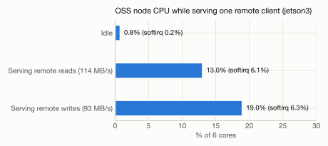
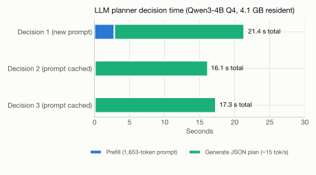
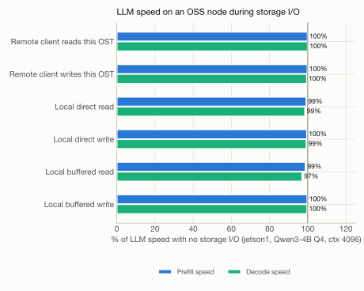
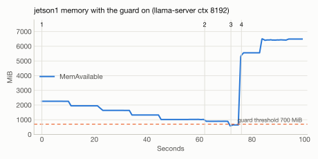
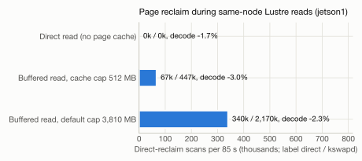
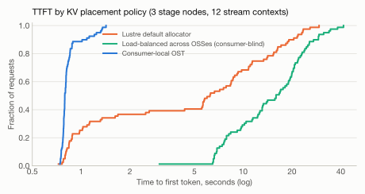

# Motivation 측정 상세

> README 3장(Motivation)의 상세 자료이다. 관찰마다 측정 구성, 전체 표, 분석을 담는다. 그림 생성: `experiments/p0_env/plot_motivation.py`, `experiments/motivation/plot_motivation2.py`.

측정은 2026-10-22에 실제 클러스터에서 했다. README 4장 설계의 근거이며, README 5.4절 관찰 실험(O1–O7)의 예비 결과이다.

- 장비·구성 상세: `docs/testbed.md`
- 결과 요약: `results/p0/summary.md`
- 그림 생성: `experiments/p0_env/plot_motivation.py` (결과 파일에서 직접 읽어 그린다)

## 테스트베드와 측정 방법

| 호스트 | Lustre 역할 | NVMe | 비고 |
|---|---|---|---|
| jetson0 | MGS + MDT | Samsung 970 EVO Plus 500GB (MGT·MDT가 전부 사용) | – |
| jetson1 / jetson2 / jetson3 | OSS, OST0000 / 0001 / 0002 | Samsung 980 500GB (장치 전체가 OST) | 측정 ①②③에서 jetson1에 client를 임시 마운트 |
| jetson | client | 없음 | 측정 C2, C5, C8 |

| 항목 | 내용 |
|---|---|
| 공통 | Orin Nano 8GB Super(25W), L4T R36.4.4, Lustre 2.17.0(ldiskfs), 유선 1GbE, OS는 microSD, GUI 켜짐 |
| 저장 측정 | fio, 2GiB 파일, 4MiB I/O, libaio iodepth 16, direct I/O(별도 표기 시 buffered), 측정 전 캐시 비움, 3회 평균 |
| KV 측정 | llama.cpp(commit e3797b1, CUDA sm_87), Qwen3-4B Q4_K_M, KV FP16, slot save/restore, 2회 평균 |
| 그림 색 | 로컬 = 파랑, 원격 = 주황, 재계산 = 청록 (모든 그림에서 같은 대상은 같은 색) |

## M1. 원격 접근은 1GbE가 상한이고, striping은 이득이 없다

<picture>
  <source media="(prefers-color-scheme: dark)" srcset="figures/m1a-network-dark.svg">
  
</picture>

<picture>
  <source media="(prefers-color-scheme: dark)" srcset="figures/m1b-striping-dark.svg">
  
</picture>

| 측정 | 결과 |
|---|---|
| 노드 간 유선 대역폭 | 약 930Mb/s (client 송신만 약 723Mb/s, 케이블·포트 문제로 추정) |
| client → OST, stripe count 1 / 2 / 3 (재측정, 3회 평균) | 쓰기 93.3 / 92.8 / 92.8MB/s, 읽기 114.6 / 117.5 / 117.5MB/s |
| buffered 쓰기 / 읽기 | 65MB/s / 113.5MB/s |

- stripe count 측정은 다시 했다. P0 C2에서는 fio가 크기가 모자란 파일을 지우고 다시 만들면서 `lfs setstripe` 설정이 사라졌을 수 있었다. 재측정에서는 파일을 dd로 미리 채우고, OSS별 송수신량으로 실제 분산(stripe 2는 OSS 2대에 각 1.08GiB, stripe 3은 3대에 각 0.72GiB)을 확인했다(`experiments/motivation/m1b_striping.sh`).

**시사점:** 원격 경로의 대역폭은 client NIC가 정한다. stripe count를 늘려 대역폭을 넓히는 기존 방법(원 IFLustre의 수단)이 엣지에서는 통하지 않는다. 그래서 성능을 바꾸는 수단은 데이터를 어느 노드에 두느냐뿐이다.

## M2. 같은 노드 OST 접근은 원격보다 15–22배 빠르지만, CPU의 약 45%를 쓴다

<picture>
  <source media="(prefers-color-scheme: dark)" srcset="figures/m2a-local-remote-dark.svg">
  
</picture>

<picture>
  <source media="(prefers-color-scheme: dark)" srcset="figures/m2b-io-cpu-dark.svg">
  
</picture>

| 경로 (jetson1) | 쓰기 | 읽기 | NIC 사용 | CPU (6코어 전체 대비) |
|---|---|---|---|---|
| 같은 노드 OST | 1,699MB/s | 2,482MB/s | 0 | 42–45% |
| 원격 OST | 114.6MB/s | 114.8MB/s | 회선 최대 | 13–20% (client 측) |
| 원격 I/O를 처리하는 OSS (jetson3, M5 재측정) | – | – | – | 13% (읽기), 19% (쓰기) |

**시사점:**
- 데이터 위치에 따라 접근 속도가 15–22배 달라진다. KV와 가중치를 사용 노드의 OST에 두는 배치가 핵심이다.
- 같은 노드 접근은 NIC를 거치지 않는 대신 CPU를 6코어의 약 45% 쓴다. 다만 GPU 중심의 LLM 연산은 이 CPU 사용에 거의 영향을 받지 않았다(M8, 3% 이내). CPU를 쓰는 작업(수집, 토큰화, 압축)과는 경쟁할 수 있다.

## M3. 로컬에 저장한 KV는 재계산보다 7–12배 빠르고, 원격 KV는 재계산보다 느릴 수 있다

<picture>
  <source media="(prefers-color-scheme: dark)" srcset="figures/m3-prefill-vs-kv-dark.svg">
  
</picture>

| 토큰 | 재계산 (prefill) | KV 파일 | 로컬 OST 복원 | 원격 OST 복원 | 복원 후 첫 토큰 |
|---|---|---|---|---|---|
| 1k | 1.73초 | 144MiB | 0.20초 | 1.37초 | 0.11초 |
| 2k | 3.42초 | 288MiB | 0.34초 | 2.68초 | 0.12초 |
| 4k | 7.03초 | 576MiB | 0.61초 | 5.30초 | 0.12초 |
| 8k | 15.2초 | 1,152MiB | 2.16초 | 21.9초 | 0.14초 |

**시사점:**
- 로컬에 저장한 KV를 복원하면 재계산보다 7–12배 빠르다. 복원 후 첫 토큰까지는 0.1초대이다. 데이터가 들어올 때 KV를 미리 만들어 두는 설계(README 4.8.2절)의 이득이 크다.
- 원격 KV 복원은 재계산과 비슷하고, 8k에서는 오히려 느리다(약 53MB/s). 원격 KV는 재계산과 비교해 선택해야 한다.
- 8k에서는 로컬 복원도 4k 대비 3.5배 느려졌다(크기는 2배). llama-server 실행 중 남은 메모리가 약 1.8GB여서 1.15GB 파일을 page cache로 읽으며 메모리 회수가 일어난 것으로 추정한다. 이 측정은 서버의 호스트 RAM prompt cache가 켜진 기본 설정이어서, 앞선 1k–4k 요청의 KV가 RAM에 남아 압박을 키웠을 가능성이 크다(M10). KV 읽기는 page cache를 거치지 않게 해야 한다(direct I/O 또는 캐시 해제).
- KV 파일 크기(토큰당 144KiB)는 README 부록 A의 계산과 일치한다.

## M4. Lustre client 캐시가 8GB 메모리를 잠식하고 GPU 할당을 늦춘다

<picture>
  <source media="(prefers-color-scheme: dark)" srcset="figures/m4a-cache-memfree-dark.svg">
  
</picture>

<picture>
  <source media="(prefers-color-scheme: dark)" srcset="figures/m4b-cache-gpu-dark.svg">
  
</picture>

| 측정 | 결과 |
|---|---|
| client 캐시 기본 상한 | 3,810MB (RAM의 1/2) |
| 2GiB buffered 읽기 1회 후 | MemFree −2,162MiB (상한 512MB이면 −520MiB). `MemAvailable`은 −105MiB만 보임 |
| GPU 4GiB / 5GiB 할당 (캐시 가득) | 할당 시간 +24% / +25%, 가장 느린 256MiB 할당 지연 2배. 실패는 없음 |
| 캐시 상한 512MB | 할당 시간이 캐시가 빈 상태와 같음 |

**시사점:**
- 8GB unified memory에서는 파일 시스템 캐시가 GPU가 쓸 메모리를 직접 줄인다. 캐시 상한은 선택이 아니라 필수이다.
- 메모리 압박은 `MemAvailable`로는 보이지 않으므로 MemFree와 PSI로 측정해야 한다.

## M5. 다른 노드의 I/O를 처리하는 OSS는 CPU의 13–19%를 쓴다

jetson(client)이 jetson3의 OST0002를 60초 동안 회선 최대 속도로 읽거나 쓰고, jetson3 안의 샘플러가 CPU를 기록한다(2회, `experiments/motivation/m5_oss_cpu.sh`). LLM은 실행하지 않는다.

<picture>
  <source media="(prefers-color-scheme: dark)" srcset="figures/m5-oss-cpu-dark.svg">
  
</picture>

| 조건 (jetson3) | 처리량 | CPU (6코어 기준) | softirq | MemAvailable 변화 |
|---|---|---|---|---|
| 유휴 | – | 0.8% | 0.2% | – |
| jetson이 OST0002를 읽음 | 114MB/s | 13.0% | 6.1% | 변화 없음 |
| jetson이 OST0002에 씀 | 93MB/s | 19.0% | 6.3% | 변화 없음 |

- P0에서는 SSH로 `/proc/stat`을 조회해 jetson1·jetson3 약 2%, jetson2 13–19%를 얻었고, jetson2 값을 SSH 영향으로 보았다. 재측정 결과는 13–19%가 맞다. P0 측정에서는 fio가 파일을 다시 만들면서 지정한 OST가 아닌 곳에 데이터가 놓여, I/O를 처리하지 않은 OSS의 CPU를 잰 것으로 보인다(M1).

**시사점:**
- OSS가 다른 노드의 I/O를 처리하는 부담은 CPU 13–19%로 작지 않다. 그중 약 6%는 네트워크 수신·송신 처리(softirq)이다.
- 그러나 같은 노드의 LLM(GPU 중심)은 이 부담에 거의 영향을 받지 않는다(M8, 1% 안팎). CPU를 쓰는 작업(수집, 토큰화, 압축기)에는 영향이 남는다.
- 다른 노드의 I/O가 LLM에 주는 영향은 CPU보다 NIC 공유(M9)에서 크다.

## M6. 엣지 LLM 플래너는 형식은 지키지만 내용 검증이 필요하다

| 측정 (jetson, llama.cpp, Qwen3-4B Q4_K_M, ctx 4096) | 결과 |
|---|---|
| 입력 1,653토큰 prefill | 2.84초 (583 tok/s) |
| 생성 속도 | 약 15.4 tok/s |
| 결정 1회 총시간 | 16–21초 (같은 입력 재사용 시 16–17초) |
| JSON 스키마 준수 | 3/3 |
| 메모리 | 약 4.1GB |
| 내용 | 조치 유형을 잘못 사용함 (예: `repartition` 대상에 컨텍스트 ID 지정) |

<picture>
  <source media="(prefers-color-scheme: dark)" srcset="figures/m6-planner-dark.svg">
  
</picture>

**시사점:** 결정 지연은 이벤트 단위 재계획에 쓸 수 있는 수준이다. 하지만 검증기와 조치별 입력 형식 제한이 필수이고, 플래너 모델 크기와 배치 노드를 다시 정해야 한다(메모리 4.1GB).

## M7. 여러 흐름이 OSS 하나를 공유하면 총 처리량이 그 OSS의 NIC 하나로 묶인다

client 3개(jetson, jetson1, jetson3)가 동시에 30초 동안 2GiB 파일을 direct I/O(4MiB, iodepth 16)로 읽거나 쓴다. 2회 반복(`experiments/motivation/m7_oss_share.sh`).

<picture>
  <source media="(prefers-color-scheme: dark)" srcset="figures/m7-oss-sharing-dark.svg">
  
</picture>

| 조건 | 읽기: jetson / jetson1 / jetson3 (합계) | 쓰기: jetson / jetson1 / jetson3 (합계) |
|---|---|---|
| 세 흐름이 OST0001(jetson2) 하나를 공유 | 76–92 / 14–21 / 17–21MB/s (120) | 40 / 40 / 40MB/s (120) |
| 서로 다른 OSS (OST0001 / OST0002 / OST0000) | 115 / 94 / 94MB/s (303, 2.5배) | 93 / 75 / 75MB/s (243, 2.0배) |
| jetson의 3-stripe 파일, 혼자 | 117.6MB/s | 93.0MB/s |
| jetson의 3-stripe 파일 + OST0001에 다른 흐름 2개 | 110.8MB/s (−6%) | 69.5MB/s (−25%) |

**시사점:**
- 원 IFLustre의 interference-free allocation이 전제로 삼은 OSS 공유 간섭이 엣지에서도 그대로 나타난다. OSS마다 1GbE NIC가 상한이므로, 흐름을 서로 다른 OSS로 나누면 총 처리량이 2–2.5배가 된다.
- 공유할 때 몫이 고르지 않다. 읽기에서 한 흐름은 14MB/s까지 떨어졌다. 지연에 민감한 흐름이 붐비는 OSS에 놓이면 크게 느려진다.
- 원 IFLustre의 "가장 느린 OSS가 성능을 정한다"는 관찰도 나타난다. 쓰기에서는 붐비는 OST 하나가 3-stripe 파일 전체를 25% 늦춘다. 읽기에서 영향이 6%로 작은 것은, 이 파일이 OST마다 필요로 하는 속도(약 39MB/s)가 공유 상태에서 받는 몫과 비슷하기 때문이다.
- OSS를 가진 노드(jetson1, jetson3)가 client로 원격 OST를 읽으면 94MB/s로, client 전용 노드(115MB/s)보다 낮다. 원인은 확인하지 않았다.

## M8. 같은 노드의 저장 I/O는 LLM을 3% 이내로만 늦추고, 반대로 LLM은 로컬 쓰기를 22% 늦춘다

jetson1에서 llama-server(Qwen3-4B Q4_K_M, 모델은 로컬 디스크, ctx 4096, `--cache-ram 0`)를 실행하고, 요청마다 2,048토큰 prefill과 128토큰 decode를 측정했다. 그동안 jetson(client)이 jetson1의 OST0000을 읽거나 쓰거나(원격), jetson1 자신의 client로 OST0000을 읽거나 쓴다(로컬). 조건마다 요청 10개(2회 × 5개)를 보냈다(`experiments/motivation/m8_oss_llm.sh`).

<picture>
  <source media="(prefers-color-scheme: dark)" srcset="figures/m8-llm-under-io-dark.svg">
  
</picture>

| 같은 노드의 저장 I/O (jetson1) | prefill | decode | 토큰 간격 p99 |
|---|---|---|---|
| 없음 | 608 tok/s | 16.09 tok/s | 67ms |
| 원격 client가 OST0000을 읽음 (1GbE 최대) | 608 (0%) | 16.09 (0%) | 68ms |
| 원격 client가 OST0000에 씀 | 606 (−0.3%) | 16.00 (−0.6%) | 68ms |
| 로컬 direct 읽기 | 603 (−0.8%) | 15.86 (−1.4%) | 68ms |
| 로컬 direct 쓰기 | 606 (−0.3%) | 15.98 (−0.7%) | 68ms |
| 로컬 buffered 읽기 (캐시 상한 512MB) | 601 (−1.2%) | 15.63 (−2.9%) | 71ms |
| 로컬 buffered 쓰기 | 607 (−0.2%) | 16.04 (−0.3%) | 68ms |

반대 방향(LLM이 저장 I/O에 주는 영향):

| 저장 I/O | LLM 없음 | LLM 실행 중 (1회, 2회) |
|---|---|---|
| 원격 읽기 / 쓰기 | 115 / 94MB/s | 116, 116 / 94, 94MB/s |
| 로컬 direct 쓰기 | 714MB/s | 559, 561MB/s (−22%) |
| 로컬 buffered 쓰기 | 296MB/s | 300, 165MB/s |
| 로컬 buffered 읽기 | 1,163MB/s | 1,336, 1,339MB/s |

- 로컬 direct 읽기는 회차에 따라 620–2,810MB/s로 흔들려(M10에서도 같음) 이 비교에서 뺐다.

**시사점:**
- 같은 노드의 저장 I/O는 원격이든 로컬이든 GPU 중심의 LLM 연산을 3% 이내로만 늦춘다. OSS가 CPU의 13–19%(M5), 로컬 I/O가 CPU의 약 45%(M2)를 쓰는데도 그렇다. "저장 I/O가 LLM 연산을 방해한다"는 이 장치·런타임에서 성립하지 않는다.
- 반대로 LLM이 실행 중이면 같은 노드의 로컬 direct 쓰기가 22% 느려진다. 체크포인트, 복제, 수집 시점 prefill 쓰기의 완료 시간 추정에 넣어야 한다.
- 첫 측정(prompt cache 켜짐)에서는 원격 쓰기 조건 중 jetson1이 멈췄다. 원인은 llama-server의 호스트 RAM prompt cache였다(M10). `--cache-ram 0`으로 다시 측정한 이번 결과에서는 멈춤도 메모리 보호 작동도 없었다.

## M9. stage 노드의 저장 I/O가 stage 사이 activation 전달을 2–4배 늦춘다

jetson1(stage 1)에서 jetson2(stage 2)로 activation을 TCP로 보내고, 그동안 jetson(client)이 fio로 저장 I/O를 낸다. activation 크기는 Qwen3-4B hidden 2560, FP16 기준 토큰당 5,120B이다(`experiments/motivation/act_probe.py`). 각 조건 2회, 노드 내부 샘플러로 NIC 사용량을 확인했다.

<picture>
  <source media="(prefers-color-scheme: dark)" srcset="figures/m9a-activation-handoff-dark.svg">
  
</picture>

<picture>
  <source media="(prefers-color-scheme: dark)" srcset="figures/m9b-decode-hop-dark.svg">
  
</picture>

| 조건 | 2k prefill activation (10MiB) | 8k prefill activation (40MiB) | decode 메시지 왕복 (p99) | 저장 I/O 처리량 (단독) |
|---|---|---|---|---|
| 저장 I/O 없음 | 91ms | 362ms | 0.6ms (1.1) | – |
| 받는 stage의 OST(OST0001)에 쓰기 → 수신 링크 공유 | 178ms (2.0배) | 709ms (2.0배) | 0.4ms (1.0) | 90MB/s (94) |
| 보내는 stage의 OST(OST0000)에서 읽기 → 송신 링크 공유 | 388ms (4.3배) | 1,473ms (4.1배) | 4.6ms (5.5) | 111MB/s (115) |
| 둘 다 | 372ms (4.1배) | 1,267ms (3.5배) | 3.0ms (4.1) | 86 / 108MB/s |

**시사점:**
- stage 노드의 OSS가 다른 노드의 I/O를 처리하면, 같은 NIC를 쓰는 pipeline activation이 느려진다. 저장 I/O 처리량은 거의 줄지 않고 손해는 activation 쪽에 생긴다. LNet이 4MiB RPC 여러 개를 동시에 보내 송신 큐를 차지하기 때문으로 추정한다.
- 송신 링크를 공유할 때(4.1배)가 수신 링크를 공유할 때(2.0배)보다 크다. 원격 읽기를 받는 OST가 어느 stage 노드에 있느냐가, 그 stage가 다음 stage로 보내는 시간을 정한다.
- decode 메시지도 송신 링크를 공유하면 왕복이 0.6ms에서 4.6ms로 늘어난다. 영향을 받는 hop마다 토큰당 약 4ms가 더해진다.
- M5·M8에서 원격 I/O가 서버의 CPU와 연산에 주는 영향은 작았다. 그러나 NIC 공유를 통해 LLM pipeline에는 큰 영향을 준다. 원 IFLustre가 다룬 OSS 사이의 간섭이, 하이퍼컨버지드 구성에서는 OSS와 pipeline 사이의 간섭으로 넓어진다.

## M10. LLM 런타임이 KV를 호스트 RAM에 쌓아 8GB를 거의 채우고, 같은 노드의 Lustre I/O가 남은 메모리를 마저 써서 노드가 멈췄다

M10(메모리 압박 시 LLM 성능)을 측정하던 중 jetson1이 멈췄다. 같은 노드는 M8 원격 쓰기 조건에서도 한 번 멈췄다(`docs/testbed.md` F7). 두 번째에는 노드 내부 감시 샘플러(1초 간격, 매 줄 fsync)가 직전 상태를 남겼다.

<picture>
  <source media="(prefers-color-scheme: dark)" srcset="figures/m10-jetson1-hang-dark.svg">
  
</picture>

| 그림 번호 | 내용 | MemAvailable |
|---|---|---|
| 1 | M12: llama-server 시작 (Qwen3-4B Q4_K_M, 모델을 Lustre에서 mmap, ctx 4608) | 6,550 → 약 2,700MB |
| 2 | M12 서버 종료 | 5,491MB (시작 전보다 약 1GB 적음) |
| 3 | M10: llama-server 시작 (모델은 로컬 디스크, ctx 8192) | 5,479 → 2,216MB |
| 4 | LLM 요청 5개 (2k prefill + 128 decode). 요청마다 약 310MB 감소 | 2,216 → 906MB |
| 5 | 같은 노드에서 Lustre direct 읽기 시작 (자기 client → 자기 OSS) | 906 → 41MB, zram 스왑 0 → 3.4GB |
| 6 | 응답 없음, 약 3분 뒤 재부팅. client 마운트가 사라지고 OST0000은 자동으로 다시 마운트됨 | – |

**원인 확인.** 4번의 요청당 감소는 llama.cpp 서버의 호스트 RAM prompt cache(`--cache-ram`, 기본 8,192MiB) 때문이다. 서버는 프롬프트가 바뀔 때마다 이전 요청의 KV를 호스트 RAM에 저장한다. 기본 상한이 장치 메모리 전체(7.6GB)보다 크므로, 요청이 이어지면 메모리를 계속 채운다. jetson2에서 프롬프트가 서로 다른 요청 4개(각 2,705토큰)로 확인했다(`experiments/motivation/cache_ram_check.sh`).

| llama-server 설정 | 요청 1 → 2 → 3 → 4 후 MemAvailable |
|---|---|
| 기본값 (`--cache-ram 8192`) | 2,668 → 2,301 → 1,959 → 1,581MB (요청마다 약 370MB = 2,705토큰 × 144KiB) |
| `--cache-ram 0` | 2,738 → 2,734 → 2,729 → 2,726MB |

**재측정 1 (메모리 보호 켬, 새로 부팅한 jetson1, prompt cache는 기본값)**

<picture>
  <source media="(prefers-color-scheme: dark)" srcset="figures/m10b-guard-dark.svg">
  
</picture>

| 그림 번호 | 내용 | MemAvailable |
|---|---|---|
| 1 | llama-server(ctx 8192) 로드 후 LLM 요청 5개. 요청마다 prompt cache로 약 310MB 감소 | 2,260 → 1,017MB |
| 2 | 같은 노드에서 Lustre direct 읽기 시작 (2.5GB/s, CPU 62%) | 1,017 → 896MB |
| 3 | 읽기 중 다음 LLM 요청 시작 | 896 → 580MB |
| 4 | 보호 장치(700MB 기준)가 llama-server와 fio 종료 | 580 → 5,556MB |

- 같은 순서가 재현되었다. 보호 장치가 없었다면 첫 번째 측정처럼 멈췄을 것이다.
- 서버를 내린 뒤 같은 노드의 Lustre 읽기만 측정하면 direct 2,569MB/s, buffered(상한 512MB) 1,239MB/s, buffered(기본 상한) 1,040MB/s였다.

**시사점:**
- 8GB 통합 메모리에서는 LLM 런타임이 따로 두는 KV 계층(호스트 RAM prompt cache)과 저장 계층(Lustre client·OSS)이 같은 메모리를 나눠 쓴다. 둘 다 서로를 모르고 자기 상한만 지키므로, 합이 장치 메모리를 넘으면 노드 전체가 멈춘다. client 캐시 상한(512MB)은 client page cache만 제한하고, 런타임 캐시와 OSS 쪽 처리는 제한하지 않는다.
- 이것은 KV를 어느 계층(GPU 메모리, 호스트 RAM, 로컬 OST, 원격 OST)에 둘지를 노드 메모리 예산 안에서 하나의 관리자가 정해야 하는 근거이다. CoStripe의 KV 저장소와 상주 집합 관리(README 4.8.2절), 메모리 제약(README 4.9.3절)이 이 역할을 맡는다.
- 이후 모든 측정은 `--cache-ram 0`으로 런타임 캐시를 끄고, KV 재사용은 slot 저장·복원(저장 계층)으로만 한다.
- jetson2에서는 Lustre에서 모델을 mmap한 서버가 끝난 뒤 약 1.3GB가 MemAvailable에서 빠졌고 `drop_caches` 후에야 돌아왔다. 로컬 디스크 모델에서는 생기지 않았다. 별도 현상으로 기록해 둔다.

**재측정 2 (`--cache-ram 0`, 메모리 보호 켬, ctx 8192)**

<picture>
  <source media="(prefers-color-scheme: dark)" srcset="figures/m10c-reclaim-dark.svg">
  
</picture>

| 같은 노드의 Lustre 읽기 (jetson1, 2회) | 최소 MemAvailable | direct reclaim 스캔 / kswapd 스캔 (85초당) | decode | prefill |
|---|---|---|---|---|
| 없음 | 2,076MB | 0 / 0 | 16.07 tok/s | 608 tok/s |
| direct 읽기 (page cache 사용 안 함) | 2,056MB | 0 / 0 | −1.7% | −0.8% |
| buffered 읽기, 캐시 상한 512MB | 1,965MB | 67k / 447k | −3.0% | −1.3% |
| buffered 읽기, 기본 상한 3,810MB | 1,966MB | 340k / 2,170k | −2.3% | −1.0% |

- 런타임 캐시를 끄면 ctx 8192 서버와 같은 노드의 Lustre 읽기가 함께 돌아도 MemAvailable이 약 2GB로 유지되고, 메모리 보호는 한 번도 작동하지 않았다.
- 캐시 상한이 기본값이면 512MB일 때보다 페이지 회수가 약 5배 많다. 서버가 새 메모리를 잡을 때 direct reclaim으로 기다리게 되는 위험이 커진다. 이번 측정에서 LLM 속도 차이는 3% 이내였다.

## M11. 체크포인트 쓰기를 KV 복원과 겹치면 복원이 41% 느려지고, 시점을 미루면 2%로 줄어든다

jetson3에서 4k 토큰 KV(576MiB)를 3초 간격으로 10번 복원한다(매번 캐시 비움). 같은 로컬 OST에 체크포인트 파일(1GiB)을 쓴다(`experiments/motivation/kv_restore_bench.py`).

<picture>
  <source media="(prefers-color-scheme: dark)" srcset="figures/m11-runtime-aware-dark.svg">
  
</picture>

| 조건 | KV 복원 중앙값 (최대) | 체크포인트 쓰기 속도 |
|---|---|---|
| 체크포인트 없음 | 663ms (738) | – |
| 동시에 최대 속도로 쓰기 | 932ms (1,012), +41% | 1,472MiB/s |
| 100MB/s로 제한 | 696ms (5,378), +5% | 102MiB/s |
| 복원 사이로 미루기 (복원이 끝나면 256MiB씩) | 679ms (698), +2% | 45MiB/s |

**시사점:**
- 원 IFLustre의 runtime-aware allocation(기다릴지, 공유할지)이 엣지에서도 의미가 있다. 같은 OST에서 체크포인트를 최대 속도로 함께 쓰면 복원이 41% 느려지고, 시점을 미루면 2%로 줄어든다.
- 대신 체크포인트 속도가 1,472 → 102 → 45MiB/s로 줄어든다. 어느 쪽을 택할지는 체크포인트 크기와 마감 시간으로 정해야 한다. 비용 모델의 시점 결정이 필요한 이유이다.
- 속도 제한 조건에서도 한 번 5.4초가 걸렸다. 속도 제한만으로는 꼬리 지연을 막지 못할 수 있다.

## M12. 원격 KV는 첫 사용 후 사용 노드로 옮기면, 이동 비용을 포함해도 세 번째 사용부터 이득이다

jetson1이 원격 OST0001에 있는 4k 토큰 KV(576MiB)를 5번 쓴다. 세 방식을 비교한다(`experiments/motivation/kv_restore_bench.py`).

<picture>
  <source media="(prefers-color-scheme: dark)" srcset="figures/m12-relocation-dark.svg">
  
</picture>

| 방식 | 1회째 | 2회째부터 (회당) | 5회 누적 |
|---|---|---|---|
| 매번 재계산 (prefill) | 7.15초 | 약 6.98초 | 35.1초 |
| 원격 OST에서 복원 | 5.49초 | 약 5.46초 | 27.3초 |
| 첫 사용 후 `lfs migrate`로 로컬 OST로 이동 | 5.49초 + 이동 6.50초 | 약 0.70초 | 14.8초 |

**시사점:**
- IoTJ 버전의 read-aware relocation이 KV에서도 성립한다. 이동 비용을 요청 경로에 포함해도 세 번째 사용부터 원격 유지보다 빠르고, 재계산보다는 두 번째 사용부터 빠르다. 이동을 백그라운드에서 하면 두 번째 사용부터 이득이다.
- 어떤 KV를 옮길지는 재사용 횟수 예측이 정한다. 같은 데이터 스트림에 대한 반복 요청 같은 의미 정보가 그 예측의 근거가 된다(README 4.8.2절).

## M13. IoT 레코드를 파일 단위로 쓰면 MDS 요청이 병목이고, pack에 붙이면 30배 빠르다

jetson(client)에서 512B IoT 레코드 3,000개를 세 방식으로 쓴다. 레코드당 파일과 256KiB 창 파일은 fsync하지 않고, pack은 32개마다 fsync한다(pack에 불리한 비교). 2회 반복(`experiments/motivation/m13_smallfile.py`).

<picture>
  <source media="(prefers-color-scheme: dark)" srcset="figures/m13-ingest-pack-dark.svg">
  
</picture>

| 방식 | stripe count 1 | stripe count 3 | 레코드(파일)당 MDS 요청 |
|---|---|---|---|
| 레코드당 파일 (512B) | 224 rec/s | 217 rec/s | 2.0 |
| 256KiB 창 파일 (원 IFLustre IoTJ의 소파일 크기) | 180 파일/s, 47MB/s | 177 파일/s, 46MB/s | 2.0 |
| pack append (32개마다 fsync) | 6,642 rec/s | – | 0.0013 |

**시사점:**
- 작은 IoT 레코드를 파일로 쓰면 파일마다 MDS 요청 2개가 필요하고, 처리량은 MDS 왕복이 정한다. stripe count는 효과가 없다. 원 IFLustre IoTJ의 소파일 관찰이 엣지에서도 그대로 나타난다.
- 256KiB 파일도 47MB/s로 큰 파일 쓰기(93MB/s)의 절반이다.
- 같은 레코드를 pack에 붙이면 30배 빠르고 MDS 요청은 약 1/1,500이다. KV chunk를 pack 단위로 저장하는 설계(README 4.8.2절)의 근거이다.

## M14. KV를 사용 노드에 두면 TTFT가 Lustre 기본 할당보다 8–19배, 사용 노드를 보지 않는 부하 분산보다 20–27배 짧다

stage 노드 3대(jetson1–3)가 각자 llama-server(Qwen3-4B Q4_K_M, ctx 4608, `--cache-ram 0`)를 실행한다. 데이터 스트림 컨텍스트 12개(각 4k 토큰, KV 576MiB)는 담당 노드가 정해져 있다. jetson의 요청 생성기가 Zipf 분포(인기 순서 고정 seed)로 초당 0.3개 요청을 4분 동안 보낸다. 요청이 오면 담당 노드가 KV slot 파일을 복원하고 질문 꼬리만 prefill한다. 정책은 KV 파일을 어느 OST에 두느냐만 다르다(`experiments/motivation/kv_router.py`, 메모리 보호 켬).

<picture>
  <source media="(prefers-color-scheme: dark)" srcset="figures/m14-ttft-cdf-dark.svg">
  
</picture>

| KV 배치 정책 | 로컬 복원 요청 | 복원 시간 p50 | 대기 p50 | TTFT p50 | TTFT p90 | TTFT p99 | 최대 |
|---|---|---|---|---|---|---|---|
| Lustre 기본 할당기 (`lfs migrate -c 1`, OST 지정 없음) | 35 / 79 | 5.4초 | 0초 | 6.2초 | 19.1초 | 25.9초 | 29.4초 |
| OSS 부하 기반 분산 (사용 노드를 보지 않음, IFLustre식) | 9 / 79 | 6.4초 | 7.7초 | 16.0초 | 27.2초 | 38.2초 | 41.6초 |
| 사용 노드 OST | 79 / 79 | 0.62초 | 0초 | 0.79초 | 1.01초 | 1.36초 | 1.43초 |

- 컨텍스트 배치: Lustre 기본 할당기는 12개 중 3개, 부하 분산은 2개만 담당 노드의 OST에 두었다. 부하 분산은 컨텍스트 순서를 고정 seed로 섞은 뒤 KV 바이트가 가장 적은 OST에 둔다(번호 순서대로 두면 담당 노드 배정과 우연히 같아져 처음 측정에서 고쳤다).
- 같은 측정을 런타임 캐시를 켠 상태에서 먼저 했을 때도 Lustre 기본 할당기 p50 5.0초, 사용 노드 배치 0.8초로 같은 경향이었다(`results/motivation/m14`).

**시사점:**
- 원격 KV 복원은 1GbE 때문에 576MiB에 5–6초가 걸린다. 같은 노드의 다음 요청이 그동안 기다리므로, 원격 비율이 높은 정책일수록 대기가 쌓여 꼬리 지연이 커진다.
- 원 IFLustre처럼 OSS 부하만 보고 사용 노드를 보지 않는 분산은, 엣지 LLM에서는 Lustre 기본 할당보다도 나쁠 수 있다. 이번 배치에서는 인기 컨텍스트가 원격에 놓여 p50이 16초가 되었다. 부하 분산의 결과는 어떤 컨텍스트가 어디에 놓이느냐에 크게 좌우되므로, 논문에서는 seed를 바꿔 반복한다.
- 위치를 아는 배치(README 4.9.4절)가 IFLustre의 부하 기반 할당에 더해져야 하는 근거이다. CoStripe는 사용 노드 배치를 기본으로 하고, 공유 자원(OSS, NIC, 메모리)과 부하를 보고 예외를 정한다.

## IFLustre 이점의 계승

CoStripe가 IFLustre의 확장이 되려면, 원 IFLustre의 전제가 엣지에서도 성립해야 한다. 아래 표는 IFLustre의 정책·관찰별로 엣지에서의 확인 결과와 남은 실측을 정리한 것이다. 상세 계획은 `docs/motivation_plan.md`에 있다.

| 원 IFLustre 정책·관찰 | 엣지(A')에서의 형태 | 실측 | 상태 |
|---|---|---|---|
| 소파일은 striping 효과가 없음 (IoTJ) | 레코드당 파일은 MDS 요청이 병목, stripe 무관 | M13 | 확인 (pack 30배) |
| Throughput-aware allocation (많은 OSS 사용) | 단일 client는 자기 NIC가 상한 | M1 | 확인 (stripe 1–3 차이 2% 이내) |
| Interference-free allocation (OSS 공유 회피) | OSS마다 1GbE가 상한. 흐름이 한 OSS를 공유하면 각자 줄어든다 | M7 | 확인 (공유 시 합계 120MB/s, 분산 시 2–2.5배) |
| 가장 느린 OSS가 성능을 결정 | 여러 OST에 걸친 파일은 붐비는 stage 노드 OST가 속도를 정한다 | M7 | 확인 (쓰기 −25%, 읽기 −6%) |
| Runtime-aware allocation (대기 대 공유) | 체크포인트·복제 쓰기가 KV 복원과 겹치지 않게 시점을 미룬다 | M11 | 확인 (동시 +41%, 지연 +2%) |
| Read-aware relocation (IoTJ) | 반복 읽히는 원격 KV를 사용 노드 OST로 옮긴다 | M12 | 확인 (5회 사용 시 27.3초 → 14.8초) |
| (확장) 간섭 범위: NIC | 저장 I/O가 activation 전달을 늦춘다 | M9 | 확인 (2–4배) |
| (대조) 같은 노드 연산 | 저장 I/O가 LLM prefill·decode를 늦추는 효과 | M5, M8 | 확인: 원격·로컬, direct·buffered 모두 3% 이내. 간섭의 경로가 아님 |
| (확장) 간섭 범위: 메모리 | 캐시가 메모리를 잠식하고 GPU 할당을 늦춘다. 런타임 KV 캐시와 저장 계층 메모리의 합이 넘치면 노드가 멈춘다 | M4, M10 | M4 확인, M10 노드 정지 2회와 원인 확인. `--cache-ram 0`이면 MemAvailable 약 2GB 유지 (M10) |
| (종합) 배치 정책별 TTFT | Lustre 기본 할당 / OSS 부하 기반 분산 / 사용 노드 배치 | M14 | 확인: TTFT p50 사용 노드 0.79초, Lustre 기본 6.2초, 부하 분산 16.0초 (M14) |

M8, M10, M14는 런타임 KV 캐시를 끄고(`--cache-ram 0`) 메모리 보호를 켠 상태로 다시 측정했다.

## 관찰에서 설계로

**성능을 크게 바꾸는 것과 거의 바꾸지 않는 것**

| 구분 | 요인 | 실측 | 관찰 |
|---|---|---|---|
| 크게 바꾸는 것 | 데이터·KV 위치 | 로컬 대 원격 OST 15–22배, 로컬 KV 복원 대 재계산 7–12배 | M2, M3 |
| | KV 배치 정책 | TTFT p50 사용 노드 0.79초, Lustre 기본 6.2초, 부하 분산 16.0초 (p90 1.0 / 19.1 / 27.2초) | M14 |
| | OSS 공유 | 흐름 3개 공유 시 합계 120MB/s, 분산 시 243–303MB/s, 최악 흐름 14MB/s | M7 |
| | NIC 공유 | activation 전달 2–4배, decode 메시지 왕복 0.6 → 4.6ms | M9 |
| | 노드 메모리 | 런타임 KV 캐시와 저장 계층 메모리의 합이 넘쳐 노드 정지 2회 | M4, M10 |
| | 쓰기 시점 | KV 복원 +41%(동시 체크포인트) 대 +2%(시점 지연) | M11 |
| | 재배치 | 같은 KV 5회 사용 27.3초 → 14.8초 | M12 |
| | 수집 저장 단위 | pack이 레코드당 파일보다 30배 빠름, MDS 요청 1/1,500 | M13 |
| 거의 바꾸지 않는 것 | 저장 I/O의 LLM 연산 감속 | prefill·decode 3% 이내 (원격·로컬, direct·buffered 모두) | M8 |
| | 원격 I/O를 처리하는 OSS의 CPU | CPU 13–19%를 쓰지만 같은 노드 LLM 감속은 거의 없음 | M5, M8 |
| | striping | stripe 1–3 차이 2% 이내 | M1 |

따라서 본 연구는 저장 I/O가 LLM 연산을 늦추는 문제가 아니라 데이터 위치, 공유 자원(OSS, NIC, 메모리), 쓰기 시점을 다룬다. 반대 방향으로 LLM 실행 중 같은 노드의 저장 쓰기는 22% 느려지므로(M8, 로컬 direct 쓰기 714 → 559MB/s), 쓰기 시점과 완료 시간 추정에 반영한다.

**관찰별 설계 반영**

| 관찰 | 시사점 | 설계 반영 |
|---|---|---|
| M1 원격은 1GbE가 상한, striping 이득 없음 | 성능을 바꾸는 수단은 위치뿐 | stripe count 1 + 사용 노드 배치 (README 4.8.1, 4.9.4절) |
| M2 로컬 15–22배, 로컬 I/O가 CPU 45% 사용 | 사용 노드 배치. 로컬 I/O의 CPU 사용은 CPU를 쓰는 작업과의 경쟁으로만 반영 | README 4.8.1, 4.9.3절 |
| M3 로컬 KV 복원이 재계산보다 7–12배 빠름, 원격은 재계산 이하 | KV pack 로컬 배치, 재계산 대 읽기 판단, page cache 우회 | README 4.8.2절 |
| M4 캐시가 메모리를 잠식하고 GPU 할당을 늦춤 | 캐시 상한 필수, 메모리 항을 비용 모델에 | README 4.1.3, 4.8.4, 4.9.3절 |
| M5 원격 I/O를 처리하는 OSS는 CPU 13–19% 사용, LLM 감속은 1% 안팎 | CPU 간섭은 CPU를 쓰는 작업(수집, 토큰화, 압축)에 한정해 모델링 | README 4.9.3, 8.3절 |
| M6 플래너는 형식만 신뢰 가능, 메모리 4.1GB | 검증기 필수, 모델 크기 재결정 | README 4.8.5절 |
| M7 OSS 공유 시 합계가 그 OSS의 NIC 하나로 묶임, 분산하면 2–2.5배 | 동시 흐름을 서로 다른 OSS로 분산 (interference-free 계승). OSS별 동시 흐름 수를 비용 모델에 | README 4.8.4, 4.9.3, 4.9.6절 |
| M8 같은 노드 저장 I/O의 LLM 감속은 3% 이내. LLM 실행 중 로컬 쓰기는 −22% | 연산 감속(β)은 작은 항으로 두고 주장에서 제외. 역방향 쓰기 감속은 쓰기 시점 결정에 반영 | README 4.8.4, 4.9.3절 |
| M9 저장 I/O가 같은 NIC의 activation 전달을 2–4배 늦춤 (송신 공유가 더 큼) | 원격에서 읽히는 객체를 activation을 보내는 stage의 OST에 두지 않는다. NIC 방향별 점유를 비용 모델에 | README 4.8.4, 4.9.3, 4.9.4, 4.9.6절 |
| M10 런타임 호스트 RAM KV 캐시와 저장 계층 메모리가 서로 모른 채 8GB를 넘겨 노드 정지 | KV 계층(GPU, 호스트 RAM, 로컬 OST, 원격 OST)을 CoStripe가 하나의 메모리 예산으로 관리. 런타임 캐시는 끄거나 예산에 포함 | README 4.1.3, 4.8.2, 4.8.4, 4.9.3절 |
| M11 체크포인트와 KV 복원이 겹치면 +41%, 미루면 +2% | 백그라운드 쓰기의 시점 지연 (runtime-aware 계승) | README 4.8.3, 4.9.6절 |
| M12 원격 KV는 이동 후 세 번째 사용부터 이득 | 재사용 예측 기반 migrate (read-aware relocation 계승) | README 4.8.2, 4.9.6절 |
| M13 레코드당 파일은 MDS가 병목, pack은 30배 | KV chunk와 수집 레코드를 pack 단위로 저장 | README 4.8.2절 |
| M14 KV를 사용 노드에 두면 TTFT p50 0.79초, Lustre 기본 6.2초, 사용 노드를 보지 않는 부하 분산 16.0초 | 사용 노드를 아는 배치가 핵심 기능, 부하 기반 할당은 그 위에서 예외 결정 | README 4.8.2, 4.9.4절 |
